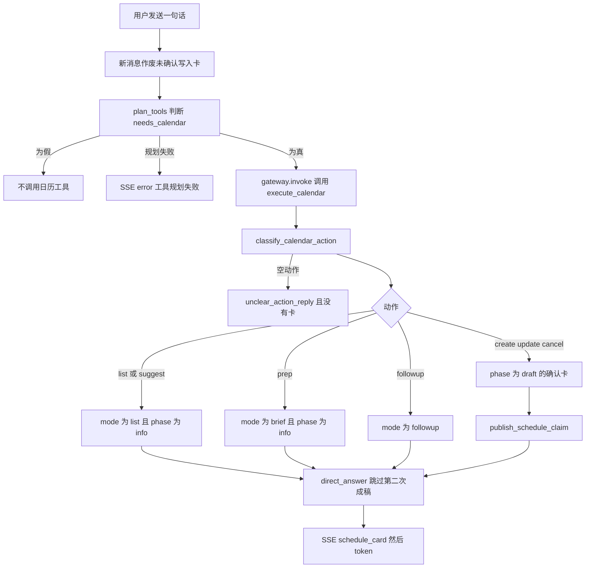
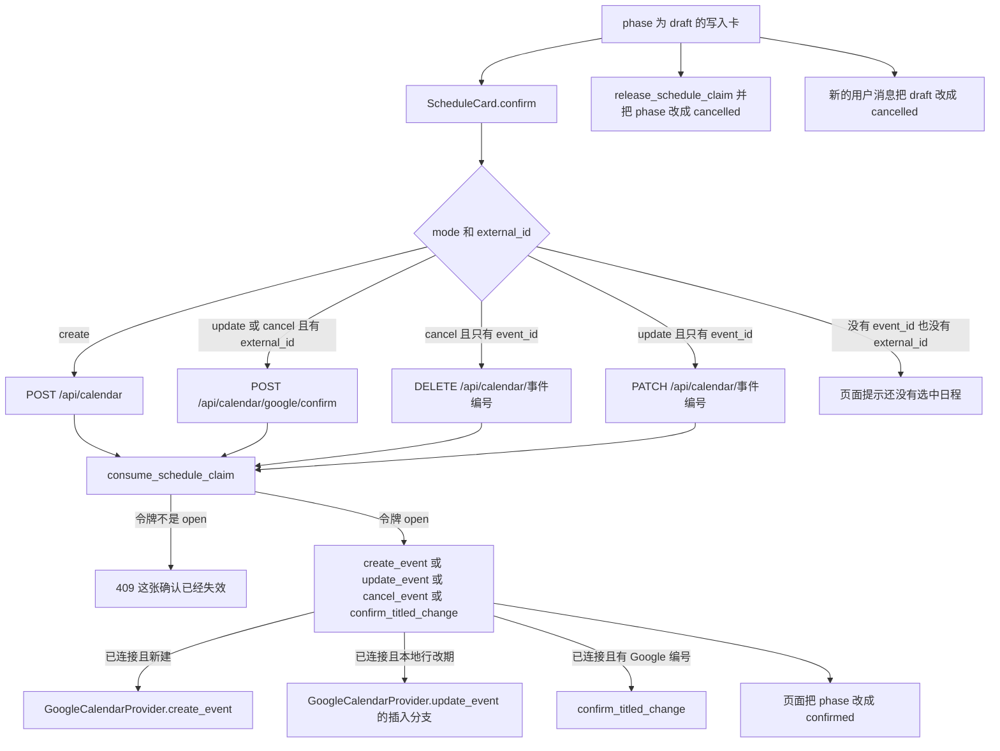
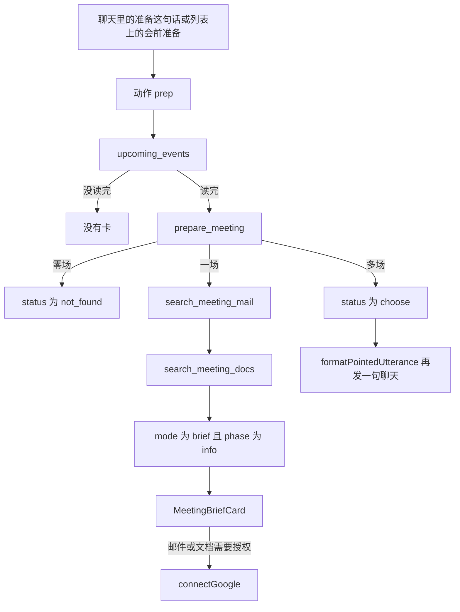
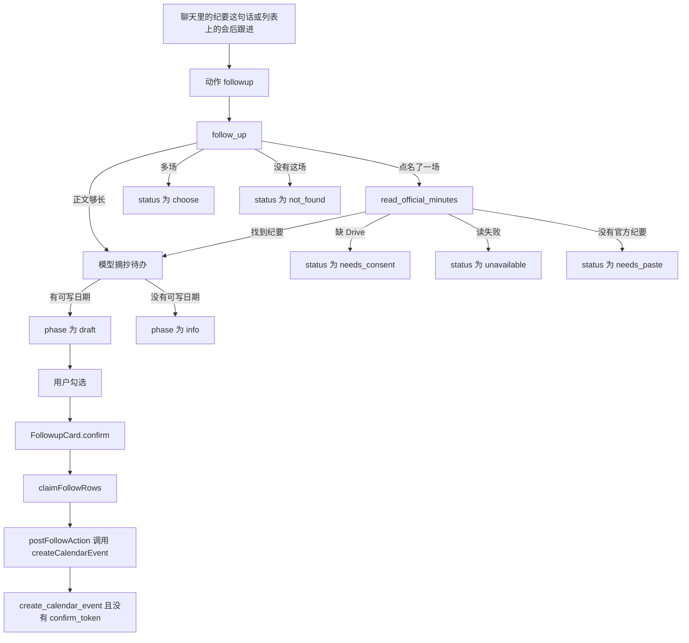
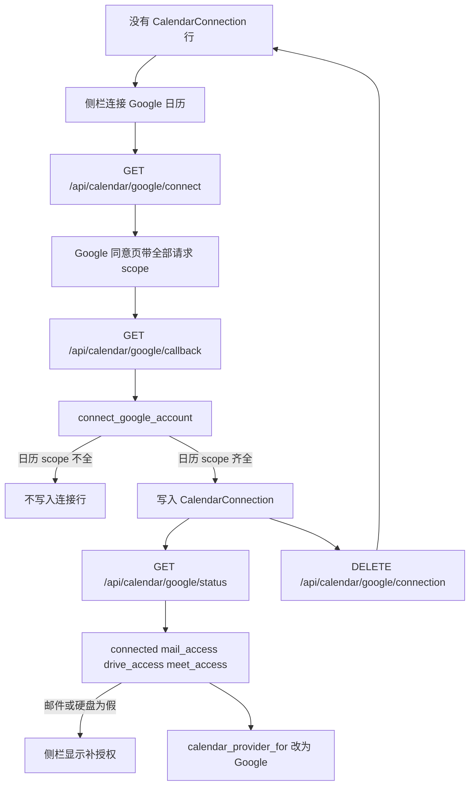

# 当前日历流程

这份说明记录 `release` 上 `f567fdd` 的代码现在怎么走。图只画已经执行的分支。`docs/plans/` 里的方案不在这张图里。`backend/app/agents/harness/HARNESS_LOGIC.md` 第 4.11 节写的是旧的写入路径，和现在的 `execute_calendar` 不一致。以本节引用的函数为准。

## 总览

用户的一句话先到 `POST /api/chat` 的 `chat`。`run_agent_workflow` 先让 `plan_tools` 决定要不要日历工具。要的话，`gateway.invoke` 调用 `execute_calendar`。这个函数只生成卡片，或一句直接回答。它不调用 `create_event`。

创建、改期、删除发生在用户点确认之后，走 `/api/calendar` 的写接口。会前准备只读邮件、云端硬盘和已经载入的日程。会后跟进在用户勾选并确认之后，才 `POST /api/calendar` 新建日程。那一次请求不带 `confirm_token`。

路由模型只回答要不要日历。日历动作是第二次模型调用，由 `classify_calendar_action` 在 `create`、`update`、`cancel`、`list`、`suggest`、`prep`、`followup` 里选一个。聊天路径没有把 `action` 传进工具参数。

## 关键概念

`CalendarAction` 在 `backend/app/services/calendar.py`。七个值就是上面那七个字符串。`parse_action` 只接受这七个。别的字符串变成空。

`calendar_provider_for` 在 `backend/app/services/calendar_factory.py`。没有 `CalendarConnection` 行时用 `LocalCalendarProvider`。有一行时用 `GoogleCalendarProvider`。`calendar_writes_remote` 为真，当且仅当选中的是 Google 实现。

确认令牌在 `ScheduleConfirmClaim`。`schedule_card_needs_claim` 只给 `phase` 为空或 `draft`，并且 `mode` 为 `create`、`update`、`cancel`、`choose` 的卡签发令牌。`list`、`brief`、`followup` 不签发。

`draft_target` 把已选中的一行分成三种确认目标。

- `GoogleConfirm`。行上有 `external_id`，并且账户已连接。卡片带这个 `external_id`。
- `BindCreate`。行是连接前的本地行，动作是 `update`，并且账户已连接。卡片有 `event_id`，`external_id` 为空。确认走 `PATCH`。`GoogleCalendarProvider.update_event` 先在 Google 插入，再把本地行标成 `provider` 为 `google`。
- `LocalDraft`。其余能定位到整数 `event_id` 的行。未连接时，即使行上有 `external_id`，也走本地 `event_id`。

OAuth 状态标志在 `connection_status` 的返回体里。它们和 `BindCreate` 不是同一个东西。

- `connected`。有 `CalendarConnection` 行则为真。
- `mail_access`。已连接，且存储的 scope 含 `GOOGLE_MAIL_SCOPES`。
- `drive_access`。已连接，且存储的 scope 含 `GOOGLE_DRIVE_SCOPES`。
- `meet_access`。已连接，且存储的 scope 含 `GOOGLE_MEET_SCOPES`。

保存连接时，`_require_scopes` 只强制 `GOOGLE_CALENDAR_SCOPES`。邮件、云端硬盘、Meet 的 scope 缺失仍会保存连接，对应标志为假。

卡片 `phase` 的现用值来自写入卡、列表卡和跟进卡。

- `draft`。待确认的写入卡，或带可写入日期的会后跟进卡。
- `confirmed`。日程确认成功之后。前端 `onChange` 会设。`consume_schedule_claim` 也会把存库卡改成这个值。
- `cancelled`。用户点「先不删」，或新的一条用户消息作废未确认写入卡。
- `info`。列表、会前简报、以及不能写入日历的会后结果。
- `expired`。前端 `isExpired` 用 `expires_at` 判断。代码里的比较要求 `phase` 仍是 `draft`。过期不是服务端另存的一列。

## 怎么走

### 从一句话到一张卡

箭头和函数。

| 箭头 | 函数 | 文件 |
| --- | --- | --- |
| 用户发送一句话 | `chat` | `backend/app/api/chat.py` |
| 新消息作废未确认写入卡 | `void_draft_schedule_cards` | `backend/app/services/calendar.py` |
| 同一作废的页面侧 | `voidOpenDrafts` | `frontend/src/services/chatStream.ts` |
| 判断 needs_calendar | `plan_tools` 然后 `route` | `backend/app/agents/router.py` |
| 提示词里的日历例子 | `router_system` | `backend/app/core/prompts.py` |
| 工作流调用工具 | `retrieve_node` 里的 `gateway.invoke` | `backend/app/agents/workflow.py` |
| 工具入口 | `execute_calendar` | `backend/app/agents/tools/calendar_tool.py` |
| 七选一 | `classify_calendar_action` | `backend/app/services/calendar.py` |
| 直接回答不第二次成稿 | `answer_node` 看见 `direct_answer` | `backend/app/agents/workflow.py` |
| 签发令牌并推卡 | `publish_schedule_claim` | `backend/app/api/chat.py` 调用 `backend/app/services/schedule_confirm.py` |
| 页面按 mode 选组件 | `MessageBubble` | `frontend/src/components/ChatWindow.tsx` |

`plan_node` 把 `needs_calendar` 放进 `pending_tools` 的 `calendar`。`intent_from_decision` 在沙箱和知识库之后才把意图标成 `calendar`。意图只影响 SSE 的 `intent` 和页面上的「日程安排」。它不选择七个动作里的哪一个。

`execute_calendar` 在分类之后的顺序是固定的。

1. `followup` 先处理。账户时钟失败时，仍调用 `follow_up`，但传入的日程列表为空。
2. 时钟失败且动作不是跟进时，`list` 只读本地行，`suggest` 返回「暂时读不到 Google 日历，不能建议空闲时段。」，其余动作没有卡。
3. `_load_upcoming` 调用 `upcoming_events`。
4. `list` 和 `suggest` 出 `mode` 为 `list`、`phase` 为 `info` 的卡。`suggest` 不把 `mode` 设成 `suggest`。
5. `prep` 在日程没读完时没有卡。读完才调用 `prepare_meeting`。
6. `update` 和 `cancel` 在日程没读完时没有卡。
7. `create` 即使有读失败提示，仍生成 `draft` 卡。`_fill_conflicts` 只使用已经读到的行。

`pick_event` 在改期和删除时只接受恰好一行。零行或并列多行时，若用户说了标题，`_unbound_mutate` 仍给一张没有 `event_id`、没有 `external_id` 的 `draft` 卡。确认时 `ScheduleCard.confirm` 因没有选中日程而返回，不发写请求。

列表卡上的「会前准备」调用 `formatPointedUtterance`，经 `onAsk` 再发一条聊天。句子形如「帮我准备这场会：标题，日期 开始」。`prepare_meeting` 里的 `_hint` 用同一句式。

列表卡上的「会后跟进」调用 `formatFollowUtterance`。句子形如「帮我整理这场会的纪要：标题，日期 开始」。`follow_up` 用同一句式。

列表卡上的「用这个时段」不发聊天。`useSlot` 调用 `openConfirmClaim`，把同一张卡改成 `mode` 为 `create`、`phase` 为 `draft`。

列表项上的接受、拒绝、暂定调用 `rsvpCalendarEvent`，直接 `POST /api/calendar/google/rsvp`。`rsvp_google_event` 的注释写明聊天不调用这条路由。

### 创建、改期、删除的确认

箭头和函数。

| 箭头 | 函数 | 文件 |
| --- | --- | --- |
| 点确认 | `confirm` | `frontend/src/components/ScheduleCard.tsx` |
| 新建 | `createCalendarEvent` 然后 `create_calendar_event` | `frontend/src/api/client.ts`，`backend/app/api/calendar.py` |
| 已连接的新建 | `_create_connected_event` 然后 `create_event` | `backend/app/api/calendar.py`，`backend/app/services/calendar.py` |
| Google 插入 | `GoogleCalendarProvider.create_event` | `backend/app/services/calendar_google.py` |
| 有 external_id 的改期或删除 | `confirmGoogleCalendarChange` 然后 `confirm_google_title_change` | `frontend/src/components/ScheduleCard.tsx`，`backend/app/api/calendar.py` |
| 标题核对后的写入 | `confirm_titled_change` | `backend/app/services/calendar.py` |
| 只有 event_id 的删除 | `cancelCalendarEvent` 然后 `delete_event` | `frontend/src/api/client.ts`，`backend/app/api/calendar.py` |
| 只有 event_id 的改期 | `updateCalendarEvent` 然后 `patch_event` | `frontend/src/api/client.ts`，`backend/app/api/calendar.py` |
| 连接前本地行的改期确认 | `GoogleCalendarProvider.update_event` 的未关联分支 | `backend/app/services/calendar_google.py` |
| 消费令牌 | `consume_schedule_claim` | `backend/app/services/schedule_confirm.py` |
| 先不删 | `declineCancel` 然后 `releaseConfirmClaim` | `frontend/src/components/ScheduleCard.tsx` |
| 下一条用户消息 | `voidOpenDrafts` 与 `void_draft_schedule_cards` | `frontend/src/services/chatStream.ts`，`backend/app/services/calendar.py` |
| 冲突 409 | `CalendarOverlapError` 或本地 `check_conflict` | `backend/app/api/calendar.py` |

确认按钮的 `disabled` 条件是 `locked`、`busy`，或 `mode` 为 `choose`。`locked` 在 `phase` 不是 `draft`、已过期、或 `phase` 为 `cancelled` 时为真。没有 `phase` 且没有 `mode` 的旧卡仍可写。

`chooseCandidate` 仍在 `ScheduleCard.tsx`。当前 `execute_calendar` 把 `candidates` 设成空数组，也不发出 `mode` 为 `choose` 的卡。多场匹配走 `_unbound_mutate`，不走选择卡。

### 会前准备

箭头和函数。

| 箭头 | 函数 | 文件 |
| --- | --- | --- |
| 列表按钮 | `formatPointedUtterance` | `frontend/src/api/client.ts` |
| 服务端同一句式 | `pointed_utterance` | `backend/app/services/meeting_prep.py` |
| 准备一场 | `prepare_meeting` | `backend/app/services/meeting_prep.py` |
| 搜邮件 | `search_meeting_mail` | `backend/app/services/gmail.py` |
| 搜文档 | `search_meeting_docs` | `backend/app/services/drive.py` |
| 卡片字段 | `to_wire` | `backend/app/services/meeting_prep.py` |
| 页面 | `MeetingBriefCard` 与 `briefFromWire` | `frontend/src/components/MeetingBriefCard.tsx`，`frontend/src/utils/briefFromWire.ts` |
| 授权按钮文案 | `consentLabel` | `frontend/src/utils/briefFromWire.ts` |
| 跳转授权 | `connectGoogle` | `frontend/src/api/client.ts` |

`search_meeting_mail` 通过 `scoped_access` 要 `gmail.readonly`。没有连接、缺 scope、或令牌被拒，返回 `NoGrant`。邮件区 `state` 成为 `needs_consent`。网络或暂时失败成为 `unavailable`。有授权但没有命中成为 `empty`。

`search_meeting_docs` 要 `drive.readonly`。没有连接时 `connected` 为假，文档区仍是 `needs_consent`。`_connected` 在邮件因为未连接而失败、且文档也未连接时，把简报的 `connected` 设为假。

这条路径没有 `create_event`、`update_event`、`cancel_event`，也没有 `gmail.send`。正式检查见下一节。

### 会后跟进

箭头和函数。

| 箭头 | 函数 | 文件 |
| --- | --- | --- |
| 列表按钮 | `formatFollowUtterance` | `frontend/src/utils/followMail.ts` |
| 服务端同一句式 | `follow_utterance` | `backend/app/services/meeting_followup.py` |
| 整理 | `follow_up` | `backend/app/services/meeting_followup.py` |
| 官方纪要 | `read_official_minutes` | `backend/app/services/drive.py` |
| 卡片字段 | `to_wire` | `backend/app/services/meeting_followup.py` |
| 页面 | `FollowupCard` | `frontend/src/components/FollowupCard.tsx` |
| 一次只提交未完成行 | `claimFollowRows` | `frontend/src/utils/followMail.ts` |
| 确认后写入 | `postFollowAction` | `frontend/src/components/FollowupCard.tsx` |

`follow_up` 先看句末是否还有一段正文。长度达到 `_MIN_PASTE` 就直接摘抄，不读官方纪要。否则用点名或模型抽出的 `EventHint` 调 `pick_event`。一场会再交给 `read_official_minutes`。

`read_official_minutes` 先按会议号看 Meet 智能纪要，再看日程附件。缺云端硬盘授权时，`consent` 为 `meet` 或 `attachment`。页面按钮是「授权读取 Drive」，调用 `connectGoogle`。复制邮件和 `mailtoHref` 不发信。

`postFollowAction` 的标题是「跟进：」加待办原文。请求体没有 `confirm_token`。`consume_schedule_claim` 在令牌为空时直接返回。一次只写的门在浏览器里的 `inflight` 和 `done`，不在确认令牌。

有可写日期时 `to_wire` 把 `phase` 设为 `draft`，所以下一条用户消息的 `void_draft_schedule_cards` 会把这张卡改成 `cancelled`。那次作废不撤销已经 `POST` 成功的日程。

### OAuth 连接和四个标志

箭头和函数。

| 箭头 | 函数 | 文件 |
| --- | --- | --- |
| 读状态 | `googleCalendarStatus` 然后 `google_calendar_status` | `frontend/src/api/client.ts`，`backend/app/api/calendar.py` |
| 组装四个标志 | `connection_status` 与 `_status_body` | `backend/app/services/calendar_secrets.py` |
| 开始授权 | `connectGoogle` 然后 `google_calendar_connect` | `frontend/src/api/client.ts`，`backend/app/api/calendar.py` |
| 授权地址 | `build_authorize_url` | `backend/app/services/calendar_secrets.py` |
| 回调保存 | `google_calendar_callback` 然后 `connect_google_account` | `backend/app/api/calendar.py`，`backend/app/services/calendar_secrets.py` |
| 日历 scope 门槛 | `_require_scopes` | `backend/app/services/calendar_secrets.py` |
| 侧栏文案 | `SessionSidebar` | `frontend/src/components/SessionSidebar.tsx` |
| 断开 | `disconnectGoogleCalendar` 然后 `disconnect_google` | `frontend/src/api/client.ts`，`backend/app/services/calendar_secrets.py` |
| 之后的读写选实现 | `calendar_provider_for` | `backend/app/services/calendar_factory.py` |

`SessionSidebar` 在 `mail_access` 或 `drive_access` 为假时显示补授权。它不读取 `meet_access`。`meet_access` 只出现在状态 JSON 和 `frontend/src/api/client.ts` 的类型里。会后官方纪要是否去读 Meet，由 `read_official_minutes` 再调 `scoped_access` 决定。

`disconnect_google` 只删令牌行。本地日程和 Google 上的日程都留着。

`BindCreate` 不是这四个标志之一。它是改期确认时的目标类型。条件在 `draft_target`。已连接、动作是 `update`、选中行没有 `external_id`、但有整数 `event_id`。

## 给以后的状态图用的状态

下面每条都是现在代码里的一个阶段。名字用读代码的人能对上的说法。后面的代码名是现在的 `phase`、`status` 或函数，方便以后对上 `/statechart`。这次没有画新的产品状态机，也没有改 TLC 模型。

聊天入口。

1. 句子已进入这条会话。`chat`。
2. 这条会话里未确认的写入卡被标成未确认。新消息走 `void_draft_schedule_cards`，`phase` 从 `draft` 变成 `cancelled`。`mode` 为 `suggest` 的卡不动。当前建议动作发出的是 `mode` 为 `list` 的卡。
3. 路由还没决定工具。`plan_node`。
4. 路由失败，日历工具没有运行。`RouterError`。
5. 路由决定要日历。`needs_calendar` 为真，队列里有 `calendar`。
6. 路由决定不要日历。队列里没有 `calendar`。
7. 动作没听清。`classify_calendar_action` 返回空，没有卡。
8. 日历工具已经给出直接回答。`direct_answer`。`answer_node` 不再调用回答模型。

日程确认卡。`mode` 为 `create`、`update` 或 `cancel`。

9. 待确认。`phase` 为 `draft`。令牌 `status` 为 `open`。
10. 正在提交。页面 `busy` 为真。按钮禁用。
11. 已安排。`phase` 为 `confirmed`。令牌 `status` 为 `written`。
12. 未确认就关掉。`phase` 为 `cancelled`。令牌 `status` 为 `cancelled`。来源是「先不删」或下一条用户消息。
13. 待确认但已过期。`phase` 仍是 `draft`，`isExpired` 为真。`consume_schedule_claim` 拒绝 `expires_at` 已过的 `open` 令牌。
14. 页面上的待确认已经对不上令牌。重新生成会 `cancel_open_schedule_claims`，但不改更早消息里的 `phase`。再点确认得到 409。
15. 没有选中日程。`_unbound_mutate` 的卡。`confirm` 在发请求前返回。
16. 连接前的本地日程，确认后要在 Google 上新建。`BindCreate`。写路径是 `patch_event` 里的未关联插入。
17. 已连接且行上有 Google 编号。`GoogleConfirm`。写路径是 `confirm_google_title_change`。
18. 未连接，或连接了但按本地编号写。`LocalDraft`。

列表和空闲。

19. 只读列表。`mode` 为 `list`，`phase` 为 `info`。
20. 从列表上的空档改成一张新建草稿。`useSlot`。同一张卡变成状态 9。
21. 回复邀请。`rsvp_google_event`。不经过确认令牌，也不改这张列表卡的 `phase`。

会前简报。`mode` 为 `brief`，`phase` 为 `info`。

22. 请点一场。`status` 为 `choose`。
23. 没有这场会。`status` 为 `not_found`。
24. 简报已齐。`status` 为 `ready`。邮件区和文档区各自是 `found`、`empty`、`unavailable` 或 `needs_consent`。
25. 需要连接或补 scope。`consentLabel` 非空。`connected` 表示邮件或文档是否还能视为已连接。

会后跟进。`mode` 为 `followup`。

26. 请把纪要贴过来。`phase` 为 `info`，`status` 为 `needs_paste`。
27. 需要云端硬盘授权。`status` 为 `needs_consent`，`consent` 为 `meet` 或 `attachment`。
28. 官方纪要暂时读不到。`status` 为 `unavailable`。
29. 没有这场会。`status` 为 `not_found`。
30. 请点一场。`status` 为 `choose`。
31. 纪要在卡上，但没有可写入的日期。`phase` 为 `info`，`status` 为 `ready`。
32. 纪要在卡上，并且有可写入的日期。`phase` 为 `draft`，`status` 为 `ready`。
33. 某一行已勾选，还没提交。`FollowupCard` 的 `ticked`。
34. 提交进行中。`inflight.current` 为真。
35. 这一行已写入。`done` 里有这个 id。
36. 这一行提交失败或响应丢失。`catch` 不把 id 放进 `done`。`inflight` 在 `finally` 里放开。

账户连接。

37. 未连接。没有 `CalendarConnection` 行。四个标志都为假。提供者是本地。
38. 已连接，日历 scope 齐全。`connected` 为真。提供者是 Google。
39. 已连接但邮件未授权。`mail_access` 为假。
40. 已连接但云端硬盘未授权。`drive_access` 为假。
41. 已连接但 Meet 未授权。`meet_access` 为假。侧栏不显示这一条。
42. 授权回调拒绝保存。`_require_scopes` 失败，或状态对不上当前用户。没有新的连接行。

已有的 TLC 图只覆盖状态 9 到 13 附近的日程确认卡，外加模型里的选择卡。文件是 `verification/schedule-confirm/statechart/chart.mmd`。它不包含会前、会后和 OAuth。

## 形式化检查已经覆盖什么

这次没有重跑 TLC。下表来自规格、检查脚本和仓库里的检查说明。覆盖范围以那些文件里写的边界为准。

| 检查 | 路径 | 已经声称覆盖 | 明确不覆盖 |
| --- | --- | --- | --- |
| 日程确认 TLC | `verification/schedule-confirm/ScheduleConfirm.tla`，`verification/schedule-confirm/check.py`，`.github/workflows/schedule-confirm-tla.yml` | `NoWriteBeforeConfirm`，`WritesFollowConfirm`，`NoReentryWhileBusy`，`SecondWriteImpliesRestore`，`AtMostOneSuccessfulWrite`，`NoWriteAfterRetire`。步骤对应 `confirm`、`create_calendar_event`、`patch_event`、`delete_event`、`confirm_google_title_change`、`voidOpenDrafts`、`void_draft_schedule_cards`、`isExpired`。说明在 `.cursor/skills/verify-schedule-confirm/SKILL.md`。 | 第二张卡、RSVP、列表、建议、只读行、会前、OAuth、Meet、服务端幂等、会后的 `inflight`。说明把 `useSlot`、`reply`、`execute_calendar` 标成不得调用写入函数的锚点，模型里没有它们的步骤。 |
| 会后确认 TLC | `verification/followup-confirm/FollowupConfirm.tla`，`verification/followup-confirm/check.py`，`.github/workflows/followup-confirm-tla.yml` | `AtMostOneEvent`，`NoWriteBeforeConfirm`，`NeedsPasteWritesNothing`，`OneRequestPerLoop`。一张卡、一行有日期的待办、最多两次确认。门是 `claimFollowRows`。重叠检查在 `create_calendar_event` 和 `GoogleCalendarProvider.create_event`。说明在 `.cursor/skills/verify-followup-confirm/SKILL.md`。 | 第二张卡或第二个标签页、把 `follow_action:` 当幂等键、Drive 授权、Meet 探测、发信、日程确认卡、和别的日程重叠、Google 列表漏掉忙碌时段。 |
| 会前只读 | `verification/prep-readonly/check.py`，`.github/workflows/prep-readonly.yml` | 从「会前准备」按钮走到 `prepare_meeting` 的闭包里，没有日历写入函数，也没有发信。不下载 TLC。说明在 `.cursor/skills/verify-prep-readonly/SKILL.md`。 | 日程确认、会后确认、RSVP、`mailto`、空闲建议、`execute_calendar` 里生成草稿卡的后半段。 |

还没有 TLC 或同类闭包检查的当前路径。

- 路由是否把一句话标成 `needs_calendar`，以及 `classify_calendar_action` 是否选对七个动作。
- `draft_target` 的三种目标，包括 `BindCreate` 之后的 Google 插入。
- OAuth 四个标志、回调保存、断开连接。
- 会前的 `choose`、`not_found`、邮件区和文档区四种 `state`。
- 会后的 `choose`、`not_found`、`unavailable`、官方纪要读取，以及没有日期的 `info` 卡。
- 重新生成只取消令牌、不改更早卡片 `phase` 的那条路径。
- 列表上的 RSVP。

`verification/schedule-confirm/statechart/report.md` 写的是那次 TLC 画出 7 个状态、10 条箭头。那是确认卡模型的视图，不是上面 42 条产品阶段。

## 文件在哪

| 区域 | 路径 |
| --- | --- |
| 聊天入口 | `backend/app/api/chat.py` |
| 路由 | `backend/app/agents/router.py`，`backend/app/core/prompts.py` |
| 工作流 | `backend/app/agents/workflow.py` |
| 工具网关 | `backend/app/agents/harness/gateway.py` |
| 日历工具 | `backend/app/agents/tools/calendar_tool.py` |
| 动作、选会、确认目标 | `backend/app/services/calendar.py` |
| 确认令牌 | `backend/app/services/schedule_confirm.py` |
| 本地或 Google | `backend/app/services/calendar_factory.py` |
| Google 读写 | `backend/app/services/calendar_google.py` |
| 写接口和 OAuth 路由 | `backend/app/api/calendar.py` |
| 令牌和四个标志 | `backend/app/services/calendar_secrets.py` |
| 会前 | `backend/app/services/meeting_prep.py`，`backend/app/services/gmail.py`，`backend/app/services/drive.py` |
| 会后 | `backend/app/services/meeting_followup.py` |
| 确认卡、简报、跟进 | `frontend/src/components/ScheduleCard.tsx`，`MeetingBriefCard.tsx`，`FollowupCard.tsx` |
| 连接标志的侧栏 | `frontend/src/components/SessionSidebar.tsx` |

## 容易看错的地方

`HARNESS_LOGIC.md` 第 4.11 节写取消走 `is_calendar_cancel`，成功走 `create_event`。当前 `execute_calendar` 不调用这两个函数。`is_calendar_cancel` 和 `calendar_hint` 只定义在 `calendar.py`，仓库里的 Python 没有别的调用点。

`ScheduleCard` 仍有 `mode` 为 `suggest` 的分支，也仍有 `chooseCandidate`。当前 `execute_calendar` 的建议结果用 `_list_card`，`mode` 是 `list`。选择列表留空。

会后确认不走 `ScheduleConfirmClaim`。`schedule_card_needs_claim` 的模式集合里没有 `followup`。

重新生成走 `cancel_open_schedule_claims` 和 `prepareRegeneratePlaceholder`。它不调用 `void_draft_schedule_cards`。更早一张 `draft` 卡在页面上还可以点，写请求会因令牌已不是 `open` 而 409。

`docs/architecture.md` 描述路由分层和 SSE 顺序。它不描述这七个日历动作。日历动作以 `calendar_tool.py` 和 `calendar.py` 为准。
