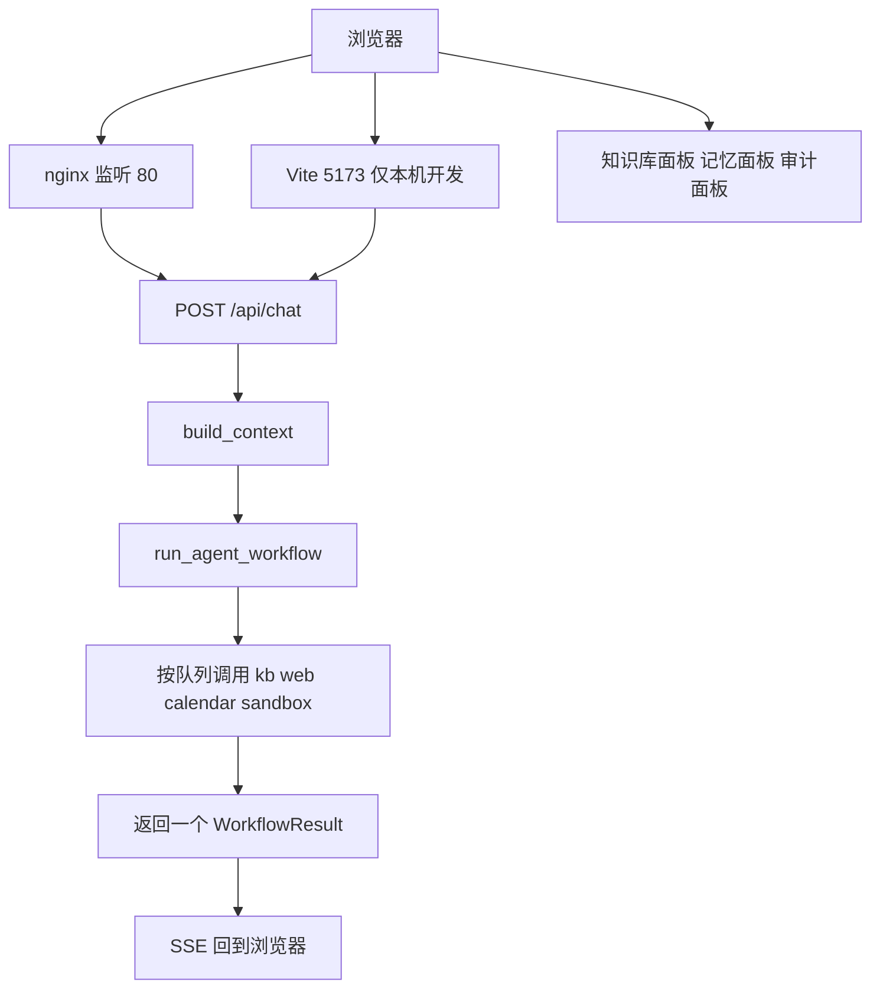
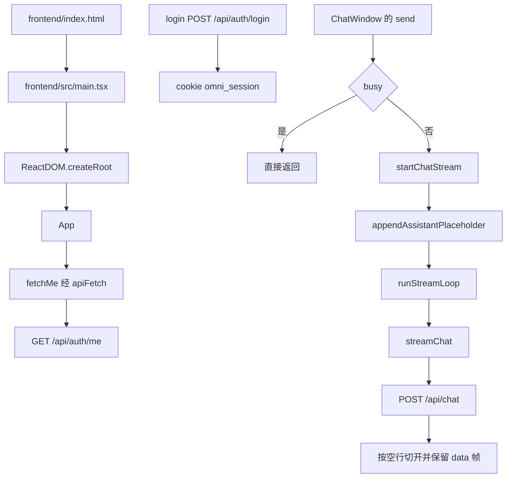
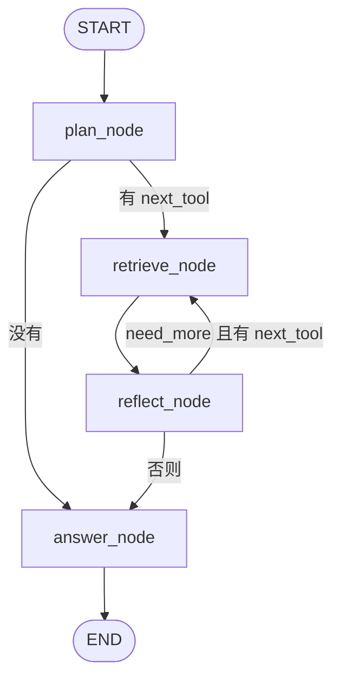
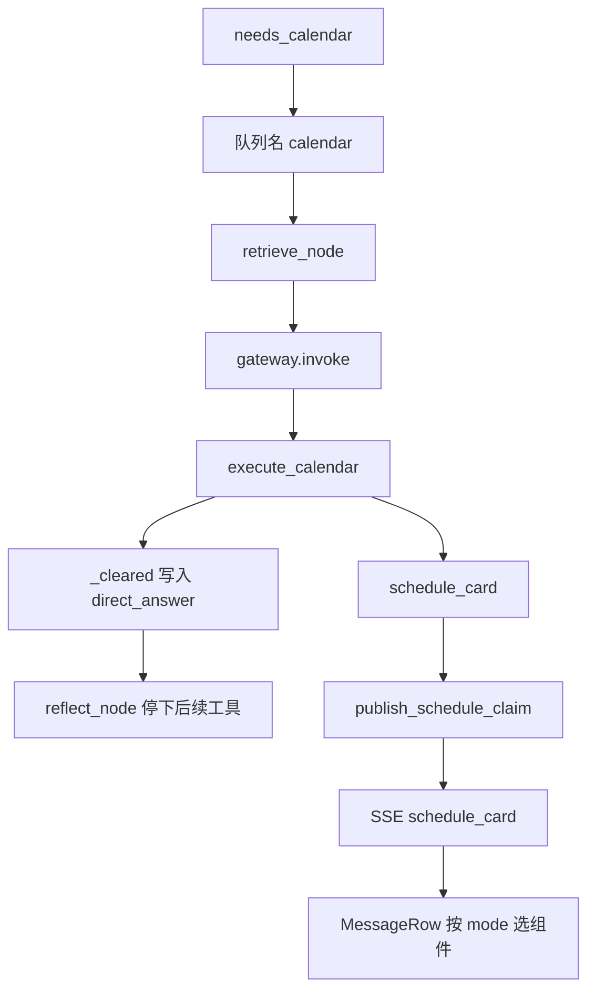
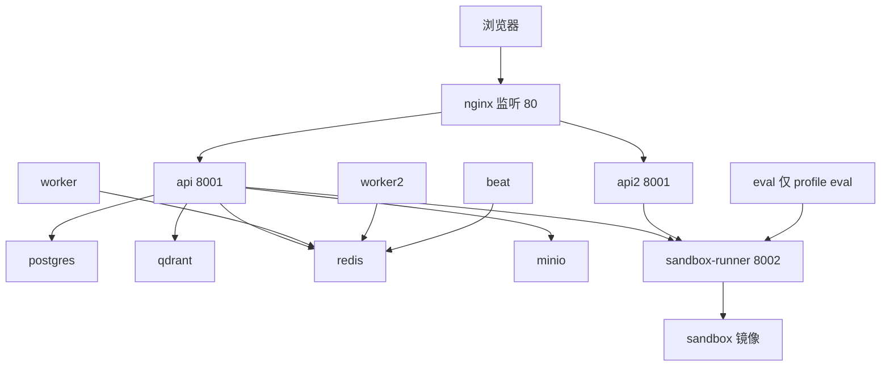

# 当前产品流程

本文是 release 在提交 `f567fdd789c7b4404ca01ad54846cb86e6736035` 上的现状。日历对话的逐步图不在这篇里。那部分在文末链接的另一篇文档。

## 总览

Compose 里浏览器访问 nginx。本机开发时 Vite 监听 5173，把 `/api` 转到后端，不经过 nginx。一次发送都是 `POST /api/chat`。`chat` 先调用 `build_context`，再把 `run_agent_workflow` 放到工作线程。图返回一个 `WorkflowResult`。token 在图结束之后才写成 SSE。

图里注册的工具是 `kb`、`web`、`calendar`、`sandbox`。知识库、记忆、审计三个面板各自拉 HTTP 列表。它们不从这条 SSE 里长出来。



## 关键概念

浏览器里的登录凭证是 session cookie。名字是 `omni_session`。它是 HttpOnly。`get_current_user` 读这枚 cookie。

`Session` 是数据库模型，表名 `sessions`。一行是一段聊天。列里有 `pending_calendar`、`context_summary`、`working_state`。

`WorkflowResult` 是 `run_agent_workflow` 的返回值。里面有 `intent`、`llm_messages`、`direct_answer`、`schedule_card`、`pending_calendar`、`artifact`。图只交回这一份，不往外吐 token。

`RouterDecision` 是一组布尔值。字段是 `needs_kb`、`needs_web`、`needs_calendar`、`needs_sandbox`、`needs_freshness`，再加上 `reasoning` 和 `confidence`。`confidence` 不决定工具顺序。

`ToolResult` 是一次工具执行的结果。`retrieve_node` 调用 `as_state_update`，把证据和 `direct_answer` 并进图状态。

`direct_answer` 是已经写好的终稿。它一旦出现，同一计划里后面的工具不再跑。`chat` 把它收成一条 token。

证据池是各工具写进状态的 `evidence`。`build_pool_prompt` 把它收成提示词里的【证据池】。

`MemoryItem` 是表 `memories` 的一行。`kind` 是 `identity`、`preference` 或 `entity`。

后端没有 workspace 这个类型，也没有这张表。前端的 `resetWorkspace` 清的是浏览器状态。长回答可以由 `infer_workspace_artifact` 猜成文档或代码卡片。

## 怎么走

### 从页面到一次发送

`frontend/index.html` 用模块脚本加载 `/src/main.tsx`，也就是 `frontend/src/main.tsx`。`ReactDOM.createRoot` 挂上 `App`。

`App` 用 `useState` 存当前用户。`useStore` 不存用户。启动时 `fetchMe` 经 `apiFetch` 发 `GET /api/auth/me`。`login` 发 `POST /api/auth/login`。成功后服务端写入 cookie `omni_session`。前端代码里没有 `EventSource`。

`streamChat` 是异步生成器。它 `POST /api/chat`，把响应体按空行切开，只留下以 `data:` 开头的帧。

`ChatWindow` 的 `send` 在 `busy` 时直接返回。`startChatStream` 发现该会话 `busy` 也直接返回。否则它先调用 `appendAssistantPlaceholder`，再调用 `runStreamLoop`。`stopChatStream` 只中止一个会话。侧栏 `handleLogout` 先调用 `logout`。`App` 的登出回调和 401 的 `setUnauthorizedHandler` 都调用 `abortAllChatStreams` 和 `resetWorkspace`。

`KnowledgeBasePanel` 调用 `listDocuments`。`MemoryPanel` 调用 `listMemories`。`AuditPanel` 从侧栏打开，调用 `listToolAudits`。这三个都是普通 HTTP 列表。

`runStreamLoop` 收到日程卡后调用 `updateLastAssistant`，写到最后一条助手消息。`MessageRow` 看 `scheduleCard.mode`。`brief` 用 `MeetingBriefCard`。`followup` 用 `FollowupCard`。`list` 和其他 mode 用 `ScheduleCard`。`briefFromWire` 在 `MeetingBriefCard` 渲染时运行。

客户端会处理这些事件类型。

- `token`
- `session_title`
- `citations`
- `intent`
- `ack`
- `status`
- `ttft`
- `thinking`
- `reasoning`
- `schedule_card`
- `artifact`
- `error`

服务端还会发 `done`，以及以冒号开头的 ping 注释。生成器不把它们当成上面的事件。



### 一轮对话怎么走

`chat` 返回 `StreamingResponse`。图在工作线程里跑，入口是 `_run_workflow_with_heartbeat`，它再调用 `_run_workflow_sync`。等待时 `chat` 每 2 秒写一条 ping 注释。图本身不产生 token。

`_prepare_session_context` 清掉 `Session.pending_calendar`，传给工作流的 `pending_calendar` 是 `None`。普通发送还会调用 `void_draft_schedule_cards`。图返回后，`chat` 把结果里的 `pending_calendar` 写回这一行。

`run_agent_workflow` 建 `StateGraph`。`START` 到 `plan_node`。`plan_node` 在 `next_tool` 有值时去 `retrieve_node`，否则去 `answer_node`。`retrieve_node` 总是去 `reflect_node`。`reflect_node` 在 `need_more` 且 `next_tool` 有值时回到 `retrieve_node`，否则去 `answer_node`。`answer_node` 到 `END`。`_MAX_ITERATIONS` 是 4。

口头说的 plan_tools 就是 `plan_tools`。口头说的 router 是函数 `route`。口头说的 retrieve 是 `retrieve_node`。口头说的 answer 是 `answer_node`。

`plan_node` 调用 `plan_tools`。`plan_tools` 调用 `route`，再调用 `_decision_to_plan`。`route` 的顺序是 `_tier0_forced`，然后 `_tier1_certain`，然后 Redis 或 `_llm_decide`，最后每条结果都过 `_apply_availability`。缓存是否启用看 `router_redis_cache_active`。命中看 `json_get`。未命中才调用 `_llm_decide`。`_llm_decide` 使用 `router_system` 和 `plan_user`。缓存键也用 `plan_user`。

`_decision_to_plan` 的入队顺序固定为 `kb`、`web`、`calendar`、`sandbox`。`needs_freshness` 不单独入队。`confidence` 只留在计划里。没有库时 `_apply_availability` 把 `needs_kb` 关掉。没有表格时把 `needs_sandbox` 关掉。

`retrieve_node` 对当前工具调用一次 `gateway.invoke`。日历和知识库、网页的参数是空对象。沙箱会带上 `network` 为 `none` 和 `read_only` 为真。

`reflect_node` 先看 `direct_answer`。有它就清空 `next_tool`，不再调用 `verify_state`。没有它，并且队列里还有工具、轮次小于 4，就先把队列走完。队列走完才调用 `verify_state`。`verify_state` 可以再补一次知识库、一次网页，或在沙箱指标没盖住时再补一次沙箱。

`answer_node` 有三条常见出口。问过知识库，但证据里没有知识库、网页和沙箱，也没有 `direct_answer` 时，它改用 `EMPTY_KB_MESSAGE`。已经有 `direct_answer` 时，`llm_messages` 是空列表。其余情况调用 `compose_answer_messages`。沙箱标明算不出来时，它直接给一句拒答，同样把 `llm_messages` 留空。

`should_ground_answer` 为真时，`answer_node` 用 `complete_text` 起草，再调用 `ground_and_repair_answer`，然后清空 `llm_messages`。`chat` 因此只发一条 `token`。没有 `direct_answer` 时，`chat` 调用 `stream_chat`。

有日程卡时，`chat` 先调用 `publish_schedule_claim`，再发 SSE，类型是 `schedule_card`。



### 四个工具

`ensure_builtin_tools` 注册的名字只有 `kb`、`web`、`calendar`、`sandbox`。产品路径里出站的工具调用都经过 `gateway.invoke`。`invoke` 在执行前做白名单和参数检查，并调用 `write_audit`。

`kb` 的 `execute_kb` 调用 `retrieve`。`retrieve` 调用 `_keyword_ranked` 和 `_vector_ranked`。`_vector_ranked` 调用 `embed_query` 和 `vector_store.search`。两边都有 id 时调用 `rrf_fuse`。`rag_expand_window` 大于 0 时调用 `expand_hits`。然后总是调用 `rerank_hits`。

`web` 的 `execute_web` 调用 `search_planned`。`search_planned` 调用 `plan_search`，再调用 `search_api`。`plan_search` 调用 `rewrite_queries`。规则改写不够，或到了第二轮，`rewrite_queries` 才调用 `_llm_rewrite_queries`。`search_api` 向智谱网页搜索发 HTTP。默认地址由 `_web_search_url` 拼出来。

`sandbox` 的 `execute_sandbox` 调用 `run_analysis`。`run_analysis` 调用 `_plan_analysis_spec` 得到 IR，再调用 `_execute_analysis_spec`。`_execute_analysis_spec` 调用 `run_code`。`sandbox_runner_url` 非空时，`run_code` 经 `_run_via_http` 对 `{sandbox_runner_url}/run` 发 HTTP POST。否则调用 `run_code_local`。`backend/app/sandbox/server.py` 的 `run` 调用 `run_code_local`。容器参数里有 `--network=none` 和 `--read-only`。

日历工具的挂点在下一节。

```mermaid
flowchart TD
 subgraph kbG [kb]
 ekb[execute_kb] --> ret[retrieve]
 ret --> kw[_keyword_ranked]
 ret --> vec[_vector_ranked]
 vec --> emb[embed_query]
 vec --> vs[vector_store.search]
 kw --> both{两边都有 id}
 vec --> both
 both -->|是| rrf[rrf_fuse]
 both -->|否| win{窗口大于 0}
 rrf --> win
 win -->|是| exh[expand_hits]
 win -->|否| rr[rerank_hits]
 exh --> rr
 end
 subgraph webG [web]
 eweb[execute_web] --> planned[search_planned]
 planned --> psearch[plan_search]
 psearch --> rw[rewrite_queries]
 rw --> llmrew[_llm_rewrite_queries]
 planned --> sapi[search_api]
 end
 subgraph sbG [sandbox]
 esb[execute_sandbox] --> ran[run_analysis]
 ran --> spec[_plan_analysis_spec]
 ran --> exspec[_execute_analysis_spec]
 exspec --> runcode[run_code]
 runcode -->|地址非空| http["_run_via_http POST /run"]
 runcode -->|地址为空| local[run_code_local]
 http --> srv["server.run"]
 srv --> local
 local --> flags["--network=none 与 --read-only"]
 end
```



### 日历挂在哪

`needs_calendar` 为真时，队列里出现工具名 `calendar`。`retrieve_node` 用这个名字调用 `gateway.invoke`。图传入的参数是空对象。

`execute_calendar` 用 `parse_action` 读参数里的 `action`。读不到就调用 `resolve_action`。`resolve_action` 再调用 `classify_calendar_action`。

读日程走 `_load_upcoming`，它调用 `upcoming_events`。动作为 `prep` 时调用 `prepare_meeting`。动作为 `followup` 时调用 `follow_up`。`prepare_meeting` 调用 `search_meeting_mail` 和 `search_meeting_docs`。点名一场会时，`follow_up` 调用 `read_official_minutes`。粘贴正文够长时，`follow_up` 先走摘抄。`workflow.py` 不直接调用 Gmail 或 Drive。

成功路径调用 `_cleared`。它写入 `direct_answer`，并把待写日历清成空。这个工具不写日历行。因为 `direct_answer` 已经设上，`reflect_node` 不会再跑同一计划里排在后面的工具，包括 `sandbox`。

图返回后，若有卡片，`chat` 调用 `publish_schedule_claim`，再发 SSE，类型是 `schedule_card`。浏览器把卡放在最后一条助手消息上。`MessageRow` 按 `mode` 选组件。

创建、改期、删除、会前准备、会后跟进的状态机在 PR 74。该 PR 开着，分支是 `cursor/current-calendar-flows-1981`。文件 `docs/current-calendar-flows.md` 不在这份 release 上。

[从一句话到一张卡](https://github.com/y4483784-png/omni-butler/blob/cursor/current-calendar-flows-1981/docs/current-calendar-flows.md#从一句话到一张卡) 写一句话如何进入日历工具，并变成一张尚未写入的卡。

[创建、改期、删除的确认](https://github.com/y4483784-png/omni-butler/blob/cursor/current-calendar-flows-1981/docs/current-calendar-flows.md#创建改期删除的确认) 写草稿卡在用户确认之后才创建、改期或删除。

[会前准备](https://github.com/y4483784-png/omni-butler/blob/cursor/current-calendar-flows-1981/docs/current-calendar-flows.md#会前准备) 写准备一场会时如何只读日程、邮件和云端文件。

[会后跟进](https://github.com/y4483784-png/omni-butler/blob/cursor/current-calendar-flows-1981/docs/current-calendar-flows.md#会后跟进) 写跟进如何读纪要并给出待办卡，确认之后才新建日程。

[OAuth 连接和四个标志](https://github.com/y4483784-png/omni-butler/blob/cursor/current-calendar-flows-1981/docs/current-calendar-flows.md#oauth-连接和四个标志) 写已登录用户如何连接 Google，以及 `connected`、`mail_access`、`drive_access`、`meet_access`。



### 记忆、上下文和提示词

后端没有 workspace 表，也没有 workspace 模块。`infer_workspace_artifact` 可以把长回答猜成文档或代码卡片。`chat` 在图没有自带卡片时才做这次猜测。`resetWorkspace` 只清浏览器里的会话、面板和工件。

`MemoryItem` 的种类是 `identity`、`preference`、`entity`。消息落库之后，`chat` 调用 `remember_from_turn`。`load_memory_prompt` 在进图前读出记忆块。`answer_node` 在块为空时会再读一次。`compose_answer_messages` 有记忆文本时调用 `inject_system_memory`，把块放进回答的系统消息。

`build_context` 切出路由窗口、工具窗口和回答窗口。`context_manager_enabled` 默认是 true。路由窗口和工具窗口按轮数截取，设置是 `context_router_turns` 和 `context_tool_turns`。`compose_answer_messages` 只在 `TokenBudget` 的 `level` 越过 `safe` 时裁回答消息。它不回头改路由窗口和工具窗口。

一轮结束并落库之后，`chat` 调用 `refresh_session_context`。它写 `context_summary` 和 `working_state`。

提示词常量是 `ROUTER_SYSTEM`、`router_system`、`plan_user`、`REWRITE_SYSTEM`、`answer_rules`、`no_evidence_block`。`_llm_decide` 调用 `router_system` 和 `plan_user`。`router_system` 套用 `ROUTER_SYSTEM`。`_llm_rewrite_queries` 使用 `REWRITE_SYSTEM`。`build_pool_prompt` 和 `compose_answer_messages` 调用 `answer_rules` 和 `no_evidence_block`。

`gateway.invoke` 是受治理的工具入口。`verify_state` 是 `reflect_node` 的检查。`ground_and_repair_answer` 是回答上的那一次修复。`write_audit` 写 JSONL，并插入 `ToolAuditLog`。

`services/session.py` 里给出标题的函数是 `auto_name` 和 `generate_session_title`。`_clean_llm_title` 只清洗模型给出的标题。用户消息和助手消息由 `chat.py` 写入。普通发送走 `_persist_turn`，它调用 `_commit_user_turn` 和 `_save_assistant_turn`。重新生成走 `_persist_assistant_only`。

```mermaid
flowchart TD
 mem[load_memory_prompt] --> build[build_context]
 build --> graph[run_agent_workflow]
 graph --> ans[answer_node]
 ans --> compose[compose_answer_messages]
 compose --> inj[inject_system_memory]
 graph --> save["_persist_turn 或 _persist_assistant_only"]
 save --> remember[remember_from_turn]
 save --> refresh[refresh_session_context]
```

### 登录、接口和进程

用户登录是密码加 HttpOnly cookie。`get_current_user` 只读 cookie。这些路由上没有用户登录用的 OAuth，也没有 `Authorization` Bearer 依赖。

Google OAuth 是两条 GET。`google_calendar_connect` 在 `/api/calendar/google/connect`。`google_calendar_callback` 在 `/api/calendar/google/callback`。回调仍然依赖会话 cookie。`connect_google_account` 经 `encrypt_token` 把 Fernet 密文写进 `CalendarConnection`。`GOOGLE_REQUESTED_SCOPES` 含日历、Gmail、Drive、Meet 和 OpenID。邮件和云端硬盘没有自己的 OAuth 路由。

`main.py` 用 `include_router` 挂上 auth、chat、messages、sessions、kb、calendar、memory、audit。这里不再加前缀。前缀写在每个 `APIRouter` 上。

`get_db_scoped` 调用 `set_rls_context`，把当前用户写进行级隔离。审计列表用 `get_current_admin` 和 `get_db`，不用这个带用户的会话。

`on_startup` 调用 `init_db`，调用 `get_blob_store` 建桶，再调用 `ensure_bootstrap_users`。`get_blob_store` 返回的实现是 `S3BlobStore`。

`upload_documents` 经 `get_blob_store` 存文件，再调用 `enqueue_document_ingest`。worker 执行的任务是 `ingest_document_task`。

`health` 和 `health_ready` 写在 `main.py`。`health_ready` 调用 `readiness_checks`，检查 Postgres 和 Redis。

Compose 服务有 postgres、qdrant、redis、minio、sandbox、sandbox-runner、api、worker、beat、nginx、eval。`eval` 只在 profile `eval` 里，普通 up 不拉起它。`docker-compose.override.yml` 会自动加载，并加上 `api2` 和 `worker2`。这时 nginx 的 `NGINX_SCALE` 是 1，改用 `deploy/nginx-scale.conf`，把 `/api/` 和 `/health` 分到 `api:8001` 与 `api2:8001`。不加载 override 时，`deploy/nginx.conf` 只转到 `api:8001`。nginx 监听 80。sandbox-runner 在网内听 8002。

同一份后端镜像按 `MODE` 选 `api`、`worker`、`beat` 或 `sandbox`。`backend/Dockerfile` 在构建时写下 `/entrypoint.sh`，入口是这一份。仓库里的 `backend/entrypoint.sh` 不是这个入口。

`frontend/vite.config.ts` 的 `API_TARGET` 决定本机开发的代理目标。环境变量 `VITE_API_PROXY` 可以覆盖它。没设时默认是 `http://192.168.88.136:8001`。步骤在 `docs/dev-setup.md`。

`config.py` 的默认聊天地址是 `https://api.deepseek.com`，`chat_model` 是 `deepseek-flash`。`docs/architecture.md` 开头的供应商一行写的是智谱 GLM。代码与同文后面那张默认值表一致，那张表写的是 DeepSeek。



| 方法 | 路径 | 函数 | 文件 |
| --- | --- | --- | --- |
| POST | /api/auth/login | `login` | `backend/app/api/auth.py` |
| POST | /api/auth/logout | `logout` | `backend/app/api/auth.py` |
| GET | /api/auth/me | `me` | `backend/app/api/auth.py` |
| POST | /api/auth/users | `create_user` | `backend/app/api/auth.py` |
| POST | /api/auth/password | `change_password` | `backend/app/api/auth.py` |
| POST | /api/chat | `chat` | `backend/app/api/chat.py` |
| PATCH | /api/messages/{message_id}/feedback | `set_feedback` | `backend/app/api/messages.py` |
| GET | /api/sessions | `list_sessions` | `backend/app/api/sessions.py` |
| POST | /api/sessions | `create_session` | `backend/app/api/sessions.py` |
| GET | /api/sessions/{session_id}/messages | `get_messages` | `backend/app/api/sessions.py` |
| PATCH | /api/sessions/{session_id} | `rename` | `backend/app/api/sessions.py` |
| DELETE | /api/sessions/{session_id} | `delete` | `backend/app/api/sessions.py` |
| GET | /api/kb/documents | `list_documents` | `backend/app/api/kb.py` |
| POST | /api/kb/documents | `upload_documents` | `backend/app/api/kb.py` |
| DELETE | /api/kb/documents/{doc_id} | `delete_document` | `backend/app/api/kb.py` |
| POST | /api/kb/documents/{doc_id}/reingest | `reingest_document` | `backend/app/api/kb.py` |
| GET | /api/memory | `list_memory` | `backend/app/api/memory.py` |
| POST | /api/memory | `create_memory` | `backend/app/api/memory.py` |
| PATCH | /api/memory/{memory_id} | `patch_memory` | `backend/app/api/memory.py` |
| DELETE | /api/memory/{memory_id} | `delete_memory` | `backend/app/api/memory.py` |
| GET | /api/audit/tools | `list_tool_audits` | `backend/app/api/audit.py` |
| GET | /api/calendar | `list_calendar_events` | `backend/app/api/calendar.py` |
| POST | /api/calendar | `create_calendar_event` | `backend/app/api/calendar.py` |
| PATCH | /api/calendar/{event_id} | `patch_event` | `backend/app/api/calendar.py` |
| DELETE | /api/calendar/{event_id} | `delete_event` | `backend/app/api/calendar.py` |
| POST | /api/calendar/google/rsvp | `rsvp_google_event` | `backend/app/api/calendar.py` |
| POST | /api/calendar/confirm-claims | `open_confirm_claim` | `backend/app/api/calendar.py` |
| POST | /api/calendar/confirm-claims/{token}/release | `release_confirm_claim` | `backend/app/api/calendar.py` |
| POST | /api/calendar/google/confirm | `confirm_google_title_change` | `backend/app/api/calendar.py` |
| GET | /api/calendar/google/status | `google_calendar_status` | `backend/app/api/calendar.py` |
| GET | /api/calendar/google/connect | `google_calendar_connect` | `backend/app/api/calendar.py` |
| GET | /api/calendar/google/callback | `google_calendar_callback` | `backend/app/api/calendar.py` |
| DELETE | /api/calendar/google/connection | `google_calendar_disconnect` | `backend/app/api/calendar.py` |
| GET | /health | `health` | `backend/app/main.py` |
| GET | /health/ready | `health_ready` | `backend/app/main.py` |

## 文件在哪

先打开这些目录。

- `frontend/src` 是页面、`streamChat` 和面板。
- `backend/app/api` 是 HTTP 路由。
- `backend/app/agents` 是图和 `route`。
- `backend/app/agents/tools` 是四个工具。
- `backend/app/agents/context` 是窗口和摘要。
- `backend/app/agents/harness` 是 `invoke`、核验、审计和依据修复。
- `backend/app/services` 是搜索、分析、记忆、日历和会话标题。
- `backend/app/rag` 是检索、扩展和重排。
- `backend/app/sandbox` 是 `run_code` 和 runner。
- `backend/app/core` 是配置、cookie、提示词和模型客户端。
- `backend/app/tasks` 是入库任务。
- `deploy` 是 nginx。

## 容易看错的地方

流是 `fetch` 读 body，按空行切开，保留以 `data:` 开头的帧。前端没有 `EventSource`。

`runStreamLoop` 先把 `busy` 设成 false，再 `await loadMessages`。这个空档里新的发送可以插进来，并和这次历史重载抢消息列表。

日历工具写下 `direct_answer` 之后，同一计划里排在后面的工具不再跑，包括 `sandbox`。

沙箱失败并写下 `direct_answer` 时，`reflect_node` 在 `verify_state` 之前就停了，所以不会按失败再规划一次。沙箱成功、带有 SUMMARY、所问指标没被 metrics 盖住、并且还没补算过时，`verify_state` 会把 `next_tool` 指回 `sandbox` 一次。已经标成算不出来，或 missing 有内容而 metrics 为空，则不再补算。

每一轮开始，`_prepare_session_context` 清掉 `Session.pending_calendar`，传进图的值是 `None`。

走了依据核验的回答，`llm_messages` 被清空，`chat` 发一条 `token`。这条路径不调用 `stream_chat`。

`route_intent` 定义在 `workflow.py`。全仓库没有调用它的地方。

workspace 是 `resetWorkspace` 清掉的浏览器状态，加上 `infer_workspace_artifact` 对长回答的猜测。后端没有存 workspace 的类型。

用户登录是密码和 cookie。Google OAuth 挂在已经登录的会话上。回调仍要这枚 cookie。

`tool_audit_logs` 没有行级安全。管理员的 `list_tool_audits` 用 `get_db`，列表里是每个用户的记录。

`docs/architecture.md` 第一张表的供应商一行写智谱 GLM。`config.py` 的 `chat_model` 与同文后面那张默认值表一致，是 DeepSeek。

### 这次没有核实的运行配置

- 没有看运行中的生产环境是否改写了 `sandbox_runner_url`。`config.py` 默认是空字符串。仓库 Compose 的 api 写成 `http://sandbox-runner:8002`。
- 没有进入运行中的容器确认 autoharness 是否可导入。`requirements.txt` 里该依赖是注释。这份 Dockerfile 安装的是这份 requirements。`invoke` 在导入失败时走本地规则。
- 没有看部署环境是否把 `memory_enabled` 或 `grounding_enabled` 设为 false。`config.py` 里这两个默认都是 true。

## 引用锚点

### 前端

| 文件 | 符号 | 作用 |
| --- | --- | --- |
| frontend/index.html | main.tsx | 页面脚本入口 |
| frontend/src/main.tsx | createRoot | 挂载 React 根 |
| frontend/src/App.tsx | function App | 持有当前用户 |
| frontend/src/App.tsx | fetchMe | 启动时读取登录用户 |
| frontend/src/api/client.ts | apiFetch | 带 cookie 的请求 |
| frontend/src/api/client.ts | function login | 提交用户名和密码 |
| frontend/src/api/client.ts | function logout | 请求退出 |
| frontend/src/api/client.ts | setUnauthorizedHandler | 登记 401 回调 |
| frontend/src/api/client.ts | streamChat | 读取聊天响应帧 |
| frontend/src/api/client.ts | listDocuments | 拉取知识库列表 |
| frontend/src/api/client.ts | listMemories | 拉取记忆列表 |
| frontend/src/api/client.ts | listToolAudits | 拉取审计列表 |
| frontend/src/services/chatStream.ts | startChatStream | 开始一次发送 |
| frontend/src/services/chatStream.ts | appendAssistantPlaceholder | 先放空的助手气泡 |
| frontend/src/services/chatStream.ts | runStreamLoop | 消费流并回写气泡 |
| frontend/src/services/chatStream.ts | stopChatStream | 中止一个会话的流 |
| frontend/src/services/chatStream.ts | abortAllChatStreams | 中止全部会话的流 |
| frontend/src/services/chatStream.ts | updateLastAssistant | 把卡片写到最后一条助手消息 |
| frontend/src/components/ChatWindow.tsx | function send | 输入框发送 |
| frontend/src/components/ChatWindow.tsx | MessageRow | 按 mode 选择卡片组件 |
| frontend/src/components/SessionSidebar.tsx | handleLogout | 先退出再清本地状态 |
| frontend/src/components/MeetingBriefCard.tsx | MeetingBriefCard | brief 卡片 |
| frontend/src/components/MeetingBriefCard.tsx | briefFromWire | 渲染时整理简报 |
| frontend/src/components/FollowupCard.tsx | FollowupCard | followup 卡片 |
| frontend/src/components/ScheduleCard.tsx | ScheduleCard | 其余日程卡片 |
| frontend/src/components/KnowledgeBasePanel.tsx | KnowledgeBasePanel | 知识库列表面板 |
| frontend/src/components/MemoryPanel.tsx | MemoryPanel | 记忆列表面板 |
| frontend/src/components/AuditPanel.tsx | AuditPanel | 审计列表面板 |
| frontend/src/store/useStore.ts | resetWorkspace | 清空浏览器工作区状态 |

### 工作流

| 文件 | 符号 | 作用 |
| --- | --- | --- |
| backend/app/api/chat.py | async def chat | 对话 HTTP 入口 |
| backend/app/api/chat.py | StreamingResponse | 聊天响应类型 |
| backend/app/api/chat.py | _prepare_session_context | 清掉待写日历并装入历史 |
| backend/app/api/chat.py | void_draft_schedule_cards | 普通发送时作废未确认卡 |
| backend/app/api/chat.py | _run_workflow_with_heartbeat | 把图放进工作线程 |
| backend/app/api/chat.py | _run_workflow_sync | 线程里实际调用图 |
| backend/app/api/chat.py | publish_schedule_claim | 发出卡片前登记确认令牌 |
| backend/app/api/chat.py | stream_chat | 没有终稿时流式生成 |
| backend/app/agents/workflow.py | run_agent_workflow | 编译并跑完一张图 |
| backend/app/agents/workflow.py | StateGraph | 图的类型 |
| backend/app/agents/workflow.py | WorkflowResult | 图的返回 |
| backend/app/agents/workflow.py | _MAX_ITERATIONS | 工具轮次上限 |
| backend/app/agents/workflow.py | plan_node | 规划节点 |
| backend/app/agents/workflow.py | retrieve_node | 调用一个工具 |
| backend/app/agents/workflow.py | reflect_node | 决定继续或回答 |
| backend/app/agents/workflow.py | answer_node | 组装回答 |
| backend/app/agents/workflow.py | route_intent | 没有调用方的旧入口 |
| backend/app/agents/workflow.py | build_pool_prompt | 把证据收成证据池提示 |
| backend/app/agents/workflow.py | EMPTY_KB_MESSAGE | 空知识库固定句子 |
| backend/app/agents/router.py | plan_tools | 规划入口 |
| backend/app/agents/router.py | def route | 路由判断 |
| backend/app/agents/router.py | RouterDecision | 路由结果模型 |
| backend/app/agents/router.py | _decision_to_plan | 布尔值变成工具队列 |
| backend/app/agents/router.py | _tier0_forced | 强制知识库 |
| backend/app/agents/router.py | _tier1_certain | 短句和明确指代 |
| backend/app/agents/router.py | _llm_decide | 模型做路由判断 |
| backend/app/agents/router.py | _apply_availability | 按库和表格关掉不可用工具 |
| backend/app/agents/router.py | router_redis_cache_active | 是否读写路由缓存 |
| backend/app/agents/router.py | json_get | 读路由缓存 |
| backend/app/agents/router.py | router_system | 路由系统提示 |
| backend/app/agents/router.py | plan_user | 路由用户提示 |
| backend/app/agents/harness/verify.py | verify_state | 反思阶段的检查 |
| backend/app/agents/harness/types.py | as_state_update | 工具结果并进图状态 |
| backend/app/agents/harness/critique.py | should_ground_answer | 是否先起草再核对 |
| backend/app/agents/harness/critique.py | ground_and_repair_answer | 核对失败后的一次修复 |
| backend/app/core/llm.py | complete_text | 依据核验前的整段起草 |
| backend/app/agents/context/assembler.py | compose_answer_messages | 组装回答消息 |

### 工具

| 文件 | 符号 | 作用 |
| --- | --- | --- |
| backend/app/agents/tools/registry.py | ensure_builtin_tools | 注册四个内置工具 |
| backend/app/agents/harness/gateway.py | def invoke | 受治理的工具调用 |
| backend/app/agents/workflow.py | gateway.invoke | 检索节点发出工具调用 |
| backend/app/agents/tools/kb.py | execute_kb | 知识库工具 |
| backend/app/rag/retrieval.py | retrieve | 混合检索 |
| backend/app/rag/retrieval.py | _keyword_ranked | 关键词打分 |
| backend/app/rag/retrieval.py | _vector_ranked | 向量检索 |
| backend/app/rag/retrieval.py | embed_query | 把查询变成向量 |
| backend/app/rag/retrieval.py | vector_store.search | 在向量库里搜索 |
| backend/app/rag/retrieval.py | rrf_fuse | 融合两路排序 |
| backend/app/rag/retrieval.py | expand_hits | 按窗口扩展命中 |
| backend/app/rag/retrieval.py | rerank_hits | 重排命中 |
| backend/app/agents/tools/web.py | execute_web | 网页工具 |
| backend/app/services/web_search.py | search_planned | 规划并搜索 |
| backend/app/services/web_search.py | plan_search | 决定查询词和时效 |
| backend/app/services/web_search.py | rewrite_queries | 改写查询 |
| backend/app/services/web_search.py | _llm_rewrite_queries | 用模型改写查询 |
| backend/app/services/web_search.py | search_api | 请求智谱网页搜索 |
| backend/app/services/web_search.py | _web_search_url | 拼搜索地址 |
| backend/app/agents/tools/sandbox_tool.py | execute_sandbox | 沙箱工具 |
| backend/app/services/data_analysis.py | run_analysis | 规划并执行分析 |
| backend/app/services/data_analysis.py | _plan_analysis_spec | 生成分析 IR |
| backend/app/services/data_analysis.py | _execute_analysis_spec | 按 IR 跑沙箱 |
| backend/app/sandbox/runner.py | run_code | 选择 HTTP 或本机 docker |
| backend/app/sandbox/runner.py | _run_via_http | 向 runner 发 POST |
| backend/app/sandbox/runner.py | run_code_local | 本机 docker run |
| backend/app/sandbox/runner.py | --network=none | 容器断网 |
| backend/app/sandbox/runner.py | --read-only | 容器根文件系统只读 |
| backend/app/sandbox/server.py | def run | runner 的 HTTP 执行入口 |
| backend/app/agents/tools/calendar_tool.py | execute_calendar | 日历工具 |
| backend/app/agents/tools/calendar_tool.py | parse_action | 读取传入的动作 |
| backend/app/agents/tools/calendar_tool.py | resolve_action | 没有动作时再分类 |
| backend/app/agents/tools/calendar_tool.py | classify_calendar_action | 模型选出日历动作 |
| backend/app/agents/tools/calendar_tool.py | _load_upcoming | 装入即将到来的日程 |
| backend/app/agents/tools/calendar_tool.py | upcoming_events | 读取日程行 |
| backend/app/agents/tools/calendar_tool.py | prepare_meeting | 会前准备 |
| backend/app/agents/tools/calendar_tool.py | follow_up | 会后跟进 |
| backend/app/agents/tools/calendar_tool.py | _cleared | 写入终稿并清空待写日历 |
| backend/app/services/meeting_prep.py | search_meeting_mail | 会前搜索邮件 |
| backend/app/services/meeting_prep.py | search_meeting_docs | 会前搜索云端文件 |
| backend/app/services/meeting_followup.py | read_official_minutes | 点名一场时读官方纪要 |

### 记忆与上下文

| 文件 | 符号 | 作用 |
| --- | --- | --- |
| backend/app/services/artifact.py | infer_workspace_artifact | 把长回答猜成文档或代码 |
| backend/app/models/models.py | class Session | 聊天会话行 |
| backend/app/models/models.py | MemoryItem | 长期记忆行 |
| backend/app/services/memory.py | load_memory_prompt | 读出记忆提示块 |
| backend/app/services/memory.py | inject_system_memory | 把记忆块放进系统消息 |
| backend/app/services/memory.py | remember_from_turn | 从用户这句话抽取记忆 |
| backend/app/agents/context/assembler.py | build_context | 切出三份窗口 |
| backend/app/agents/context/assembler.py | TokenBudget | 回答消息的水位 |
| backend/app/core/config.py | context_manager_enabled | 是否启用上下文窗口 |
| backend/app/core/config.py | context_router_turns | 路由窗口轮数 |
| backend/app/core/config.py | context_tool_turns | 工具窗口轮数 |
| backend/app/core/config.py | memory_enabled | 记忆开关的代码默认 |
| backend/app/core/config.py | grounding_enabled | 依据核验开关的代码默认 |
| backend/app/agents/context/summary.py | refresh_session_context | 写摘要和工作状态 |
| backend/app/core/prompts.py | ROUTER_SYSTEM | 路由提示词底稿 |
| backend/app/core/prompts.py | REWRITE_SYSTEM | 搜索改写提示词 |
| backend/app/core/prompts.py | answer_rules | 回答规则 |
| backend/app/core/prompts.py | no_evidence_block | 没有证据时的提示块 |
| backend/app/agents/harness/audit.py | write_audit | 写 JSONL 和审计表 |
| backend/app/services/session.py | auto_name | 用首句做临时标题 |
| backend/app/services/session.py | generate_session_title | 用模型生成标题 |
| backend/app/api/chat.py | _persist_turn | 写入用户和助手消息 |
| backend/app/api/chat.py | _commit_user_turn | 写入用户消息 |
| backend/app/api/chat.py | _save_assistant_turn | 写入助手消息 |
| backend/app/api/chat.py | _persist_assistant_only | 重新生成时只写助手 |

### 接口与运行

| 文件 | 符号 | 作用 |
| --- | --- | --- |
| backend/app/core/auth.py | get_current_user | 从 cookie 取出用户 |
| backend/app/core/config.py | session_cookie_name | cookie 名的配置 |
| backend/app/core/config.py | chat_model | 默认聊天模型 |
| backend/app/core/config.py | sandbox_runner_url | 沙箱 runner 地址 |
| backend/app/main.py | include_router | 挂上各路由且不加前缀 |
| backend/app/main.py | on_startup | 进程启动 |
| backend/app/main.py | init_db | 启动时初始化数据库 |
| backend/app/main.py | ensure_bootstrap_users | 启动时准备引导用户 |
| backend/app/main.py | def health(): | 存活检查 |
| backend/app/main.py | def health_ready | 就绪检查 |
| backend/app/core/health.py | readiness_checks | 检查 Postgres 和 Redis |
| backend/app/core/deps.py | get_db_scoped | 带行级用户的数据库会话 |
| backend/app/core/db.py | set_rls_context | 设置行级用户 |
| backend/app/api/audit.py | get_current_admin | 审计列表的管理员依赖 |
| backend/app/api/audit.py | get_db | 审计列表用的普通会话 |
| backend/app/api/audit.py | list_tool_audits | 审计列表入口 |
| backend/app/storage/factory.py | get_blob_store | 取得对象存储 |
| backend/app/storage/factory.py | S3BlobStore | 对象存储实现 |
| backend/app/api/kb.py | upload_documents | 上传文档 |
| backend/app/tasks/ingestion.py | enqueue_document_ingest | 把文档放进入库队列 |
| backend/app/tasks/ingestion.py | ingest_document_task | worker 执行的入库任务 |
| backend/app/api/calendar.py | google_calendar_connect | 开始 Google 授权 |
| backend/app/api/calendar.py | google_calendar_callback | Google 授权回调 |
| backend/app/services/calendar_secrets.py | connect_google_account | 用授权码换票并保存 |
| backend/app/services/calendar_secrets.py | encrypt_token | 用 Fernet 加密令牌 |
| backend/app/services/calendar_secrets.py | GOOGLE_REQUESTED_SCOPES | 一次同意页请求的范围 |
| backend/app/models/models.py | CalendarConnection | 保存 Google 连接的表 |
| backend/app/api/auth.py | def login | 密码登录入口 |
| backend/app/api/auth.py | def logout | 退出入口 |
| backend/app/api/auth.py | def me( | 当前用户入口 |
| backend/app/api/auth.py | create_user | 管理员创建用户 |
| backend/app/api/auth.py | change_password | 修改密码 |
| backend/app/api/messages.py | set_feedback | 消息反馈 |
| backend/app/api/sessions.py | list_sessions | 列会话 |
| backend/app/api/sessions.py | create_session | 新建会话 |
| backend/app/api/sessions.py | get_messages | 取消息 |
| backend/app/api/sessions.py | def rename | 改会话标题 |
| backend/app/api/sessions.py | def delete( | 删除会话 |
| backend/app/api/kb.py | list_documents | 列文档 |
| backend/app/api/kb.py | delete_document | 删除文档 |
| backend/app/api/kb.py | reingest_document | 重新入库 |
| backend/app/api/memory.py | list_memory | 列记忆 |
| backend/app/api/memory.py | create_memory | 新增记忆 |
| backend/app/api/memory.py | patch_memory | 修改记忆 |
| backend/app/api/memory.py | delete_memory | 删除记忆 |
| backend/app/api/calendar.py | list_calendar_events | 列日程 |
| backend/app/api/calendar.py | create_calendar_event | 创建日程的 HTTP |
| backend/app/api/calendar.py | patch_event | 修改日程的 HTTP |
| backend/app/api/calendar.py | delete_event | 删除日程的 HTTP |
| backend/app/api/calendar.py | rsvp_google_event | Google 回复 |
| backend/app/api/calendar.py | open_confirm_claim | 占用确认令牌 |
| backend/app/api/calendar.py | release_confirm_claim | 释放确认令牌 |
| backend/app/api/calendar.py | confirm_google_title_change | Google 标题确认 |
| backend/app/api/calendar.py | google_calendar_status | 连接状态 |
| backend/app/api/calendar.py | google_calendar_disconnect | 断开 Google 连接 |
| frontend/vite.config.ts | API_TARGET | 本机开发时代理目标 |
| frontend/vite.config.ts | VITE_API_PROXY | 覆盖代理目标的环境变量 |
