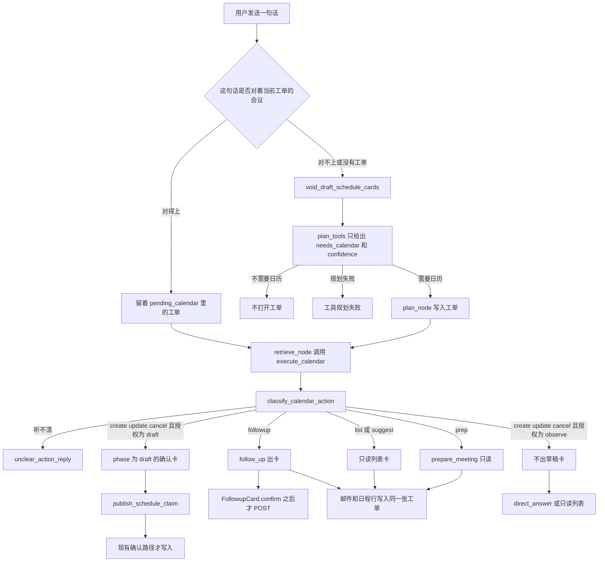

# 改完之后的日历流程

现状见 `docs/current-calendar-flows.md`，记录的是 `release` 上 `f567fdd` 已经在跑的分支。这份说明写同一批函数改完之后的走法。代码还没有改。确认写入、会前只读、会后先确认再写入，都留在现在的函数里。

模型仍由现在的 `route` 和 `classify_calendar_action` 调用。不另起一套对话服务，也不换 `Role.PLANNER` 与 `Role.CHAT`。

## 工单和授权

工单记在已有列 `sessions.pending_calendar`。这一列今天在 `_prepare_session_context` 里被清空，注释写的是未完成的日历 JSON。改完后它存一张工单，不再当废字段清掉。

工单上的字段都来自今天已经有的值。

- `confidence` 来自 `RouterDecision`。只有 `high` 和 `low`。
- `action` 仍是 `CalendarAction` 的七个值，或分类之前的空字符串。
- `mandate` 只有 `observe` 和 `draft`。没有 `write`。写入不是工单的一档。
- `quiet` 在推断出来的创建、改期、删除上为真。
- 会议身份来自 `pick_event` 和 `EventHint` 已经用的标题与开始时间。
- `related` 只收集这一轮 `upcoming_events` 和 `search_meeting_mail` 已经返回的日程行和邮件。

`ScheduleConfirmClaim` 仍是确认令牌。工单上不放 `confirm_token`。`plan_node` 写入工单。`execute_calendar` 读取工单并出卡片。日历写入仍由确认按钮调用的 HTTP 处理函数完成。

授权的含义。

- `observe` 允许今天的只读结果。列表、空闲建议、会前简报、会后读纪要并出卡，都算观察。
- `draft` 允许今天的 `phase` 为 `draft` 的创建、改期、删除卡，也允许会后那张可写入的跟进卡。
- 真正写入仍要等现有确认。创建、改期、删除走 `ScheduleCard.confirm`。会后待办走 `FollowupCard.confirm`。

静默默认落在推断上。`confidence` 为 `low`，分类结果是 `create`、`update` 或 `cancel`，并且这句话对不上会前或会后的点名句式时，工单的 `mandate` 固定为 `observe`，`quiet` 为真。`execute_calendar` 不调用 `_base_card` 去出那张待确认写入卡。它可以出只读列表，或一句 `direct_answer`。`confidence` 为 `high` 时，同样的三个动作得到 `mandate` 为 `draft`，卡片与今天相同。

会前和会后不走这道静默。分类一旦是 `prep` 或 `followup`，就按今天的函数做完。点名句式是 `pointed_utterance` 和 `follow_utterance` 已经生成的那两句，列表按钮经 `formatPointedUtterance` 和 `formatFollowUtterance` 发出。

## 改完之后怎么走

派活停在工单。`_decision_to_plan` 今天把字符串 `calendar` 放进 `pending_tools`，`plan_node` 立刻把它设成 `next_tool`。改完后 `plan_node` 先把工单写进 `pending_calendar`，再让 `retrieve_node` 去调用 `execute_calendar`。`gateway.invoke` 仍是干活的那一跳。分类仍在干活之后，仍是 `classify_calendar_action`。`plan_tools` 不挑选七个动作。

静观时，`answer_node` 仍看到 `direct_answer` 就不再叫回答模型。这和今天一样。

相关的日程和邮件留在同一张工单上。`prepare_meeting` 已经调用 `search_meeting_mail` 和 `search_meeting_docs`。`execute_calendar` 已经调用 `upcoming_events`。改完后，这些返回值里对得上工单会议的行，追加到工单的 `related`，并显示在同一张 `schedule_card` 上。不为此再调用 `plan_tools`。

下一句如果是同一场会的点名句，`chat` 里的 `_prepare_session_context` 不去作废，也不再请 `plan_tools` 做一次新的日历决定。`retrieve_node` 用这张工单再跑 `execute_calendar`。对不上的句子仍走今天的作废，然后可以新开一张工单。

`useSlot` 今天把列表上的空档直接换成 `mode` 为 `create` 的草稿，并调用 `openConfirmClaim`。改完后，这一下先把工单的 `mandate` 改成 `draft`，后面的认领和确认按钮不变。用户点了空档，就不再算推断。

## 现状步骤、改完后步骤、代码锚点

| 现状步骤 | 改完后步骤 | 要动的代码锚点 |
| --- | --- | --- |
| 每条新的用户消息都作废未确认写入卡 | 只有对不上当前工单会议的句子才作废 | `_prepare_session_context`，`void_draft_schedule_cards`，`voidOpenDrafts` |
| `pending_calendar` 在进工作流之前被清空 | 这一列保存工单。对得上就保留 | `Session.pending_calendar`，`_prepare_session_context` |
| `plan_tools` 把 `calendar` 放进队列并立刻干活 | `plan_tools` 只打开工单。建卡留在后面 | `plan_tools`，`_decision_to_plan`，`plan_node` |
| `confidence` 已经返回，日历分支不用它 | `low` 且推断为创建、改期或删除时，授权为 `observe` | `RouterDecision`，`plan_node` |
| `execute_calendar` 分类后就建草稿卡 | 先看 `mandate`。`observe` 时创建、改期、删除不调用 `_base_card` | `execute_calendar`，`_base_card` |
| 七选一和派活发生在同一次工具调用里 | 七选一仍由 `classify_calendar_action` 做，时机改到工单打开之后 | `classify_calendar_action`，`retrieve_node` |
| 听不清就没有卡 | 保持。工单可以记下空动作 | `unclear_action_reply`，`parse_action` |
| 列表按钮再发一句，整段重新派活 | 点名句对上工单会议就沿用这张工单 | `formatPointedUtterance`，`_hint`，`chat` |
| 会后按钮同样重新派活 | 沿用工单。读纪要和确认写入保持今天 | `formatFollowUtterance`，`follow_up`，`confirm` |
| 邮件和日程只出现在当次卡片上 | 对得上的行追加到同一张工单和同一张卡 | `upcoming_events`，`search_meeting_mail`，`prepare_meeting` |
| 会前简报只读 | 保持。`prepare_meeting` 仍不写日历、不发信 | `prepare_meeting`，`search_meeting_docs` |
| 会后有日期才是 `draft`，确认后才 `POST /api/calendar` | 保持。仍不带 `confirm_token`，仍由 `claimFollowRows` 挡重复 | `to_wire`，`postFollowAction`，`claimFollowRows` |
| 创建、改期、删除的草稿卡靠确认令牌写入 | 保持。令牌、409、三种确认目标都不变 | `publish_schedule_claim`，`ScheduleCard.confirm`，`consume_schedule_claim`，`draft_target` |
| 确认后的四个写入口 | 保持 | `create_calendar_event`，`patch_event`，`delete_event`，`confirm_google_title_change` |
| 空档按钮直接变成创建草稿 | 先把授权改成 `draft`，再走现有的 `openConfirmClaim` | `useSlot`，`openConfirmClaim` |
| 直接回答跳过第二次成稿 | 保持。静观也走这条 | `answer_node` |
| 账户四个标志和连接、断开 | 保持 | `connection_status`，`connect_google_account`，`disconnect_google` |

`confirm` 这个名字在两张卡上各有一个。表里会后那一行的 `confirm` 在 `frontend/src/components/FollowupCard.tsx`。创建、改期、删除那一行的 `ScheduleCard.confirm` 在 `frontend/src/components/ScheduleCard.tsx`。

## 给以后的状态图用的状态

下面是改完之后多出来的工单阶段。现有确认卡、简报、跟进和账户阶段仍用 `docs/current-calendar-flows.md` 里的 9 到 42。那些阶段的进入条件，多一道工单授权。

工单。

1. 工单已打开，动作还没分类。`plan_node` 写完 `pending_calendar`，`execute_calendar` 还没跑。
2. 静观。`confidence` 为 `low`，动作是 `create`、`update` 或 `cancel`，`mandate` 为 `observe`。没有 `phase` 为 `draft` 的写入卡。
3. 观察中的只读结果。`mandate` 为 `observe`，卡片是今天的列表、简报，或还不能写入的跟进卡。对应现状 19、22 到 25、26 到 31。
4. 允许出草稿。`mandate` 为 `draft`。`execute_calendar` 可以走出今天的草稿卡。对应现状 9、32。写入仍未发生。
5. 同一张工单被下一句沿用。点名句对上会议。`plan_tools` 不跑，`void_draft_schedule_cards` 不跑。
6. 相关行已附上。`upcoming_events` 或 `search_meeting_mail` 的命中写进工单的 `related`，卡仍是这一张。
7. 工单因话题换了而关掉。句子对不上。然后才是现状 2 的作废。
8. 工单因写入完成而关掉。现状 11 或现状 35 已经成功。`pending_calendar` 清空。令牌和跟进的 `done` 仍按今天的规则。

从静观到草稿只有两条显式路。用户改口说出高把握的创建、改期或删除，新开或改写工单的 `mandate`。或者用户在列表上点空档，`useSlot` 把 `mandate` 改成 `draft`，然后进入现状 20 和现状 9。

会前没有草稿阶段。它停在现状 22 到 25。会后的勾选、在途、成功、丢失响应仍是现状 33 到 36。账户仍是现状 37 到 42。

现有 `verification/schedule-confirm/statechart/chart.mmd` 仍只画确认卡。工单的 8 个阶段还不在那张图里。会后 TLC 和会前只读检查所钉住的写入边界，这份设想不移动。

## 保持不动的部分

这些函数的对外结果与 `docs/current-calendar-flows.md` 相同。

- 确认分流。`ScheduleCard.confirm` 按 `mode` 和 `external_id` 调用 `create_calendar_event`、`confirm_google_title_change`、`delete_event` 或 `patch_event`。
- 三种目标。`draft_target` 的 `GoogleConfirm`、`BindCreate`、`LocalDraft`。
- 令牌。`publish_schedule_claim`、`consume_schedule_claim`、`release_schedule_claim`，以及过期和 409。
- 会前。`prepare_meeting`、`search_meeting_mail`、`search_meeting_docs`。不调用 `create_event`，不发信。卡片仍是 `mode` 为 `brief`、`phase` 为 `info`。
- 会后。`follow_up`、`to_wire`、`read_official_minutes`、`FollowupCard.confirm`、`claimFollowRows`、`postFollowAction`。有日期才 `draft`。确认后才创建。邮件仍是复制和 `mailtoHref`。
- 邀请回复。`rsvp_google_event` 仍不经过工单，也不经过确认令牌。
- 连接。`connection_status` 的四个标志，`google_calendar_connect`，`google_calendar_callback`，`disconnect_google`，`calendar_provider_for`。
- 重新生成。仍是 `cancel_open_schedule_claims` 和 `prepareRegeneratePlaceholder`。仍不把更早卡片的 `phase` 改成 `cancelled`。
- 路由失败。仍是 `RouterError`，日历工具不跑。
- 页面分发。`ChatWindow` 仍按 `list`、`brief`、`followup` 和其余写入卡选组件。

`chooseCandidate` 今天没有数据可点。这份设想不给它新的选择列表。多场会仍走会前和会后自己的 `status` 为 `choose`。
