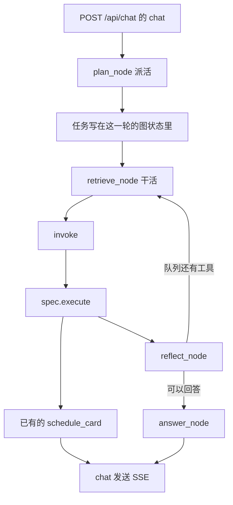
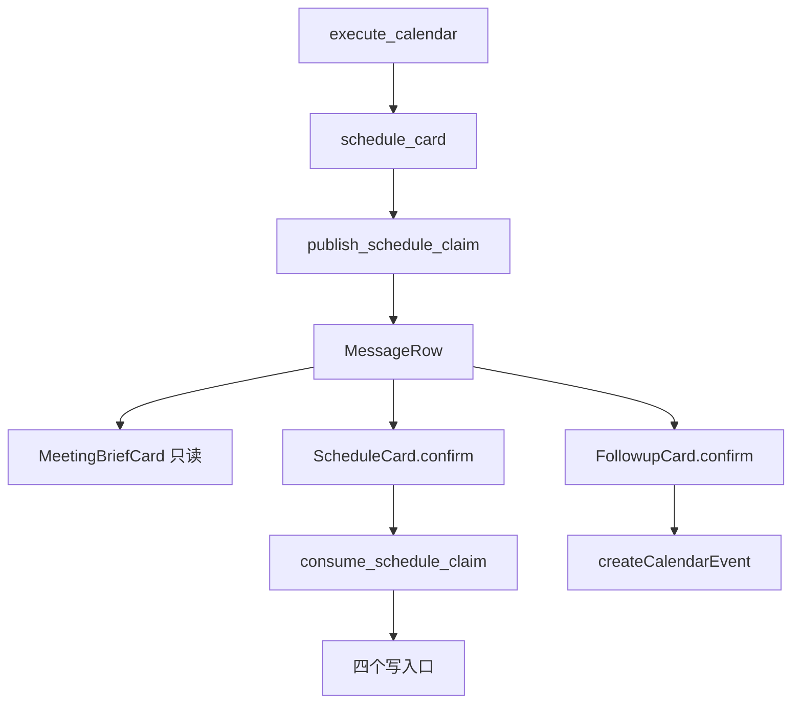

# 预想中的产品流程

本文写 Omni-Butler 就地演进之后的走法。基准是 release 的提交 `f567fdd789c7b4404ca01ad54846cb86e6736035`。现状全文在 [PR 75](https://github.com/y4483784-png/omni-butler/pull/75)，文件 `docs/current-product-flows.md` 在分支 `cursor/current-product-flows-0106` 上，还没有进入这份 release。

日历局部草案在 [PR 74](https://github.com/y4483784-png/omni-butler/pull/74) 的 `docs/envisioned-calendar-flows.md`。那份草案只改日历函数的走法。全产品的结论以本文为准。

代码还没有按本文修改。本文不新增 HTTP 路径，不新增表，不新增工具名。

## 总览

一句话进来，仍然是前缀 `/api/chat` 上的 `chat`。`chat` 在调用 `run_agent_workflow` 之前调用 `build_context`。图仍从 `plan_node` 走到 `retrieve_node`，再到 `reflect_node`，再到 `answer_node`。注册的工具仍由 `ensure_builtin_tools` 装上，名字仍是 `kb`、`web`、`calendar`、`sandbox`。

派活和干活今天写在同一次 `run_agent_workflow` 里。派活是 `plan_node` 调用 `plan_tools`。干活是 `retrieve_node` 调用 `gateway.invoke`，再由 `invoke` 调用 `spec.execute`。

预想把职责拆开，图仍是这一张。派活写下这一轮的任务，任务上带着授权范围。干活按任务跑工具。要提交的副作用停在干活里面，等人在页面卡片上确认。用户在等的结果仍从 `answer_node` 或已有的 `schedule_card` 说出来。只是观察的记录先进入 `write_audit`。

## 派活和干活拆开

派活观察并分派。干活才调用工具。今天这两段没有各自的入口，融合点是 `chat` 里的一次 `run_agent_workflow`。

`plan_node` 读取 `plan_tools` 返回的 `pending_tools`，把第一个名字写成 `next_tool`，其余留在队列里。`retrieve_node` 随即调用 `gateway.invoke`。`workflow.py` 里没有 `confidence` 这个名字。`_decision_to_plan` 已经把 `confidence` 放进计划字典，`plan_node` 没有把它抄进图状态。

跨回合时，`_prepare_session_context` 把 `Session.pending_calendar` 清成空字符串，传进图的 `pending_calendar` 是 `None`。回合结束之后，`refresh_session_context` 写 `context_summary` 和 `working_state`。`retrieve_node` 构造 `ToolContext` 时把 `working_state` 设成 `None`。

预想里的任务，就是派活交给干活的那一份状态。讨论里的 ticket 指这一份。代码里没有 Ticket 类型。本文也不加类型，不加表。

`plan_node` 把任务写进图状态。`retrieve_node` 读任务，再调用 `gateway.invoke`。授权范围放在任务上，经 `ToolContext` 传给 `invoke`。今天的 `ToolContext` 没有授权字段。相近的已有字段是 `pending_calendar`。那一字段是未完成的日历 JSON，而且进图之前已经被清空。

PR 74 打算把日历工单放进 `pending_calendar`。那是日历切片自己的草案。本文不把这一列改成全产品任务，也不采用那份草案的字段表。

`plan_tools` 调用 `route`。两者仍只决定要不要 `kb`、`web`、`calendar`、`sandbox`。它们不执行工具。`execute_calendar` 先用 `parse_action` 读参数里的 `action`。读不到时调用 `resolve_action`，再由它调用 `classify_calendar_action`。`CalendarAction` 有七个值，定义都在 `backend/app/services/calendar.py`。`plan_tools` 不挑选这七个值。

## 授权范围

授权范围是这一轮任务可以碰什么。它写在任务上。登录身份、工具白名单、Google 同意范围继续各自有效。上下文变长，这三道边界不变。

`get_current_user` 从会话 cookie 认出用户。cookie 名来自 `session_cookie_name`。

`_local_permission_ok` 读取 `load_constitution` 返回的 `allowed_tools`。默认就是 `kb`、`web`、`calendar`、`sandbox`。`invoke` 在 `spec.execute` 之前做这道检查。名单外的工具被拒绝。

`GOOGLE_REQUESTED_SCOPES` 是同一次 Google 同意页要的范围。`connection_status` 把它收成 `connected`、`mail_access`、`drive_access`、`meet_access`。任务不能把这些标志改成允许。

上下文走另一路。`build_context` 切出路由窗口、工具窗口和回答窗口。`load_memory_prompt` 读出记忆块。`refresh_session_context` 在回合结束后写摘要和 `working_state`。这些决定模型能看见什么。它们不改 `allowed_tools`，也不改 `connection_status`。

预想里，任务上的授权只用已经算出的两类值。

可以调用的工具名，就是 `_decision_to_plan` 放进 `pending_tools` 的那些名字。`invoke` 在 `_local_permission_ok` 通过之后再看任务。名字不在这一轮队列里，就拒绝。这道任务检查今天没有。白名单检查今天有，继续先做。

副作用停在哪一档，读 `RouterDecision.confidence`。它只有 `high` 和 `low`。`plan_node` 把计划字典里的 `confidence` 留在任务上。`low` 时，推断出来的写入不出草稿卡，只做观察。`high` 时可以出今天已有的草稿卡。没有任何一档等于已经允许写入。写入仍等页面确认。

## 确认闸嵌在干活里

确认闸在干活内核里，在副作用提交之前。人看到的是页面上的 `ScheduleCard`、`MeetingBriefCard` 或 `FollowupCard`。`MessageRow` 看 `scheduleCard.mode` 来选。确认不走终端提示。

壳子指外层收发。本仓库的壳子是 `chat`。浏览器到 `chat` 的代理保持现状文里的 nginx 和本机 Vite。定时收发是 `beat_schedule`。停点不放在壳子里。本仓库的核是 `run_agent_workflow`。停点在 `invoke` 调用 `spec.execute` 之前。

`plan_node` 不画卡，也不调用 `publish_schedule_claim`。

`chat` 在图返回之后，若 `WorkflowResult` 带有 `schedule_card`，就调用 `publish_schedule_claim`，再发类型为 `schedule_card` 的 SSE。这是把已经做好的卡片送出去。

`beat_schedule` 只登记 `recover_stale_ingests_task`。它不调用 `run_agent_workflow`。

今天的 `invoke` 要么拒绝，要么执行。`_autoharness_precheck` 看到 `action == "ask"` 时，沙箱以及风险为 `high` 或 `critical` 的调用会拒绝。拒绝原因是 `需要确认但当前为非交互`。其余 `ask` 不在这里拒绝。后面的执行仍由 `write_audit` 记账。这条分支不返回 `schedule_card`。

`get_autoharness_pipeline` 为空时，`_autoharness_precheck` 直接返回，进不了 `ask`。`requirements.txt` 里 autoharness 那一行是注释。默认镜像走本地规则。日历确认不依赖这条分支。

预想里，`ask` 这个停点改成页面卡片。卡片仍用 `ToolResult` 已有的 `schedule_card`，经 `WorkflowResult` 回到 `chat`，事件类型仍是 `schedule_card`。不新增事件类型。本文不定义非日历卡片的字段。在出现第二个要确认的工具之前，页面上的卡仍是日历这三张。

日历写入今天就不在 `spec.execute` 里面。`execute_calendar` 准备一次等用户确认的变更，返回卡片，并用 `_cleared` 写下 `direct_answer`。`direct_answer` 一旦有值，`reflect_node` 不再跑同一计划里后面的工具。

真正写入在四个 HTTP 函数里。`create_calendar_event`、`patch_event`、`delete_event`、`confirm_google_title_change` 各自先调用 `consume_schedule_claim`。`schedule_card_needs_claim` 在 `phase` 为空或 `draft`，并且 `mode` 属于 `create`、`update`、`cancel`、`choose` 时，才给卡盖上 `confirm_token`。

会后那张卡不带 `confirm_token`。`FollowupCard` 的 `confirm` 经 `postFollowAction` 调用 `createCalendarEvent`，请求体里没有令牌。重复点击由 `claimFollowRows` 挡住。`consume_schedule_claim` 在令牌为空时直接返回，所以这条创建不核销 `ScheduleConfirmClaim`。它仍是页面上的确认，仍在人点过之后才创建日程。

会前不写日历，也不发信。`prepare_meeting` 定义在 `backend/app/services/meeting_prep.py`。它调用 `search_meeting_mail` 和 `search_meeting_docs`。这两个函数分别定义在 `backend/app/services/gmail.py` 和 `backend/app/services/drive.py`。卡片是 `MeetingBriefCard`，`mode` 为 `brief`。

`retrieve_node` 调用沙箱时传入 `network` 为 `none`，并传入 `read_only`。越界参数由 `_local_classify_risk` 拒绝。本文不给沙箱加确认卡。

`remember_from_turn` 仍由 `chat` 在回合落库之后调用。它不是 `ensure_builtin_tools` 里的工具。本文不把它放进确认闸。

## 安静和观察

用户刚发出的这句话仍要得到结果。`answer_node` 看到 `direct_answer` 就交回那一句，不再起草第二遍。没有终稿时，`chat` 调用 `stream_chat`。

安静管的是还没被明确要求的副作用，以及只做观察的记录。`confidence` 为 `low` 的推断写入不出草稿卡。只读工具可以跑。`execute_kb`、`execute_web`，以及日历的列表和 `prepare_meeting`，都停在读取。每次 `invoke` 仍调用 `write_audit`。同一条记录进入 `ToolAuditLog`。人在 `AuditPanel` 里通过 `list_tool_audits` 查看。

先记账，再谈自动写入。本文不打开无人确认的写入。草稿卡和四个写入口之间的确认保持。

现在没有后台循环会自己开口。`beat_schedule` 不跑这张图。以后若要加观察者，它仍从 `plan_node` 进入，仍由 `retrieve_node` 跑工具。没有结果、也不需要人做动作时，不发 `token`。本文不添加这个观察者。

## 日历只是一块切片

创建、改期、删除、会前、会后，是同一道确认闸上的一块。全产品的拆分不由这块日历草案定义。

创建、改期、删除用 `ScheduleCard`。按钮是 `confirm`。令牌来自 `publish_schedule_claim`。写入走 `create_calendar_event`、`patch_event`、`delete_event` 或 `confirm_google_title_change`。

会前用 `MeetingBriefCard`。`prepare_meeting` 不写日历，不发信。

会后用 `FollowupCard`。`follow_up` 定义在 `backend/app/services/meeting_followup.py`。它读纪要并出卡。`confirm` 之后才创建日程。邮件仍是按钮 `复制邮件`，以及 `mailtoHref`。

`MessageRow` 继续按 `list`、`brief`、`followup` 和其余 `mode` 选组件。`ScheduleCard` 里已经处理 `suggest`、`choose`、`create`、`update`、`cancel`。这些 `mode` 保持。

连接保持。`google_calendar_connect` 和 `google_calendar_callback` 仍是那两条 GET。范围仍是 `GOOGLE_REQUESTED_SCOPES`。四个标志仍由 `connection_status` 给出。

普通发送时，`void_draft_schedule_cards` 仍作废未确认的写入卡。对得上同一场会时是否保留这张卡，写在 PR 74。本文保持这个函数的现行行为，也不把那条规则提升成全产品规则。

PR 74 里的工单阶段、`observe` 与 `draft` 两个词、以及沿用同一张日历工单的条件，只对日历函数有效。本文不把那两个词收成新的接口字段。全产品只规定三件事。`plan_node` 写任务。干活产出卡片。写入等页面确认。

## 现状符号和预想落点

下表每一行都是上述提交里能按固定字符串找到的符号。预想落点是以后改代码时接在这一处。表里没有新的路径名。

| 现状符号 | 文件 | 预想落点 |
| --- | --- | --- |
| `/api/chat` | `backend/app/api/chat.py` | 渠道入口的前缀保持。`chat` 仍启动图，并发送 SSE。 |
| `async def chat` | `backend/app/api/chat.py` | 壳子。转发 `token` 和 `schedule_card`。不决定确认闸。 |
| `run_agent_workflow` | `backend/app/agents/workflow.py` | 干活内核。派活和干活仍在这一张图里。 |
| `plan_node` | `backend/app/agents/workflow.py` | 派活。把任务和 `confidence` 写进图状态。不调用 `gateway.invoke`。 |
| `plan_tools` | `backend/app/agents/router.py` | 派活的判断。仍只给出工具队列和 `RouterDecision`。 |
| `def route` | `backend/app/agents/router.py` | `plan_tools` 调用的路由。仍不执行工具。 |
| `pending_tools` | `backend/app/agents/router.py` | 这一轮可以碰的工具名。任务授权引用这份队列。 |
| `_decision_to_plan` | `backend/app/agents/router.py` | 这一轮可以碰的工具名从这里来。顺序仍是四个内置工具。 |
| `RouterDecision` | `backend/app/agents/router.py` | `confidence` 仍只有 `high` 和 `low`。安静规则读它。 |
| `retrieve_node` | `backend/app/agents/workflow.py` | 干活。读任务，调用 `gateway.invoke`。 |
| `gateway.invoke` | `backend/app/agents/workflow.py` | 检索节点上的那一次调用。 |
| `def invoke` | `backend/app/agents/harness/gateway.py` | 副作用提交前的检查点。任务授权挨着白名单。 |
| `spec.execute` | `backend/app/agents/harness/gateway.py` | 四个工具的执行点。日历工具在这里只准备卡片。 |
| `_local_permission_ok` | `backend/app/agents/harness/gateway.py` | 白名单保持，并且先于任务授权。 |
| `_local_classify_risk` | `backend/app/agents/harness/gateway.py` | 沙箱越界参数仍在这里拒绝。不加沙箱确认卡。 |
| `_autoharness_precheck` | `backend/app/agents/harness/gateway.py` | `ask` 今天因非交互而拒绝。预想改成页面卡片，不改成终端提问。 |
| `action == "ask"` | `backend/app/agents/harness/gateway.py` | 上述停点的现行分支。 |
| `需要确认但当前为非交互` | `backend/app/agents/harness/gateway.py` | 现行拒绝原因。预想不再靠这句话代替页面卡片。 |
| `get_autoharness_pipeline` | `backend/app/agents/harness/constitution.py` | 管道为空时没有 `ask`。日历确认不依赖它。 |
| `load_constitution` | `backend/app/agents/harness/constitution.py` | 继续提供 `allowed_tools`。 |
| `allowed_tools` | `backend/app/agents/harness/constitution.py` | 默认仍是四个内置工具。任务不能写出这个名单。 |
| `ensure_builtin_tools` | `backend/app/agents/tools/registry.py` | 工具集合保持。本文不加第五个名字。 |
| `execute_kb` | `backend/app/agents/tools/kb.py` | 只读。安静的观察可以跑它。 |
| `execute_web` | `backend/app/agents/tools/web.py` | 只读。安静的观察可以跑它。 |
| `execute_calendar` | `backend/app/agents/tools/calendar_tool.py` | 确认闸的日历实例。准备卡片，不写日历行。 |
| `def parse_action` | `backend/app/services/calendar.py` | `execute_calendar` 先读参数里的 `action`。 |
| `def resolve_action` | `backend/app/agents/tools/calendar_tool.py` | 参数里没有动作时，再调用 `classify_calendar_action`。 |
| `def classify_calendar_action` | `backend/app/services/calendar.py` | `CalendarAction` 的七个值在干活里挑选。`plan_tools` 不挑选。 |
| `class CalendarAction` | `backend/app/services/calendar.py` | 七个值是 `create`、`update`、`cancel`、`list`、`suggest`、`prep`、`followup`。 |
| `_cleared` | `backend/app/agents/tools/calendar_tool.py` | 仍写 `direct_answer`，并让后续工具停下。 |
| `def prepare_meeting` | `backend/app/services/meeting_prep.py` | 会前只读。保持。 |
| `def follow_up` | `backend/app/services/meeting_followup.py` | 会后出卡。写入仍在确认之后。 |
| `def search_meeting_mail` | `backend/app/services/gmail.py` | 会前读邮件。保持。 |
| `def search_meeting_docs` | `backend/app/services/drive.py` | 会前读云端文件。保持。 |
| `class WorkflowResult` | `backend/app/agents/workflow.py` | 图交回 `chat` 的那一份。卡片仍走其中的 `schedule_card`。 |
| `class ToolResult` | `backend/app/agents/harness/types.py` | 已有 `schedule_card`。`ask` 的预想卡片用这个字段，不新增字段名。 |
| `ToolContext` | `backend/app/agents/harness/types.py` | 干活读任务的位置。今天没有授权字段。 |
| `direct_answer` | `backend/app/agents/harness/types.py` | 终稿。有它时 `answer_node` 不再第二遍起草。 |
| `pending_calendar` | `backend/app/models/models.py` | 未完成的日历 JSON。日历切片可以继续用。不改成全产品任务列。 |
| `working_state` | `backend/app/models/models.py` | 上下文 JSON。不当作授权。 |
| `class Session` | `backend/app/models/models.py` | 任务若要落在会话行上，以后仍改这一类。本文不加列。 |
| `_prepare_session_context` | `backend/app/api/chat.py` | 今天清空 `pending_calendar`。本文不改这次清空。 |
| `void_draft_schedule_cards` | `backend/app/services/calendar.py` | 普通发送时作废未确认卡。改不改留在日历草案。 |
| `def publish_schedule_claim` | `backend/app/services/schedule_confirm.py` | 送出卡片前盖令牌。不是闸门的决定点。 |
| `schedule_card_needs_claim` | `backend/app/services/schedule_confirm.py` | `phase` 为空或 `draft`，且 `mode` 为 `create`、`update`、`cancel`、`choose`。 |
| `consume_schedule_claim` | `backend/app/services/schedule_confirm.py` | 四个写入口在写入前核销令牌。空令牌直接返回。 |
| `ScheduleConfirmClaim` | `backend/app/models/models.py` | 确认令牌的表。会后按钮不使用它。 |
| `create_calendar_event` | `backend/app/api/calendar.py` | 确认后的创建。保持。 |
| `patch_event` | `backend/app/api/calendar.py` | 确认后的改期。保持。 |
| `delete_event` | `backend/app/api/calendar.py` | 确认后的删除。保持。 |
| `confirm_google_title_change` | `backend/app/api/calendar.py` | 确认后的 Google 标题修改。保持。 |
| `ScheduleCard` | `frontend/src/components/ScheduleCard.tsx` | 创建、改期、删除、选择的页面卡片。 |
| `async function confirm` | `frontend/src/components/ScheduleCard.tsx` | 创建、改期、删除的确认按钮。 |
| `MeetingBriefCard` | `frontend/src/components/MeetingBriefCard.tsx` | 会前简报。只读。 |
| `FollowupCard` | `frontend/src/components/FollowupCard.tsx` | 会后跟进卡片。 |
| `postFollowAction` | `frontend/src/components/FollowupCard.tsx` | 会后确认后的创建。不带令牌。 |
| `claimFollowRows` | `frontend/src/components/FollowupCard.tsx` | 会后重复点击的挡板。 |
| `createCalendarEvent` | `frontend/src/api/client.ts` | 会后确认调用的客户端函数。 |
| `function MessageRow` | `frontend/src/components/ChatWindow.tsx` | 按 `mode` 选三张卡。不新增卡片组件。 |
| `get_current_user` | `backend/app/core/auth.py` | 登录身份。授权范围比它更窄。 |
| `session_cookie_name` | `backend/app/core/config.py` | 会话 cookie 的配置名。不扩大授权。 |
| `GOOGLE_REQUESTED_SCOPES` | `backend/app/services/calendar_secrets.py` | 账户同意的范围。任务不能放大它。 |
| `connection_status` | `backend/app/services/calendar_secrets.py` | 四个连接标志保持。 |
| `google_calendar_connect` | `backend/app/api/calendar.py` | 开始 Google 授权。保持。 |
| `google_calendar_callback` | `backend/app/api/calendar.py` | 授权回调。保持。 |
| `load_memory_prompt` | `backend/app/services/memory.py` | 上下文。不提高授权。 |
| `remember_from_turn` | `backend/app/services/memory.py` | 回合后的记忆抽取。不进入确认闸。 |
| `build_context` | `backend/app/agents/context/assembler.py` | 三份窗口。不提高授权。 |
| `refresh_session_context` | `backend/app/agents/context/summary.py` | 回合后写摘要和 `working_state`。仍是上下文。 |
| `answer_node` | `backend/app/agents/workflow.py` | 用户在等的结果从这里出。 |
| `reflect_node` | `backend/app/agents/workflow.py` | 仍在干活里决定继续工具还是去回答。 |
| `async def stream_chat` | `backend/app/core/llm.py` | 没有终稿时的说话路径。 |
| `write_audit` | `backend/app/agents/harness/audit.py` | 观察的账本。安静时先记这里。 |
| `ToolAuditLog` | `backend/app/models/models.py` | 账本的表。 |
| `list_tool_audits` | `backend/app/api/audit.py` | 审计列表入口。 |
| `AuditPanel` | `frontend/src/components/AuditPanel.tsx` | 人查看账本的面板。 |
| `beat_schedule` | `backend/app/tasks/celery_app.py` | 定时任务保持入库回收。不调用 `run_agent_workflow`。 |
| `recover_stale_ingests_task` | `backend/app/tasks/celery_app.py` | `beat_schedule` 里的那一项。 |
| `"network": "none"` | `backend/app/agents/workflow.py` | 沙箱断网参数保持。 |
| `read_only` | `backend/app/agents/workflow.py` | 沙箱只读参数保持。本文不给沙箱加卡。 |
| `mailtoHref` | `frontend/src/components/FollowupCard.tsx` | 会后邮件仍是打开邮件应用。不改成代发。 |
| `复制邮件` | `frontend/src/components/FollowupCard.tsx` | 会后邮件的复制按钮。保持。 |

## 非做清单

下面这些不在本文里做。

- 不重写仓库。`run_agent_workflow` 保留，四个工具保留。
- 不做多渠道网关。入口仍是 `/api/chat` 上的 `chat`。
- 不把定时任务当成核。`beat_schedule` 仍只跑 `recover_stale_ingests_task`。
- 不引入 OpenClaw 或 Pi 的代码。停点放在干活核里，只用这条位置上的结论。
- 不做手机端。
- 不新增 HTTP 路径、数据表、工具名或事件类型。
- 不把确认闸放进 `plan_node`，也不放进 `chat` 的发送分支。
- 不把 PR 74 的日历字段表当成全产品接口。
- 不给沙箱、记忆抽取、文档上传加新的确认卡。
