# 预想产品实现计划

后面的实现按十四条 PR 做完图上的十二个模块。使用者仍用现在这个 Omni-Butler。桌面安装包是完整产品，网页只留对话、日历确认卡和知识库。

确认闸留在干活里。停止要传到子任务、队列和请求发出之前。四路叫醒对同一件写操作只开一轮确认。Khoj 只做侧车，不并进这个仓库。

顺序是 `ev-task`、`ev-gate`、`ev-plug`、`ev-stop`、`ev-dispatch`、`ev-work`、`ev-net`、`ev-events`、`ev-memory`、`ev-watch`、`ev-webblock`、`ev-mail`、`ev-errands`、`ev-desktop`。操作者说开始才执行。操作者说「合」才合并。本文件所在的 PR 不在这条链里。

## How to read this

One box is one unit of work. Every box names the evidence that checks it. A nested box is a sub-step of the box above it. Check a box only when its evidence exists, a file, a log line, a screenshot, a test run, or a SHA. The body is a how-to. The appendices explain and record.

The program runs `pstack/skills/poteto-mode/playbooks/autopilot-stack.md`. The operator lands every PR. Owners stop at stack-ready. Nobody in this program merges. Merge waits until the operator says 「合」.

Tests alone are not sufficient verification. A PR is verified only when its unit, live, and perf boxes are all checked.

一个勾是一份工作。证据要能打开。正文只写这一刀要做的步骤。对照、缺口和被否决的做法在附录。

产品主干是 `release`。仓库里没有 `pstack`。`git show origin/main:` 失败时，改读本机插件缓存里的同名文件，并把实际路径记到决策记录。

## Program checklist

### Arm the program

- [ ] 先把这份计划和执行约定交给操作者，然后停下。操作者明确说开始之后才执行。说「合」之前不合并。
- [ ] 不要改写或删除 `docs/envisioned-product/` 里的图、定案、对照和这份计划。要改就单独做一次修订。
- [ ] 不要把 Khoj 代码并进本仓库。不要为⑫开 PR。
- [ ] 程序开始时读下面这些文件。每一轮复查都重读。
  - [ ] `git show origin/main:pstack/skills/poteto-mode/playbooks/autopilot-stack.md`
  - [ ] `git show origin/main:pstack/skills/swarm/SKILL.md`
  - [ ] `git show origin/main:pstack/skills/control-ui/SKILL.md`
  - [ ] `git show origin/main:pstack/skills/poteto-mode/playbooks/opening-a-pr.md`
  - [ ] `git show origin/main:pstack/skills/poteto-mode/playbooks/shipping.md`
  - [ ] `git show origin/main:pstack/skills/how/SKILL.md`
  - [ ] `git show origin/main:pstack/skills/interrogate/SKILL.md`
  - [ ] `git show origin/main:pstack/skills/show-me-your-work/SKILL.md`
- [ ] `git show origin/main:` 失败时，从附录 D 的插件缓存读取同名手册。
- [ ] 执行阶段的子任务模型以仓库规则 `.cursor/rules/pstack-models.mdc` 为准，当前是 `grok-4.7-high`。写这份计划时用过的 Claude high 席位不带进执行。
- [ ] 操作者说开始之后，用 `/loop 1h` 挂上复查。不要靠记忆记间隔。
- [ ] 复查提示词用下面这一段，一个字不改。`Re-read the execution playbook from trunk. Audit the operation against it and fix drift in this tick. Probe every active lane and judge progress by side effects only. Stand down a stuck lane and dispatch its replacement now. Then post a short status message to the operator in chat only when the audit found a tracked change that no earlier status message reported, such as a PR opened, a code-ready head, a round launched or closed, a verdict, a merge, a stuck agent and the action taken, a blocker added or cleared, or a decision only the operator can make. Name every such change and nothing else. Do not repeat a table, the merged list, or an unchanged blocker. If the audit found none, end the turn with no reply text. Either way, log this tick's row in your decision trail. The row names the items reported, or none.`
- [ ] 操作者说暂停时，立刻通知每个 PR 的负责人停止写入。

### Spawn owners

- [ ] 每个 PR 一个负责人。生命周期按 `autopilot-stack` 走。负责人报告可以叠进栈，自己不合并。
- [ ] 依赖是一条链。后一个从父分支拉出，不从 `release` 另起。
  - [ ] `ev-task` 从 `release` 拉出，没有父 PR。
  - [ ] `ev-gate` 在 `ev-task` 之后。
  - [ ] `ev-plug` 在 `ev-gate` 之后。
  - [ ] `ev-stop` 在 `ev-plug` 之后。
  - [ ] `ev-dispatch` 在 `ev-stop` 之后。
  - [ ] `ev-work` 在 `ev-dispatch` 之后。
  - [ ] `ev-net` 在 `ev-work` 之后。
  - [ ] `ev-events` 在 `ev-net` 之后。
  - [ ] `ev-memory` 在 `ev-events` 之后。
  - [ ] `ev-watch` 在 `ev-memory` 之后。
  - [ ] `ev-webblock` 在 `ev-watch` 之后。
  - [ ] `ev-mail` 在 `ev-webblock` 之后。
  - [ ] `ev-errands` 在 `ev-mail` 之后。
  - [ ] `ev-desktop` 在 `ev-errands` 之后。
- [ ] 守住文件边界。`ev-task` 只加任务行、五种状态和代次，并给以后的同一件写清单留出不按代次去重的接口。`ev-gate` 只改确认凭据和日历写入口，并按用户、动作、指纹收成一条待办。`ev-plug` 只改工具契约和未知结果。`ev-stop` 只改取消链，并在停止后不再写长期记忆、不再为记忆调模型。`ev-dispatch` 只把派活移出干活。`ev-work` 只改干活循环。`ev-net` 只改这一轮的上网路径。`ev-events` 只加事件收件箱。`ev-memory` 只加记忆账本、少打扰和脉搏。停止后不写记忆已经在 `ev-stop`。`ev-watch` 只加只读看门狗。`ev-webblock` 只加网页执行拦截。表面由服务器判定。`ev-mail` 只加邮件入口。`ev-errands` 只加办事插头。`ev-desktop` 只加桌面安装包和包内本机插头。
- [ ] 已有的开放 PR，包括 #71，不属于这条链。不要合并它们，也不要为了这条链去改它们，除非本计划的文档 PR 与 `release` 发生冲突。
- [ ] 守住审阅门。`ev-gate`、`ev-plug`、`ev-stop`、`ev-work`、`ev-net`、`ev-events`、`ev-memory`、`ev-watch`、`ev-webblock`、`ev-mail`、`ev-errands`、`ev-desktop` 改了人能看见或能点的行为。合并前操作者要在聊天里看到截图和视频。`ev-task` 和 `ev-dispatch` 不改页面交互。

### PR mechanics, for every PR

- [ ] 先确定用哪个代码托管。默认 `gh`。如果 `command -v origin` 成功且 Origin 能解析这个仓库，所有 PR 操作都用 `origin pr`。记下任何退回 `gh` 的情况。不要求安装 `gt`。
- [ ] PR 打开时就是可审阅状态，不要开成草稿。这个运行环境有内置 PR 工具时用它，否则按上面的选择用 `origin pr create --status open --base <base-branch>` 或 `gh pr create --base <base-branch>`。栈里的子 PR 指向父分支。
- [ ] 面向 PR 的那次推送之前，在 `backend` 用启动配方里的环境跑一次 `python -m pytest tests -q`。改了前端的 PR 再在 `frontend` 跑 `npm test`。`frontend/package.json` 的 `test` 脚本目前只列出六个文件。新的或改过的前端测试必须先写进这个脚本，否则 `npm test` 不会跑它们。推送时打开 git 钩子。
- [ ] 每次提交前按 `/deslop` 清理文案。送审前按 `/no-comments` 检查注释。
- [ ] Bugbot 和安全审查的每条评论都按 `pstack/skills/poteto-mode/references/bugbot-triage.md` 分流。
- [ ] 报告可以叠栈之前，先变基到当时的父分支。`ev-task` 变基到当时的 `release`。修复轮次保持这个合并基线。只有准备合并、`git merge-tree` 与父分支冲突、或 CI 失败来自父分支上的新提交时，才再次变基。

### Verdict and merge, for every PR

- [ ] 完整的十路现场检查只在代码就绪的那个提交上跑一次。只有新行为、改设计或大块新差异才再跑一轮。变基、解冲突或小修补只派一个核对者看新提交。措辞修改不再跑现场。现场车道和性能车道用本计划里该 PR 的盒子。另外至少两路只读审计，各自盯一个重点，读差异和证据，不信 PR 正文。根负责人在下结论前核对证据。
- [ ] 按 `autopilot-stack` 的阻塞规则判断。没有阻塞项才算干净。标成 `Regression lane against trunk.` 的车道如果失败在主干已有行为上，记在主干名下，不阻塞这条 PR。新提交要重新下结论。`playbooks/shipping.md` 里补丁号没变的结果可以沿用。
- [ ] 每一刀的代码做完后，先做 pstack 形式化验证，并画出这一刀的状态图。图放进该 PR 的说明，或放进 `docs/envisioned-product/review/`。操作者看过代码、验证结果和这张图，并且说了「合」，才合并。没有操作者明说的部署请求，不部署。本目录里的文档不是实现许可，也不是合并许可。
- [ ] 负责人不合并。根负责人按依赖把 PR 的基线改到父分支。操作者从 `ev-task` 往上合并，而且只在说了「合」之后。补丁号规则以 `playbooks/shipping.md` 为准。

### Boot recipe, for every live lane

每路现场检查在自己的云虚拟机上跑该 PR 的提交。页面按插件里的 `control-ui` 操作。这个产品仓库没有这份技能。命令行核对用下面的 pytest。缺口记在附录 C。

- [ ] `git fetch origin <head-branch> && git checkout <head SHA>`。
- [ ] 在仓库根目录按 README 启动 Compose。等到 `curl -s http://127.0.0.1/health` 返回 `{"status":"ok","app":"Omni-Butler"}` 再开始。登录用环境里的 `ADMIN_USERNAME` 和 `ADMIN_PASSWORD`。
- [ ] 输入只通过 `control-ui` 的页面操作，或通过该 PR 写明的测试命令。日志只用 `docker compose logs api` 查看，不从日志改数据。
- [ ] 每张截图存到 `/tmp/swarm-<pr-id>/worker-<n>/`。车道盒子里的文件名就是这张图。报告带回路径。
- [ ] 后端测试从 `backend` 目录运行，环境是 `DATABASE_URL=sqlite+pysqlite:///./ci-eval.db REDIS_ENABLED=false CELERY_TASK_ALWAYS_EAGER=true SANDBOX_RUNNER_URL= SECRET_KEY=test-secret-key ADMIN_PASSWORD=test-admin-pass`。这与 `.github/workflows/eval.yml` 第 42 到 49 行一致。

## 加上任务代次和共享状态 (ev-task)

**Depends on.** None.

**Files.**

- [ ] 改 `backend/app/models/models.py`。
- [ ] 新建 `backend/alembic/versions/0011_task_run.py`。当前最后一版是 `0010_schedule_confirm_claims.py`。
- [ ] 新建 `backend/app/services/task_run.py`。
- [ ] 改 `backend/app/agents/harness/types.py` 里的 `ToolContext`。
- [ ] 改 `backend/app/api/chat.py`，只负责创建本回合任务并递增代次。
- [ ] 新建 `backend/tests/test_task_generation.py`。

**Build.**

- [ ] 读 `ToolContext`（`types.py` 第 12 行）和 `Session`（`models.py` 第 32 行）。现在没有任务行，也没有代次。
- [ ] 新增 `TaskRun`。状态只允许 `running`、`waiting_person`、`waiting_resource`、`completed`、`stopped`。正常做完写成 `completed`。`stopped` 只表示人主动停掉，或以后看门狗调用停止函数。不要把正常做完标成 `stopped`。不要用附加 reason 字段代替这第五种状态。每个用户回合一个递增的 `generation`。`generation` 只表示这一轮有没有做完或被停掉。它不是「同一件写操作」的键。
- [ ] `task_run.py` 是这张表的唯一写入者。聊天、以后的事件、脉搏和看门狗都调用它，不各自改行。
- [ ] 在 `ToolContext` 上增加 `task_id` 和 `generation`。把当前章程里的工具白名单抄到这一回合的允许列表。上下文变长时不改这张列表。这一刀不加确认凭据，不改 `ScheduleConfirmClaim`。
- [ ] 不要在 `TaskRun` 上建立包含 `generation` 的写操作唯一约束，也不要提供按用户、代次、动作和指纹去重的函数。给 `ev-gate` 留的查找是按用户、动作和参数指纹找未完成的待办。这一刀不建那张清单。
- [ ] 聊天已经要推送日历卡时，把该代次写成 `waiting_person`。人还没点，状态不能是 `stopped`，也不能是 `completed`。
- [ ] 上一句已经正常讲完，用户再发一句时，把上一句写成 `completed`。上一句还在 `running`、`waiting_person` 或 `waiting_resource`，用户又发了一句时，把上一句写成 `stopped`。终态只能是这两种里的一种，按这个规则选，不要猜。
- [ ] `task_run.stop` 由测试直接调用。它把代次写成 `stopped`。迟到结果不能把该代次改回 `running` 或 `completed`。页面上的停止按钮要到 `ev-stop` 才接到这个函数。这一刀不要用页面按钮充当停止。
- [ ] 证据级别是本仓库已打开的路径，提交 `f567fdd`。OpenMausBot 和 DS-Bot 的地图没有这组状态的源码路径。不要另找一张任务表来搬。
- [ ] 不要把 Khoj 加进仓库或 Compose。

**You see.**

- [ ] 第一句正常讲完后再发一句。第一句是 `completed`，第二句的 `generation` 更大。第一句不是 `stopped`。
- [ ] 第一句还在做时再发一句。第一句变成 `stopped`。测试调用 `task_run.stop` 之后，迟到结果不能把该代次改回 `running` 或 `completed`。
- [ ] `docker compose config --services` 与主干相同。

**Verify, unit.** Tests alone are not sufficient verification. A PR is verified only when its unit, live, and perf boxes are all checked.

- [ ] 在 `backend/tests/test_task_generation.py` 覆盖代次递增、正常结束为 `completed`、做完后再发一句仍是 `completed`、做到一半再发一句为 `stopped`、测试直接调用 `task_run.stop` 后拒绝旧代次，以及第二个用户读不到第一个用户的任务。断言没有用 reason 字段区分做完和停掉，也没有按代次去重写操作的唯一约束。不要靠页面停止按钮。用启动配方里的环境变量运行 `python -m pytest tests/test_task_generation.py -q`。
- [ ] 再跑 `python -m pytest tests/test_chat_sse_routing.py -q`。现有聊天路由仍然通过。

**Verify, live.** Tests alone are not sufficient verification. A PR is verified only when its unit, live, and perf boxes are all checked. Ten lanes on `grok-4.7-high` at the PR head, per the boot recipe.

- [ ] Lane 1. Regression lane against trunk. Ask one ordinary question on trunk and on the head. Trunk has no task row. Record that. Gate the answer bubble plus the new task row. Save `ev-task-regression.png`. Pass when the head shows one answer bubble, the api log contains one new `TaskRun` for that turn, and the finished row is `completed`.
- [ ] Lane 2. After the first answer finishes, send a second message in the same signed-in session. Save `ev-task-generation.png`. Pass when the second `generation` is greater than the first and the first row is `completed`.
- [ ] Lane 3. Press the existing stop control during planning on trunk and on the head. Save `ev-task-stop.png`. Pass when both sides end the bubble the same way. The head row is not `stopped` from that button. `task_run.stop` is covered by the unit test.
- [ ] Lane 4. Open a calendar draft that is already waiting for a click. Do not click it. Save `ev-task-waiting.png`. Pass when the task state is `waiting_person` and the card is still open.
- [ ] Lane 5. Sign in as a second user and open the first user's session URL. Save `ev-task-identity.png`. Pass when the second user does not see the first user's task or transcript.
- [ ] Lane 6. Send a second message while the first turn is still running. Save `ev-task-repeat.png`. Pass when the first row becomes `stopped`, the second `generation` is greater, and the two rows do not overwrite each other.
- [ ] Lane 7. Fill the composer with a long pasted history and send it. Save `ev-task-context.png`. Pass when the turn allow list stored on the task equals the allow list of a short turn for the same user.
- [ ] Lane 8. Call a tool name that is not on the turn allow list through the existing gateway. Save `ev-task-deny.png`. Pass when the tool audit says denied and the stored allow list is unchanged.
- [ ] Lane 9. Refresh the page after the answer. Save `ev-task-reload.png`. Pass when the transcript is still there, the finished generation stays `completed`, and no second `TaskRun` appears for it.
- [ ] Lane 10. Compare Compose services with trunk. Also search the repo diff for Khoj. Save `ev-task-scope.png`. Pass when the service list matches trunk and the diff contains no Khoj tree.

**Verify, perf.** Tests alone are not sufficient verification. A PR is verified only when its unit, live, and perf boxes are all checked.

- [ ] Metric. Pytest seconds for `tests/test_chat_sse_routing.py` on trunk and on the head, plus pytest seconds for `tests/test_task_generation.py` on the head only.
- [ ] Probe. From `backend`, run `tests/test_chat_sse_routing.py` with the boot-recipe env on trunk, then on the head, then on trunk again. On the head also run `tests/test_task_generation.py` with the same env.
- [ ] Baseline. Record the first trunk seconds for `tests/test_chat_sse_routing.py` before the head run.
- [ ] Rule. Fail when the head seconds for `tests/test_chat_sse_routing.py` are 60 seconds or more. Fail when `tests/test_task_generation.py` takes 30 seconds or more. Do not ratio `tests/test_task_generation.py` against `tests/test_chat_sse_routing.py`.

**Review gate.** None. ev-task is not review-gated.

**Merge.**

- [ ] Root's clean verdict at the exact head SHA.
- [ ] Bugbot triage done per `pstack/skills/poteto-mode/references/bugbot-triage.md`.
- [ ] Rebased onto current `release` after the verdict, with patch-id unchanged per `playbooks/shipping.md`.
- [ ] The owner does not merge `ev-task`. The operator lands it only after saying 「合」, bottom-up from `ev-task`.

## 把确认凭据收成一道闸 (ev-gate)

**Depends on.** ev-task.

**Files.**

- [ ] 改 `backend/app/services/schedule_confirm.py`。
- [ ] 改 `backend/app/models/models.py` 里的 `ScheduleConfirmClaim`。
- [ ] 新建 `backend/alembic/versions/0012_claim_fingerprint.py`。
- [ ] 改 `backend/app/api/calendar.py`。
- [ ] 改 `backend/app/api/chat.py`，去掉外壳直接签发凭据的职责。
- [ ] 改 `frontend/src/components/ScheduleCard.tsx`。
- [ ] 改 `backend/tests/test_schedule_confirm_claims.py`。
- [ ] 新建 `backend/tests/test_claim_fingerprint.py`。
- [ ] 按需要改 `verification/schedule-confirm/` 里已经写死的空 token 行为。

**Build.**

- [ ] 读 `consume_schedule_claim`（`schedule_confirm.py` 第 96 行）。`token` 为空时函数直接返回，写操作继续。`test_create_without_a_token_still_writes`（`test_schedule_confirm_claims.py` 第 54 行）把这个行为锁成通过。
- [ ] 读 `ScheduleConfirmClaim`（`models.py` 第 60 行）。现有列只有 token、用户、会话、状态和过期时间。没有动作、参数指纹、作用范围和任务代次。
- [ ] 读 `chat.py` 第 533 行。外壳在这里调用 `publish_schedule_claim`。这一刀之后，签发只留在 `schedule_confirm.py`。聊天只负责把已经签发的卡推给页面。
- [ ] 凭据记下动作、参数指纹、作用范围，以及当时那一轮的代次。代次用来拒绝已经 `stopped` 的那一轮去消费。代次不参与「是不是同一件写」的唯一键。执行前再验一次。参数变了必须重新签发。
- [ ] `publish` 对同一用户、同一动作和同一参数指纹是幂等的，不管这一轮的 `generation` 是多少，也不管唤醒源是聊天、日历提醒、新邮件还是脉搏。第二次调用返回已经打开的那张凭据，不另开一张。不要把唯一键写成用户加代次加动作加指纹。
- [ ] 某一代进入 `stopped` 时，这一代不能再消费该凭据。没有别的未停止代次还指着同一行时，未消费的凭据失效。不要因为旧代次停止就另开一张卡。`completed` 的代次同样不能把一张未消费的凭据当成自己还能写。
- [ ] 日历创建、修改、删除、会前简报和会后跟进都走这一个函数。没有 token 的写返回 409。改掉 `test_create_without_a_token_still_writes`，让无 token 的创建失败。
- [ ] RSVP 写也走这同一道闸。没有凭据就拒绝。先搜索仓库里不带 `confirm_token` 的日历创建和 RSVP 调用，把调用者写进该 PR，再改测试。
- [ ] 抄 OpenMausBot `O-CONFIRM` 的「回执绑定动作和指纹、提交失败就回滚」，以及 `O-LIVE` 的「每次决定读当前等级」。提交是 `083fd7b51405e6d0c01e189b2f65ab0322509b5a`，行号在 `envisioned-oss-map-harness.md` 的来源锚点。证据级别是地图声称的固定提交静态阅读。本计划运行没有打开那些上游文件。动工前按该提交重读 `server/routines.ts` 第 1487 到 1536 行和 `server/host/live-approval.ts` 第 12 到 17 行。
- [ ] DS-Bot `D-APPROVAL` 只抄「取消时待处理审批失效、过期回答拒绝」。文件是 `ds-bot/src/host/approvals.js`，提交 `71d344bf193f3f18185f25de3d8e5c483046910a`，地图只给了文件级锚点。不要把它的内存 Map 当成持久队列。持久行继续用 `ScheduleConfirmClaim`。
- [ ] 地图 `G-GATE` 写明作用范围和停止作废没有上游实现。这两样在本仓库写，不要假装上游已经有。代次可以记在凭据上，用来拒绝已停止的一轮。不要把它写成同一件写的钥匙。

**You see.**

- [ ] 无 token 的日历创建返回 409，数据库里没有新事件。
- [ ] 同一张卡点击两次，只出现一条事件。改时间后旧 token 返回 409，新卡才能写。
- [ ] 测试调用 `task_run.stop` 之后，原来的确认按钮不能再写。页面停止按钮还没接到这个函数。

**Verify, unit.** Tests alone are not sufficient verification. A PR is verified only when its unit, live, and perf boxes are all checked.

- [ ] 改 `tests/test_schedule_confirm_claims.py`，让无 token 创建失败。新建 `tests/test_claim_fingerprint.py`，覆盖同一凭据只写一次、参数变化后旧凭据失败、停止后凭据失效、两个不同 `generation` 发布同一用户同一动作同一指纹时仍是同一张凭据。用启动配方运行 `python -m pytest tests/test_schedule_confirm_claims.py tests/test_claim_fingerprint.py tests/test_task_generation.py -q`。
- [ ] 在 `frontend` 运行 `npm test`。
- [ ] 把 `verification/schedule-confirm/` 的规格改成无 token 不得写入。然后运行 `python3 verification/schedule-confirm/check.py`。检查必须按这个新规格通过。不要把规格改回允许无 token 写入。

**Verify, live.** Tests alone are not sufficient verification. A PR is verified only when its unit, live, and perf boxes are all checked. Ten lanes on `grok-4.7-high` at the PR head, per the boot recipe.

- [ ] Lane 1. Regression lane against trunk. Create a calendar event from the existing confirm card on trunk and on the head. Save `ev-gate-regression.png`. Pass when trunk still writes from its current card, and the head writes only after a click on a card whose token is open.
- [ ] Lane 2. Click the confirm button once on a new event card. Save `ev-gate-click.png`. Pass when one event exists and the card phase shows confirmed.
- [ ] Lane 3. Click the same confirm button again. Save `ev-gate-twice.png`. Pass when the second click does not create a second event and the page shows the closed state.
- [ ] Lane 4. Edit the time on the card and then click the original button. Save `ev-gate-edit.png`. Pass when the write is rejected and a new card is the only way to save the new time.
- [ ] Lane 5. Call `task_run.stop` for the generation that owns the open card, then click the card. Save `ev-gate-stop.png`. Pass when the click does not write. The chat stop button is not the control for this lane.
- [ ] Lane 6. Sign in as a second user and submit the first user's token. Save `ev-gate-identity.png`. Pass when the response is rejected and the first user's calendar is unchanged.
- [ ] Lane 7. Ask for the same event from two turns so the generations differ and the fingerprint matches. Save `ev-gate-idempotent.png`. Pass when the page shows one open card and the claim table has one open row for that user, action, and fingerprint.
- [ ] Lane 8. Send a calendar create request with the token field omitted. Save `ev-gate-missing.png`. Pass when the response is 409 and no event row appears.
- [ ] Lane 9. Confirm a card, then refresh the page. Save `ev-gate-reload.png`. Pass when the confirmed phase remains and a refresh does not write a second event.
- [ ] Lane 10. Look for a second approval table and for any Khoj path in the diff. Save `ev-gate-scope.png`. Pass when the only claim table is `schedule_confirm_claims` and the diff has no Khoj files.

**Verify, perf.** Tests alone are not sufficient verification. A PR is verified only when its unit, live, and perf boxes are all checked.

- [ ] Metric. Pytest seconds for `tests/test_schedule_confirm_claims.py` on trunk and on the head, plus pytest seconds for `tests/test_claim_fingerprint.py` on the head only.
- [ ] Probe. From `backend`, run `tests/test_schedule_confirm_claims.py` with the boot-recipe env on trunk, then on the head, then on trunk again. On the head also run `tests/test_claim_fingerprint.py` with the same env.
- [ ] Baseline. Record the first trunk seconds for `tests/test_schedule_confirm_claims.py` before the head run.
- [ ] Rule. Fail when the head seconds for `tests/test_schedule_confirm_claims.py` are 60 seconds or more. Fail when `tests/test_claim_fingerprint.py` takes 30 seconds or more. Do not ratio `tests/test_claim_fingerprint.py` against `tests/test_schedule_confirm_claims.py`.

**Review gate.** The operator reviews before merge.

- [ ] Copy the lane 2 screenshot into `docs/envisioned-product/review/ev-gate-review-card.png`.
- [ ] Record a 30 to 60 second video of the change on a lane VM. Save it as `docs/envisioned-product/review/ev-gate-review.mp4`.
- [ ] Post the screenshots and the video in chat. Stop at merge-ready. Wait for the operator to review them before merge.

**Merge.**

- [ ] Root's clean verdict at the exact head SHA.
- [ ] Bugbot triage done per `pstack/skills/poteto-mode/references/bugbot-triage.md`.
- [ ] Rebased onto the `ev-task` branch after the verdict, with patch-id unchanged per `playbooks/shipping.md`.
- [ ] The owner does not merge `ev-gate`. The operator lands it only after saying 「合」, bottom-up from `ev-task`.

## 给工具补上副作用契约和未知结果 (ev-plug)

**Depends on.** ev-gate.

**Files.**

- [ ] 改 `backend/app/agents/tools/registry.py` 里的 `ToolSpec`。
- [ ] 改 `backend/app/agents/harness/gateway.py` 里的 `invoke`。
- [ ] 改 `backend/app/agents/harness/constitution.yaml`。
- [ ] 改 `backend/app/api/calendar.py`，让写路由调用同一套验权。
- [ ] 改 `backend/app/services/calendar_google.py` 里的 `_insert_google_event`。
- [ ] 读 `backend/app/services/calendar_secrets.py` 里的 `refresh_access_token`，并为其失败顺序补测试。
- [ ] 新建 `backend/tests/test_tool_contract.py`。

**Build.**

- [ ] 读 `ToolSpec`（`registry.py` 第 12 行）。现在只有 `risk` 字符串。读 `invoke`（`gateway.py` 第 130 行）。它不看任务是否已停止。
- [ ] 给 `ToolSpec` 增加契约，只允许 `read`、`idempotent_write`、`non_replayable_write`。现有 kb、web、calendar、sandbox 四个注册工具按今天的实际效果标成 `read` 或草稿，不把它们标成外部写入。
- [ ] 日历的真正写入仍在 `api/calendar.py` 的 HTTP 路由里，不经过 `gateway.invoke`。不要把这些路由搬进 LangGraph。让路由调用 `schedule_confirm` 和同一个停止检查。
- [ ] `invoke` 和日历写路由在执行前读取 `TaskRun`。代次已停止就拒绝。可见工具名单不等于可以执行。
- [ ] 读 `_insert_google_event`（`calendar_google.py` 第 1190 行附近）。网络失败会抛 `CalendarRemoteWriteError`。请求体在第 1186 行已经有 `request_id`。读 `refresh_access_token`（`calendar_secrets.py` 第 310 行），它在第 357 行 `commit`。
- [ ] 不可重放的写入遇到网络失败或结果未知时，先按 `request_id` 或已经返回的 Google 事件 id 核对。核对本身不再发一次插入。写一个测试覆盖「刷新令牌已经 commit，随后插入网络失败」和「两者都回滚」两种顺序。
- [ ] 只读失败可以按契约重试。幂等写可以重试到同一个外部 id。不可重放写不重试。
- [ ] 抄 OpenMausBot `O-HTTP` 和 `O-RPC`，以及 DS-Bot `D-SCOPE` 和 `D-GUARD`。提交分别是 `083fd7b51405e6d0c01e189b2f65ab0322509b5a` 和 `71d344bf193f3f18185f25de3d8e5c483046910a`。证据级别是地图声称的静态阅读。动工前重读 `server/highlevel/client.ts` 第 335 到 401 行、`rpc.ts` 第 24 到 40 行、`ds-bot/src/host/tools.js` 第 743 到 781 行和第 834 到 915 行。
- [ ] 三类契约是图上的目标。地图写明只核验了 HighLevel 的可重放分支。不要把上游说成已经有完整三分类。不要抄整套原始命令权限。
- [ ] 不要把 Khoj 的沙箱并进 `sandbox-runner`。

**You see.**

- [ ] 日历卡确认后的写入仍只产生一条远端事件。插入请求在令牌刷新已经提交之后失败时，页面显示未知结果，再次点击不会发出第二条插入。
- [ ] 模型能看见的工具名，在执行被拒绝时不会产生外部写入。

**Verify, unit.** Tests alone are not sufficient verification. A PR is verified only when its unit, live, and perf boxes are all checked.

- [ ] 新建 `tests/test_tool_contract.py`。覆盖停止后的拒绝、只读可重试、不可重放写不重试、以及两种令牌刷新和插入失败的顺序。用启动配方运行 `python -m pytest tests/test_tool_contract.py tests/test_calendar_google.py tests/test_harness_gateway.py tests/test_claim_fingerprint.py -q`。

**Verify, live.** Tests alone are not sufficient verification. A PR is verified only when its unit, live, and perf boxes are all checked. Ten lanes on `grok-4.7-high` at the PR head, per the boot recipe.

- [ ] Lane 1. Regression lane against trunk. Confirm one calendar card on trunk and on the head. Save `ev-plug-regression.png`. Pass when both sides create one event from one click, and the head does not add a second insert.
- [ ] Lane 2. Confirm a card and let the Google insert succeed. Save `ev-plug-write.png`. Pass when one remote event exists and the card shows confirmed.
- [ ] Lane 3. Force the insert to fail after the token refresh has committed. Save `ev-plug-unknown.png`. Pass when the page says the outcome is unknown and the claim is not opened for a second insert.
- [ ] Lane 4. Click again after that unknown outcome. Save `ev-plug-second.png`. Pass when no second Google insert is sent and the event count stays the same.
- [ ] Lane 5. Call `task_run.stop` for that generation, then invoke a registered tool. Save `ev-plug-stop.png`. Pass when the gateway returns denied and the audit row records the stopped generation. The chat stop button is still the old disconnect.
- [ ] Lane 6. Sign in as a second user and submit the first user's confirm token. Save `ev-plug-identity.png`. Pass when no event is written on the first user's calendar.
- [ ] Lane 7. Repeat a read tool call that the contract marks as read. Save `ev-plug-read.png`. Pass when the second call returns data and does not create a calendar event.
- [ ] Lane 8. Show a tool name in the model-visible list and call it after the allow list removes it. Save `ev-plug-visible.png`. Pass when the call is denied even though the name was visible.
- [ ] Lane 9. Reload the page during the unknown-outcome state. Save `ev-plug-reload.png`. Pass when the unknown state remains and reload does not send another insert.
- [ ] Lane 10. Search the diff for Khoj and for a new Compose service. Save `ev-plug-scope.png`. Pass when the diff has no Khoj tree and `docker compose config --services` matches trunk.

**Verify, perf.** Tests alone are not sufficient verification. A PR is verified only when its unit, live, and perf boxes are all checked.

- [ ] Metric. Pytest seconds for `tests/test_harness_gateway.py` on trunk and on the head, plus pytest seconds for `tests/test_tool_contract.py` on the head only.
- [ ] Probe. From `backend`, run `tests/test_harness_gateway.py` with the boot-recipe env on trunk, then on the head, then on trunk again. On the head also run `tests/test_tool_contract.py` with the same env.
- [ ] Baseline. Record the first trunk seconds for `tests/test_harness_gateway.py` before the head run.
- [ ] Rule. Fail when the head seconds for `tests/test_harness_gateway.py` are 60 seconds or more. Fail when `tests/test_tool_contract.py` takes 30 seconds or more. Do not ratio `tests/test_tool_contract.py` against `tests/test_harness_gateway.py`.

**Review gate.** The operator reviews before merge.

- [ ] Copy the lane 3 screenshot into `docs/envisioned-product/review/ev-plug-review-unknown.png`.
- [ ] Record a 30 to 60 second video of the change on a lane VM. Save it as `docs/envisioned-product/review/ev-plug-review.mp4`.
- [ ] Post the screenshots and the video in chat. Stop at merge-ready. Wait for the operator to review them before merge.

**Merge.**

- [ ] Root's clean verdict at the exact head SHA.
- [ ] Bugbot triage done per `pstack/skills/poteto-mode/references/bugbot-triage.md`.
- [ ] Rebased onto the `ev-gate` branch after the verdict, with patch-id unchanged per `playbooks/shipping.md`.
- [ ] The owner does not merge `ev-plug`. The operator lands it only after saying 「合」, bottom-up from `ev-task`.

## 把停止传到请求发出之前 (ev-stop)

**Depends on.** ev-plug.

**Files.**

- [ ] 改 `backend/app/api/chat.py` 里的断开检测。
- [ ] 改 `backend/app/core/llm.py` 里的 `stream_chat` 和同步补全。
- [ ] 改 `backend/app/agents/workflow.py`，在每个节点之前检查代次。
- [ ] 改 `frontend/src/services/chatStream.ts` 里的 `stopChatStream`。
- [ ] 新建 `backend/tests/test_stop_before_send.py`。

**Build.**

- [ ] 读 `chat.py` 第 288 行和第 481 行。干活跑在 `asyncio.to_thread` 里。第 494 行只取消外面的 asyncio 任务。读 `stream_chat`（`llm.py` 第 398 行）。第 425 行发出请求之前没有停止检查。`_refuse_outbound` 在第 243 行。它拒绝工具字段。取消要另做检查。
- [ ] 把当前代次的停止标志传进工作线程。`stream_chat` 和同步补全在调用 `chat.completions.create` 之前读这个标志。已经停止就不要发请求。
- [ ] `gateway.invoke` 之前再读一次。队列里还没发出的模型请求一并丢掉。
- [ ] 停止不删除已经写入的日历，不撤回已经发出的邮件，不退回已经付出的款项。
- [ ] 改 `chat.py` 第 648 到 689 行的 `finally`。第 681 到 687 行现在会调用 `_remember_turn_isolated`。这一代已经是 `stopped` 时，不要调用它，也不要为了写记忆再调用模型。会话原文可以留下。正常结束并写成 `completed` 的回合，这一刀不建记忆账本。账本留给 `ev-memory`。
- [ ] 抄 DS-Bot `D-CANCEL`（`turns.js` 第 221 到 264 行）和 `D-LATE`（第 695 到 708 行），以及 OpenMausBot `O-CANCEL`（`client.ts` 第 259 到 265 行）和 `O-HTTP`（第 335 到 401 行）。提交分别是 `71d344bf193f3f18185f25de3d8e5c483046910a` 和 `083fd7b51405e6d0c01e189b2f65ab0322509b5a`。证据级别是地图声称的静态阅读。动工前重读这些行。
- [ ] 地图 `G-SHELL` 写明完整的暂停、改方向和流式中断还没有被证明。这一刀只做停止传到请求前和迟到结果作废。不要在这一刀做满分异步 ReAct。
- [ ] 不要把确认签发搬回外壳。

**You see.**

- [ ] 点停止之后，api 日志里没有新的模型 HTTP 请求，也没有为写记忆再发出的模型请求。已经确认过的日历事件还在。没有新的长期记忆行。
- [ ] 停止前已经发出的请求，其迟到文本不会再写进当前气泡。

**Verify, unit.** Tests alone are not sufficient verification. A PR is verified only when its unit, live, and perf boxes are all checked.

- [ ] 新建 `tests/test_stop_before_send.py`。覆盖工作线程在 `create` 之前看到停止、迟到结果不写回气泡、停止后日历行数不变，以及 `stopped` 的代次不再写长期记忆、也不再为记忆调用模型。用启动配方运行 `python -m pytest tests/test_stop_before_send.py tests/test_chat_sse_routing.py -q`。
- [ ] 在 `frontend` 运行 `npm test`。

**Verify, live.** Tests alone are not sufficient verification. A PR is verified only when its unit, live, and perf boxes are all checked. Ten lanes on `grok-4.7-high` at the PR head, per the boot recipe.

- [ ] Lane 1. Regression lane against trunk. Ask one question and let it finish on trunk and on the head. Save `ev-stop-regression.png`. Pass when both sides show a finished answer when the user does not press stop.
- [ ] Lane 2. Press stop while the page still says planning. Save `ev-stop-press.png`. Pass when the bubble stops, the row is `stopped`, and the api log shows no model request and no memory extract after the stop line.
- [ ] Lane 3. Press stop after a calendar event was already confirmed. Save `ev-stop-keep.png`. Pass when the calendar event remains and the page does not offer an undo of that event.
- [ ] Lane 4. Press stop and then wait for a delayed model chunk from the old request. Save `ev-stop-late.png`. Pass when the old chunk is not appended to the bubble.
- [ ] Lane 5. Press stop and then send a new message. Save `ev-stop-next.png`. Pass when the new message gets a new generation and can finish.
- [ ] Lane 6. Sign in as a second user and stop the first user's turn from the second session. Save `ev-stop-identity.png`. Pass when the first user's turn is unchanged.
- [ ] Lane 7. Press stop twice. Save `ev-stop-twice.png`. Pass when the task stays `stopped` and the second press does not raise an error page.
- [ ] Lane 8. Start a turn with no model key so the mock stream runs, then press stop. Save `ev-stop-mock.png`. Pass when the mock stream also stops and does not fill the bubble after the press.
- [ ] Lane 9. Reload after stop. Save `ev-stop-reload.png`. Pass when the stopped turn stays stopped and reload does not resume the old request.
- [ ] Lane 10. Search the diff for a new chat gateway and for Khoj. Save `ev-stop-scope.png`. Pass when the diff has no WeChat, Telegram, or Slack route and no Khoj tree.

**Verify, perf.** Tests alone are not sufficient verification. A PR is verified only when its unit, live, and perf boxes are all checked.

- [ ] Metric. Pytest seconds for `tests/test_chat_sse_routing.py` on trunk and on the head, plus pytest seconds for `tests/test_stop_before_send.py` on the head only.
- [ ] Probe. From `backend`, run `tests/test_chat_sse_routing.py` with the boot-recipe env on trunk, then on the head, then on trunk again. On the head also run `tests/test_stop_before_send.py` with the same env.
- [ ] Baseline. Record the first trunk seconds for `tests/test_chat_sse_routing.py` before the head run.
- [ ] Rule. Fail when the head seconds for `tests/test_chat_sse_routing.py` are 60 seconds or more. Fail when `tests/test_stop_before_send.py` takes 30 seconds or more. Do not ratio `tests/test_stop_before_send.py` against `tests/test_chat_sse_routing.py`.

**Review gate.** The operator reviews before merge.

- [ ] Copy the lane 2 screenshot into `docs/envisioned-product/review/ev-stop-review-stop.png`.
- [ ] Record a 30 to 60 second video of the change on a lane VM. Save it as `docs/envisioned-product/review/ev-stop-review.mp4`.
- [ ] Post the screenshots and the video in chat. Stop at merge-ready. Wait for the operator to review them before merge.

**Merge.**

- [ ] Root's clean verdict at the exact head SHA.
- [ ] Bugbot triage done per `pstack/skills/poteto-mode/references/bugbot-triage.md`.
- [ ] Rebased onto the `ev-plug` branch after the verdict, with patch-id unchanged per `playbooks/shipping.md`.
- [ ] The owner does not merge `ev-stop`. The operator lands it only after saying 「合」, bottom-up from `ev-task`.

## 把派活移出干活循环 (ev-dispatch)

**Depends on.** ev-stop.

**Files.**

- [ ] 改 `backend/app/agents/workflow.py`，把 `plan_node` 里的 `plan_tools` 调用移出干活图。
- [ ] 改 `backend/app/agents/router.py`，让 `route` 和 `plan_tools` 只返回任务分配。
- [ ] 新建 `backend/tests/test_dispatch_boundary.py`。

**Build.**

- [ ] 读 `run_agent_workflow`（`workflow.py` 第 219 行）和嵌套的 `plan_node`（第 236 行）。`plan_tools` 在第 239 行被调用。派活和干活现在是同一张 LangGraph。
- [ ] 把 `route` 和 `plan_tools` 放到 `run_agent_workflow` 之前的一步。这一步只观察来意并写下这一回合的任务分配。它不调用 `gateway.invoke`，不调用 `publish_schedule_claim`。
- [ ] 干活图从已经写好的任务分配开始。最终回复仍由干活路径写出，不由这一步写出。
- [ ] DSH 的 Router 和 Worker 在产品地图里没有文件路径。证据级别是仅文档。不要编造上游路径，也不要搬 DSH 的 PR 或分支边界。Leon 的 `core/brain/brain.ts` 同样是仅文档。
- [ ] 不要把 Hermes 的单循环抄进来。不要让这一步直接调日历写。

**You see.**

- [ ] 同一句「帮我约明天的会」仍然先出确认卡。确认之前不写日历。
- [ ] 派活函数的测试桩里，`gateway.invoke` 和 `publish_schedule_claim` 的调用次数都是 0。

**Verify, unit.** Tests alone are not sufficient verification. A PR is verified only when its unit, live, and perf boxes are all checked.

- [ ] 新建 `tests/test_dispatch_boundary.py`。断言派活函数不调用 `gateway.invoke` 和 `publish_schedule_claim`，并且 `tests/test_router.py` 里现有路由仍通过。用启动配方运行 `python -m pytest tests/test_dispatch_boundary.py tests/test_router.py tests/test_workflow.py -q`。

**Verify, live.** Tests alone are not sufficient verification. A PR is verified only when its unit, live, and perf boxes are all checked. Ten lanes on `grok-4.7-high` at the PR head, per the boot recipe.

- [ ] Lane 1. Regression lane against trunk. Ask for a calendar event on trunk and on the head. Save `ev-dispatch-regression.png`. Pass when both sides show a confirm card and neither writes before the click.
- [ ] Lane 2. Ask an ordinary question that needs no tool. Save `ev-dispatch-chat.png`. Pass when one answer bubble appears and no confirm card appears.
- [ ] Lane 3. Ask a question, press stop, and inspect the dispatch log. Save `ev-dispatch-stop.png`. Pass when dispatch records the assignment and does not call the gateway after the stop.
- [ ] Lane 4. Ask for a calendar change and do not click the card. Save `ev-dispatch-card.png`. Pass when the card is present and the dispatch log contains no `publish_schedule_claim` call.
- [ ] Lane 5. Sign in as a second user and repeat the first user's prompt. Save `ev-dispatch-identity.png`. Pass when the second user gets a separate task and cannot see the first user's card.
- [ ] Lane 6. Send the same prompt twice after the first answer finishes. Save `ev-dispatch-repeat.png`. Pass when two generations exist and each dispatch call stayed free of tool calls.
- [ ] Lane 7. Ask a question that the router marks as low confidence. Save `ev-dispatch-low.png`. Pass when dispatch still does not open a card by itself.
- [ ] Lane 8. Open the network log while the answer streams. Save `ev-dispatch-stream.png`. Pass when the answer still streams in the existing bubble.
- [ ] Lane 9. Reload after the answer. Save `ev-dispatch-reload.png`. Pass when the transcript remains and reload does not run a second tool.
- [ ] Lane 10. Search the diff for a copied DSH tree and for Khoj. Save `ev-dispatch-scope.png`. Pass when the diff stays inside this repo and contains no Khoj files.

**Verify, perf.** Tests alone are not sufficient verification. A PR is verified only when its unit, live, and perf boxes are all checked.

- [ ] Metric. Pytest seconds for `tests/test_router.py` on trunk and on the head, plus pytest seconds for `tests/test_dispatch_boundary.py` on the head only.
- [ ] Probe. From `backend`, run `tests/test_router.py` with the boot-recipe env on trunk, then on the head, then on trunk again. On the head also run `tests/test_dispatch_boundary.py` with the same env.
- [ ] Baseline. Record the first trunk seconds for `tests/test_router.py` before the head run.
- [ ] Rule. Fail when the head seconds for `tests/test_router.py` are 60 seconds or more. Fail when `tests/test_dispatch_boundary.py` takes 30 seconds or more. Do not ratio `tests/test_dispatch_boundary.py` against `tests/test_router.py`.

**Review gate.** None. ev-dispatch is not review-gated.

**Merge.**

- [ ] Root's clean verdict at the exact head SHA.
- [ ] Bugbot triage done per `pstack/skills/poteto-mode/references/bugbot-triage.md`.
- [ ] Rebased onto the `ev-stop` branch after the verdict, with patch-id unchanged per `playbooks/shipping.md`.
- [ ] The owner does not merge `ev-dispatch`. The operator lands it only after saying 「合」, bottom-up from `ev-task`.

## 让干活循环走确认闸和插头 (ev-work)

**Depends on.** ev-dispatch.

**Files.**

- [ ] 改 `backend/app/agents/workflow.py` 里的 `retrieve_node`、`reflect_node` 和 `answer_node`。
- [ ] 改 `backend/app/api/chat.py` 里最终回复的流出位置，使它服从干活结果。
- [ ] 新建 `backend/tests/test_work_loop.py`。

**Build.**

- [ ] 读 `_MAX_ITERATIONS`（`workflow.py` 第 42 行）、`reflect_node`（第 329 行）和 `chat.py` 第 590 行附近的最终流出。循环形状已经是规划、一步工具、反思、回答。上限是 4 轮。
- [ ] 每一步先读代次和允许列表，再决定要不要过确认闸，然后才调用 `gateway.invoke`。代次停止就结束循环。
- [ ] 工具结果回到 `reflect_node`。结果是未知时，循环不再发一次同类写入。核对只调用 `ev-plug` 已经写好的核对函数。
- [ ] 没有下一步时，最终回复由干活路径写出。派活函数仍不写回复。
- [ ] 上下文变长不修改允许列表。`_refuse_outbound` 继续阻止把工具字段发给模型。选工具仍由本仓库的路由和注册表完成。
- [ ] Leon 的 `react-llm-duty.ts` 和 `turn-lifecycle` 是仅文档。AnythingLLM 的 `aibitat/index.js` 和 `stream.js` 在产品地图里标成缺口，要在实现前补读，不能把地图句子当成已经摘录的源码。不要一次抄进满分异步 ReAct。

**You see.**

- [ ] 需要日历写入的句子先出卡。只读的知识库问题直接回答，不出现确认卡。
- [ ] 未知结果之后的下一轮日志里没有第二条插入。

**Verify, unit.** Tests alone are not sufficient verification. A PR is verified only when its unit, live, and perf boxes are all checked.

- [ ] 新建 `tests/test_work_loop.py`。覆盖停止后循环退出、未知结果不再插入、以及派活模块的调用计数仍为 0。用启动配方运行 `python -m pytest tests/test_work_loop.py tests/test_workflow.py tests/test_dispatch_boundary.py -q`。

**Verify, live.** Tests alone are not sufficient verification. A PR is verified only when its unit, live, and perf boxes are all checked. Ten lanes on `grok-4.7-high` at the PR head, per the boot recipe.

- [ ] Lane 1. Regression lane against trunk. Ask one knowledge-base question on trunk and on the head. Save `ev-work-regression.png`. Pass when both sides answer in the chat bubble and neither creates a calendar event.
- [ ] Lane 2. Ask for a new calendar event and click the card. Save `ev-work-card.png`. Pass when one event is created only after the click.
- [ ] Lane 3. Press stop during tool planning. Save `ev-work-stop.png`. Pass when the loop exits and no later tool call is logged for that generation.
- [ ] Lane 4. Force an unknown insert result and let the loop continue. Save `ev-work-unknown.png`. Pass when the next step does not send a second insert.
- [ ] Lane 5. Sign in as a second user and run a tool turn. Save `ev-work-identity.png`. Pass when the tool audit is stored under the second user only.
- [ ] Lane 6. Ask a question that needs two read steps. Save `ev-work-two.png`. Pass when both reads finish and the answer cites both, with no confirm card.
- [ ] Lane 7. Paste a long history and ask for the same tool as a short turn. Save `ev-work-context.png`. Pass when the allow list in the log matches the short turn.
- [ ] Lane 8. Ask the model path to call a tool that is visible but not allowed. Save `ev-work-deny.png`. Pass when the loop records a denial and the answer says it did not run.
- [ ] Lane 9. Reload after the final answer. Save `ev-work-reload.png`. Pass when the answer remains and reload does not start another tool.
- [ ] Lane 10. Search the diff for a replaced LangGraph package and for Khoj. Save `ev-work-scope.png`. Pass when the workflow file is still the repo's own graph and the diff has no Khoj tree.

**Verify, perf.** Tests alone are not sufficient verification. A PR is verified only when its unit, live, and perf boxes are all checked.

- [ ] Metric. Pytest seconds for `tests/test_workflow.py` on trunk and on the head, plus pytest seconds for `tests/test_work_loop.py` on the head only.
- [ ] Probe. From `backend`, run `tests/test_workflow.py` with the boot-recipe env on trunk, then on the head, then on trunk again. On the head also run `tests/test_work_loop.py` with the same env.
- [ ] Baseline. Record the first trunk seconds for `tests/test_workflow.py` before the head run.
- [ ] Rule. Fail when the head seconds for `tests/test_workflow.py` are 60 seconds or more. Fail when `tests/test_work_loop.py` takes 30 seconds or more. Do not ratio `tests/test_work_loop.py` against `tests/test_workflow.py`.

**Review gate.** The operator reviews before merge.

- [ ] Copy the lane 2 screenshot into `docs/envisioned-product/review/ev-work-review-loop.png`.
- [ ] Record a 30 to 60 second video of the change on a lane VM. Save it as `docs/envisioned-product/review/ev-work-review.mp4`.
- [ ] Post the screenshots and the video in chat. Stop at merge-ready. Wait for the operator to review them before merge.

**Merge.**

- [ ] Root's clean verdict at the exact head SHA.
- [ ] Bugbot triage done per `pstack/skills/poteto-mode/references/bugbot-triage.md`.
- [ ] Rebased onto the `ev-dispatch` branch after the verdict, with patch-id unchanged per `playbooks/shipping.md`.
- [ ] The owner does not merge `ev-work`. The operator lands it only after saying 「合」, bottom-up from `ev-task`.

## 把上网收成 DeepSeek 这一条 (ev-net)

**Depends on.** ev-work.

**Files.**

- [ ] 改 `backend/app/core/llm.py` 里的 `_build_request`。
- [ ] 改 `backend/app/services/web_search.py` 和 `backend/app/agents/tools/web.py`。
- [ ] 改 `backend/app/agents/router.py`，让这一回合的允许列表决定是否上网。
- [ ] 新建 `backend/tests/test_one_web_path.py`。

**Build.**

- [ ] 读 `execute_web`（`tools/web.py` 第 10 行）和 `search_planned`（`web_search.py` 第 342 行）。`_web_search_url`（第 58 行）默认指向智谱的 `/web_search`。读 `_build_request`（`llm.py` 第 271 行）。请求体有思考开关，没有联网开关。
- [ ] 允许列表里有「上网」时，只在 DeepSeek 的模型请求上打开它自带的联网。同一回合不要再调用 `execute_web`，也不要请求智谱的 `/web_search`。
- [ ] 允许列表里没有「上网」时，两条路都不走。
- [ ] 这一刀不动嵌入、重排和识图的智谱地址。`check_zhipu_endpoints` 可以继续检查那些地址。
- [ ] 地图 `G-NET` 写明 DeepSeek 自带联网的具体字段还没有核验。证据级别是实现前补读。动工时阅读 DeepSeek 当时的聊天补全文档，把实际字段名写进该 PR 的决策记录，再改 `_build_request`。不要在没读文档时猜字段名。
- [ ] 不要把联网做成另一个工具插头。图上它是模型开关，由允许列表控制。

**You see.**

- [ ] 打开上网的一轮回答可以带网页依据，api 日志里没有智谱 `/web_search` 请求。
- [ ] 关掉上网的一轮不发 DeepSeek 联网字段，也不发智谱搜索。

**Verify, unit.** Tests alone are not sufficient verification. A PR is verified only when its unit, live, and perf boxes are all checked.

- [ ] 新建 `tests/test_one_web_path.py`。断言允许上网时请求体只有一条联网设置且没有 `execute_web`。断言不允许时两条都没有。用启动配方运行 `python -m pytest tests/test_one_web_path.py tests/test_web_thinking.py tests/test_zhipu_endpoints.py tests/test_deepseek_roles.py -q`。

**Verify, live.** Tests alone are not sufficient verification. A PR is verified only when its unit, live, and perf boxes are all checked. Ten lanes on `grok-4.7-high` at the PR head, per the boot recipe.

- [ ] Lane 1. Regression lane against trunk. Ask a question that does not need the web on trunk and on the head. Save `ev-net-regression.png`. Pass when both sides answer without a web-search error and the head log has no Zhipu `/web_search` call.
- [ ] Lane 2. Ask a freshness question with 上网 on the turn allow list. Save `ev-net-on.png`. Pass when the answer appears and the model request carries the documented DeepSeek networking field only.
- [ ] Lane 3. Ask the same freshness question with 上网 removed from the allow list. Save `ev-net-off.png`. Pass when the model request has no networking field and `execute_web` is not called.
- [ ] Lane 4. Press stop while a networked answer is streaming. Save `ev-net-stop.png`. Pass when no further model request is sent after the stop.
- [ ] Lane 5. Sign in as a second user whose allow list has no 上网. Save `ev-net-identity.png`. Pass when that user's request does not enable networking.
- [ ] Lane 6. Send two turns, the first with 上网 and the second without it. Save `ev-net-repeat.png`. Pass when only the first turn's model request carries the networking field.
- [ ] Lane 7. Force `execute_web` while the model request already has networking enabled. Save `ev-net-both.png`. Pass when the test or the page shows that the second path was refused.
- [ ] Lane 8. Ask for a calendar write in a turn that also has 上网. Save `ev-net-card.png`. Pass when the calendar card still appears and the web path does not write the calendar.
- [ ] Lane 9. Reload after a networked answer. Save `ev-net-reload.png`. Pass when the answer remains and reload does not send another search.
- [ ] Lane 10. Search the diff for a new search vendor and for Khoj. Save `ev-net-scope.png`. Pass when the diff does not add a second search tool and does not add Khoj.

**Verify, perf.** Tests alone are not sufficient verification. A PR is verified only when its unit, live, and perf boxes are all checked.

- [ ] Metric. Pytest seconds for `tests/test_web_thinking.py` on trunk and on the head, plus pytest seconds for `tests/test_one_web_path.py` on the head only.
- [ ] Probe. From `backend`, run `tests/test_web_thinking.py` with the boot-recipe env on trunk, then on the head, then on trunk again. On the head also run `tests/test_one_web_path.py` with the same env.
- [ ] Baseline. Record the first trunk seconds for `tests/test_web_thinking.py` before the head run.
- [ ] Rule. Fail when the head seconds for `tests/test_web_thinking.py` are 60 seconds or more. Fail when `tests/test_one_web_path.py` takes 30 seconds or more. Do not ratio `tests/test_one_web_path.py` against `tests/test_web_thinking.py`.

**Review gate.** The operator reviews before merge.

- [ ] Copy the lane 2 screenshot into `docs/envisioned-product/review/ev-net-review-web.png`.
- [ ] Record a 30 to 60 second video of the change on a lane VM. Save it as `docs/envisioned-product/review/ev-net-review.mp4`.
- [ ] Post the screenshots and the video in chat. Stop at merge-ready. Wait for the operator to review them before merge.

**Merge.**

- [ ] Root's clean verdict at the exact head SHA.
- [ ] Bugbot triage done per `pstack/skills/poteto-mode/references/bugbot-triage.md`.
- [ ] Rebased onto the `ev-work` branch after the verdict, with patch-id unchanged per `playbooks/shipping.md`.
- [ ] The owner does not merge `ev-net`. The operator lands it only after saying 「合」, bottom-up from `ev-task`.

## 加上事件收件箱和去重回执 (ev-events)

**Depends on.** ev-net.

**Files.**

- [ ] 新建 `backend/app/services/event_inbox.py`。
- [ ] 新建 `backend/alembic/versions/0013_event_receipt.py`。
- [ ] 在 `backend/app/models/models.py` 增加回执模型。
- [ ] 在 `backend/app/main.py` 注册只给测试和后续邮件入口用的内部提交路由。
- [ ] 新建 `backend/tests/test_event_inbox.py`。

**Build.**

- [ ] 读 `main.py` 第 43 到 50 行的路由列表。现在没有事件收件箱。`gmail.py` 的 `search_meeting_mail`（第 57 行）只为会前准备做只读搜索。不要把这次搜索改成入口。
- [ ] 回执按来源和投递编号去重。状态分开写 `received`、`dispatched`、`external_success`。收到事件只表示 `received`。外部成功只在写操作被确认且对方接受之后才标。
- [ ] 先用程序规则丢掉噪声，再让模型判断要不要动。不要做投机执行。
- [ ] 已有 `running` 且不在等人确认的任务时，事件进入那一个代次，不另开派活。状态是 `completed` 时不要进入那一代，另开新任务。状态是 `stopped` 时不写，也不把回执标成 `external_success`。不要用附加 reason 把 `completed` 和 `stopped` 合成一种。
- [ ] 正在等人确认时，投递编号重复则什么都不做。指纹相同则保留已打开的那张凭据。指纹不同则作废旧卡并只重签一张。重签之后又来的不同事件只排队，不执行，也不再开第二张写卡。
- [ ] 抄 OpenMausBot `O-EVENT`（`server/routines.ts` 第 742 到 806 行）和 `O-RECEIPT`（`server/routine-event-receipts.ts`，文件级）。提交 `083fd7b51405e6d0c01e189b2f65ab0322509b5a`。证据级别是地图声称的静态阅读。动工前重读。地图 `G-EVENT` 写明完整闭环没有单一已核验实现。两级过滤和直通在本仓库写。
- [ ] 不要接微信、Telegram 或 Slack。不要因为收到回执就显示外部成功。

**You see.**

- [ ] 用内部路由提交同一个投递编号两次，只出现一条回执。
- [ ] 任务正在等人确认时，一份不同指纹的事件会换掉旧卡，页面上仍只有一张可写的卡。

**Verify, unit.** Tests alone are not sufficient verification. A PR is verified only when its unit, live, and perf boxes are all checked.

- [ ] 新建 `tests/test_event_inbox.py`。覆盖去重、直通同一代次、`completed` 不直通、`stopped` 不写、等人时作废并重签、以及第二条不同事件只排队。用启动配方运行 `python -m pytest tests/test_event_inbox.py tests/test_claim_fingerprint.py -q`。

**Verify, live.** Tests alone are not sufficient verification. A PR is verified only when its unit, live, and perf boxes are all checked. Ten lanes on `grok-4.7-high` at the PR head, per the boot recipe.

- [ ] Lane 1. Regression lane against trunk. Ask an ordinary question on trunk and on the head. Save `ev-events-regression.png`. Pass when the chat still answers and trunk has no event inbox to compare.
- [ ] Lane 2. Submit one new event through the internal route after the previous task is `completed`. Save `ev-events-new.png`. Pass when one receipt is `dispatched`, one new task exists, and the `completed` row is not reused.
- [ ] Lane 3. Submit the same delivery id again. Save `ev-events-dupe.png`. Pass when the receipt count stays one and no second task appears.
- [ ] Lane 4. Open a confirm card and submit a different fingerprint for that task. Save `ev-events-reissue.png`. Pass when the old card is void and exactly one new card is open.
- [ ] Lane 5. While that new card is open, submit another different event. Save `ev-events-queue.png`. Pass when the page still shows one card and the extra event is queued, not written.
- [ ] Lane 6. Press stop and then submit an event aimed at that generation. Save `ev-events-stop.png`. Pass when the stopped generation does not write and the receipt is not `external_success`.
- [ ] Lane 7. Sign in as a second user and submit an event with the first user's delivery id. Save `ev-events-identity.png`. Pass when the second user gets a separate receipt and cannot void the first user's card.
- [ ] Lane 8. Submit an event that the rule filter marks as noise. Save `ev-events-noise.png`. Pass when no task and no card are created.
- [ ] Lane 9. Reload the page after a reissued card. Save `ev-events-reload.png`. Pass when one open card remains and reload does not write.
- [ ] Lane 10. Search the diff for WeChat, Telegram, Slack, and Khoj. Save `ev-events-scope.png`. Pass when none of those trees are added.

**Verify, perf.** Tests alone are not sufficient verification. A PR is verified only when its unit, live, and perf boxes are all checked.

- [ ] Metric. Pytest seconds for `tests/test_chat_sse_routing.py` on trunk and on the head, plus pytest seconds for `tests/test_event_inbox.py` on the head only.
- [ ] Probe. From `backend`, run `tests/test_chat_sse_routing.py` with the boot-recipe env on trunk, then on the head, then on trunk again. On the head also run `tests/test_event_inbox.py` with the same env.
- [ ] Baseline. Record the first trunk seconds for `tests/test_chat_sse_routing.py` before the head run.
- [ ] Rule. Fail when the head seconds for `tests/test_chat_sse_routing.py` are 60 seconds or more. Fail when `tests/test_event_inbox.py` takes 30 seconds or more. Do not ratio `tests/test_event_inbox.py` against `tests/test_chat_sse_routing.py`.

**Review gate.** The operator reviews before merge.

- [ ] Copy the lane 4 screenshot into `docs/envisioned-product/review/ev-events-review-reissue.png`.
- [ ] Record a 30 to 60 second video of the change on a lane VM. Save it as `docs/envisioned-product/review/ev-events-review.mp4`.
- [ ] Post the screenshots and the video in chat. Stop at merge-ready. Wait for the operator to review them before merge.

**Merge.**

- [ ] Root's clean verdict at the exact head SHA.
- [ ] Bugbot triage done per `pstack/skills/poteto-mode/references/bugbot-triage.md`.
- [ ] Rebased onto the `ev-net` branch after the verdict, with patch-id unchanged per `playbooks/shipping.md`.
- [ ] The owner does not merge `ev-events`. The operator lands it only after saying 「合」, bottom-up from `ev-task`.

## 给记忆加账本并把脉搏关进确认闸 (ev-memory)

**Depends on.** ev-events.

**Files.**

- [ ] 改 `backend/app/services/memory.py` 里的 `_upsert_memory` 和 `remember_from_turn`。
- [ ] 在 `backend/app/models/models.py` 增加记忆变更账本。
- [ ] 新建 `backend/alembic/versions/0014_memory_ledger.py`。
- [ ] 改 `backend/app/api/chat.py`，只在代次为 `completed` 时写账本。不要把 `ev-stop` 里「停止后不写记忆」的判断挪到这一刀才补。
- [ ] 改 `backend/app/tasks/celery_app.py` 的 `beat_schedule`，增加提醒任务。
- [ ] 改 `frontend/src/components/MemoryPanel.tsx`。
- [ ] 新建 `backend/tests/test_memory_ledger.py`。

**Build.**

- [ ] 读 `_upsert_memory`（`memory.py` 第 329 行）。第 350 到 352 行直接覆盖 `content`。没有来源、修改者、前后值和待提交状态。`remember_from_turn` 在第 411 行。`chat.py` 第 293 行在回合结束后抽取。
- [ ] 覆盖改成追加账本。每条记下 source、actor、before、after 和 pending。冲突时保留两边，不强制撤销另一边。待提交的值可以由人恢复或丢弃。
- [ ] 把握不够时只写账本，不出草稿卡。有结果或要人动手时才由外壳开口。
- [ ] `stopped` 的回合不写长期记忆，也不为记忆调模型。这条的验收在 `ev-stop`。这一刀只在 `completed` 的回合调用 `remember_from_turn`。会话原文可以留下。允许列表不因记忆文本而变长。不要用账本上的 reason 把 `completed` 和 `stopped` 合成一种任务状态。
- [ ] 脉搏是 beat 里的提醒。它经外壳推送。要写日历或发消息时调用 `ev-gate` 的幂等 `publish`。已经有同一指纹的未完成凭据时，不再开第二张。
- [ ] Leon 的 `OWNER.md` 和 `PULSE.md`、Letta 的 MemFS 是仅文档。不要抄已经废弃的 Letta AgentFile。不要把 AnythingLLM 的浅记忆当成这个账本。不要把 Khoj 的文档检索当成身份档案。
- [ ] 壳子地图 `G-MEM`（`envisioned-oss-map-harness.md` 第 390 行）说 DS-Bot 的记忆提交和冲突恢复还有旧证据，但没有路径。动工前在提交 `71d344bf193f3f18185f25de3d8e5c483046910a` 上查找。找不到就按本图实现账本，不要空等。
- [ ] 不要做会自行改写整份记忆的第二大脑。

**You see.**

- [ ] 同一偏好改两次之后，记忆面板同时显示改前和改后。
- [ ] 停止的回合不新增记忆行。到点提醒出现在聊天里。提醒要写日历时只出现一张确认卡。

**Verify, unit.** Tests alone are not sufficient verification. A PR is verified only when its unit, live, and perf boxes are all checked.

- [ ] 新建 `tests/test_memory_ledger.py`。覆盖前后值、停止后不抽取、低把握不出卡、以及脉搏第二次命中同一指纹时不新增凭据。用启动配方运行 `python -m pytest tests/test_memory_ledger.py tests/test_memory.py -q`。
- [ ] 在 `frontend` 运行 `npm test`。

**Verify, live.** Tests alone are not sufficient verification. A PR is verified only when its unit, live, and perf boxes are all checked. Ten lanes on `grok-4.7-high` at the PR head, per the boot recipe.

- [ ] Lane 1. Regression lane against trunk. Finish one ordinary chat on trunk and on the head. Save `ev-memory-regression.png`. Pass when both sides keep the transcript, and the head does not open a draft card for a low-confidence memory.
- [ ] Lane 2. Tell the assistant a preference, then correct it. Save `ev-memory-ledger.png`. Pass when the memory panel shows the before value and the after value.
- [ ] Lane 3. Press stop before the answer finishes. Save `ev-memory-stop.png`. Pass when the row is `stopped` and no new memory ledger row is written for that generation.
- [ ] Lane 4. Wait for a pulse that needs a calendar write. Save `ev-memory-pulse.png`. Pass when one confirm card appears and no event exists before the click.
- [ ] Lane 5. Trigger the same pulse again while the card is open. Save `ev-memory-once.png`. Pass when the open card count stays one.
- [ ] Lane 6. Sign in as a second user and open the memory panel. Save `ev-memory-identity.png`. Pass when the second user does not see the first user's ledger.
- [ ] Lane 7. Paste a long transcript that mentions a new tool name. Save `ev-memory-privilege.png`. Pass when the turn allow list does not gain that tool.
- [ ] Lane 8. Save two conflicting preference statements. Save `ev-memory-conflict.png`. Pass when both statements remain and neither is silently deleted.
- [ ] Lane 9. Reload the memory panel. Save `ev-memory-reload.png`. Pass when the ledger rows remain in the same order.
- [ ] Lane 10. Search the diff for Khoj and for a second-brain rewrite job. Save `ev-memory-scope.png`. Pass when the diff has no Khoj tree and no job that rewrites all memories.

**Verify, perf.** Tests alone are not sufficient verification. A PR is verified only when its unit, live, and perf boxes are all checked.

- [ ] Metric. Pytest seconds for `tests/test_memory.py` on trunk and on the head, plus pytest seconds for `tests/test_memory_ledger.py` on the head only.
- [ ] Probe. From `backend`, run `tests/test_memory.py` with the boot-recipe env on trunk, then on the head, then on trunk again. On the head also run `tests/test_memory_ledger.py` with the same env.
- [ ] Baseline. Record the first trunk seconds for `tests/test_memory.py` before the head run.
- [ ] Rule. Fail when the head seconds for `tests/test_memory.py` are 60 seconds or more. Fail when `tests/test_memory_ledger.py` takes 30 seconds or more. Do not ratio `tests/test_memory_ledger.py` against `tests/test_memory.py`.

**Review gate.** The operator reviews before merge.

- [ ] Copy the lane 2 screenshot into `docs/envisioned-product/review/ev-memory-review-ledger.png`.
- [ ] Record a 30 to 60 second video of the change on a lane VM. Save it as `docs/envisioned-product/review/ev-memory-review.mp4`.
- [ ] Post the screenshots and the video in chat. Stop at merge-ready. Wait for the operator to review them before merge.

**Merge.**

- [ ] Root's clean verdict at the exact head SHA.
- [ ] Bugbot triage done per `pstack/skills/poteto-mode/references/bugbot-triage.md`.
- [ ] Rebased onto the `ev-events` branch after the verdict, with patch-id unchanged per `playbooks/shipping.md`.
- [ ] The owner does not merge `ev-memory`. The operator lands it only after saying 「合」, bottom-up from `ev-task`.

## 加上只读的看门狗 (ev-watch)

**Depends on.** ev-memory.

**Files.**

- [ ] 在 `backend/app/tasks/celery_app.py` 的 `beat_schedule` 增加只读检查。
- [ ] 新建 `backend/app/tasks/watchdog.py`。
- [ ] 新建 `backend/tests/test_watchdog.py`。

**Build.**

- [ ] 读 `celery_app.py` 第 37 到 43 行。现在的 beat 只恢复卡住的文档入库。`deploy/health-watch.sh` 看磁盘和容器。任务看门狗另写。不要把那份脚本改成任务看门狗。
- [ ] 新任务只读 `TaskRun`。`waiting_person` 和 `waiting_resource` 不算卡住。`completed` 不是卡住，不是失败，也不是取消。看门狗不要把它改成 `stopped`。休眠时间不计入超时。
- [ ] 真的没有进展时，提醒人，或者调用 `task_run` 已有的停止函数。不要直接改授权，不要改提示词，不要改触发规则，不要调用会写外部世界的工具。
- [ ] 已经有打开的确认凭据时，看门狗不再 `publish` 第二张。
- [ ] 抄 OpenMausBot `O-WATCH` 里「等人不是卡住、休眠要计时」这一点。文件是 `server/turn-watchdog.ts`，提交 `083fd7b51405e6d0c01e189b2f65ab0322509b5a`，地图只给文件级锚点，并写明它是进程内定时器。不要把它说成已经存在的外部看门狗。动工前重读该文件。
- [ ] `O-STALL` 在 `server/index.ts` 第 5012 到 5094 行。只借用「停止按代次释放，不释放更新的代次」。证据级别同样是地图声称的静态阅读。

**You see.**

- [ ] 等人确认超过普通超时之后，任务仍是 `waiting_person`，看门狗没有新的日历写入。
- [ ] 一个停在 `running` 且没有新日志的任务会收到提醒或进入 `stopped`。已经 `completed` 的任务仍是 `completed`。更新的代次不受影响。

**Verify, unit.** Tests alone are not sufficient verification. A PR is verified only when its unit, live, and perf boxes are all checked.

- [ ] 新建 `tests/test_watchdog.py`。覆盖等人不误判、`completed` 不被改成 `stopped`、休眠不计超时、看门狗没有写工具、以及旧代次停止不清理新代次。用启动配方运行 `python -m pytest tests/test_watchdog.py tests/test_celery_ingest.py -q`。

**Verify, live.** Tests alone are not sufficient verification. A PR is verified only when its unit, live, and perf boxes are all checked. Ten lanes on `grok-4.7-high` at the PR head, per the boot recipe.

- [ ] Lane 1. Regression lane against trunk. Let one chat finish on trunk and on the head. Save `ev-watch-regression.png`. Pass when both sides finish the answer, the head row is `completed` after the watchdog runs, and the head ingest recovery job still exists.
- [ ] Lane 2. Leave a confirm card open past the old stall window. Save `ev-watch-wait.png`. Pass when the task stays `waiting_person` and no second card appears.
- [ ] Lane 3. Create a running task with no progress past the stall window. Save `ev-watch-stall.png`. Pass when the page shows an alert or the task becomes `stopped`, and no calendar write is added.
- [ ] Lane 4. Press stop yourself and then let the watchdog run. Save `ev-watch-stop.png`. Pass when the watchdog does not restart the stopped generation.
- [ ] Lane 5. Sign in as a second user with a healthy running task. Save `ev-watch-identity.png`. Pass when the first user's stall does not stop the second user's task.
- [ ] Lane 6. Run the watchdog twice on a waiting task. Save `ev-watch-twice.png`. Pass when the claim count stays one.
- [ ] Lane 7. Record a sleep interval on a task and run the watchdog. Save `ev-watch-sleep.png`. Pass when the sleep interval is not counted as a stall.
- [ ] Lane 8. Open the tool audit after a watchdog run. Save `ev-watch-tools.png`. Pass when the watchdog identity has no write-tool audit row.
- [ ] Lane 9. Reload after an alert. Save `ev-watch-reload.png`. Pass when the alert remains a notice and the calendar is unchanged.
- [ ] Lane 10. Search the diff for prompt edits and for Khoj. Save `ev-watch-scope.png`. Pass when the watchdog module does not write prompt text and the diff has no Khoj tree.

**Verify, perf.** Tests alone are not sufficient verification. A PR is verified only when its unit, live, and perf boxes are all checked.

- [ ] Metric. Pytest seconds for `tests/test_celery_ingest.py` on trunk and on the head, plus pytest seconds for `tests/test_watchdog.py` on the head only.
- [ ] Probe. From `backend`, run `tests/test_celery_ingest.py` with the boot-recipe env on trunk, then on the head, then on trunk again. On the head also run `tests/test_watchdog.py` with the same env.
- [ ] Baseline. Record the first trunk seconds for `tests/test_celery_ingest.py` before the head run.
- [ ] Rule. Fail when the head seconds for `tests/test_celery_ingest.py` are 60 seconds or more. Fail when `tests/test_watchdog.py` takes 30 seconds or more. Do not ratio `tests/test_watchdog.py` against `tests/test_celery_ingest.py`.

**Review gate.** The operator reviews before merge.

- [ ] Copy the lane 3 screenshot into `docs/envisioned-product/review/ev-watch-review-alert.png`.
- [ ] Record a 30 to 60 second video of the change on a lane VM. Save it as `docs/envisioned-product/review/ev-watch-review.mp4`.
- [ ] Post the screenshots and the video in chat. Stop at merge-ready. Wait for the operator to review them before merge.

**Merge.**

- [ ] Root's clean verdict at the exact head SHA.
- [ ] Bugbot triage done per `pstack/skills/poteto-mode/references/bugbot-triage.md`.
- [ ] Rebased onto the `ev-memory` branch after the verdict, with patch-id unchanged per `playbooks/shipping.md`.
- [ ] The owner does not merge `ev-watch`. The operator lands it only after saying 「合」, bottom-up from `ev-task`.

## 让网页执行端拒绝本机工具 (ev-webblock)

**Depends on.** ev-watch.

**Files.**

- [ ] 改 `backend/app/api/chat.py`。服务器根据登录和安装包写入表面。忽略 `ChatRequest` 上客户端自报的 web 或 desktop 字段。
- [ ] 在 `backend/app/agents/harness/types.py` 的 `ToolContext` 上增加服务器写入的表面。
- [ ] 改 `backend/app/agents/harness/gateway.py` 的 `invoke`。
- [ ] 新建 `backend/tests/test_web_blocks_local.py`。

**Build.**

- [ ] 读 `ChatRequest`（`chat.py` 第 46 行）和 `ToolContext`（`types.py` 第 12 行）。两边都没有网页或桌面的标记。现有登录都是网页。
- [ ] 表面由服务器写入 `ToolContext`。依据是已登录的会话，以及调用方是不是服务器认出的桌面安装包。不要把客户端在 `ChatRequest` 里自填的 web 或 desktop 当作依据。网页会话即使把字段填成 `desktop`，本机工具也拒绝。
- [ ] 本仓库现在没有安装包，所以这一刀没有服务器认可的桌面表面。只注册一个测试用的本机工具名，用来证明网页拒绝和撒谎拒绝。真正的桌面放行留到 `ev-desktop`。不要在这一刀交付真正的本机程序。
- [ ] AnythingLLM 的瘦网页是仅文档。不要把它的 `server/` 搬进这个 Python 仓库。
- [ ] 不要做网页遥控一台独立的本机助手。本机执行器留到 `ev-desktop`，而且只存在于安装包里。

**You see.**

- [ ] 现在的网页聊天没有本机操作按钮。测试用的本机工具从网页调用时被拒绝。请求体自报 `desktop` 时同样被拒绝。日历确认卡仍然可用。

**Verify, unit.** Tests alone are not sufficient verification. A PR is verified only when its unit, live, and perf boxes are all checked.

- [ ] 新建 `tests/test_web_blocks_local.py`。网页会话拒绝测试本机工具。同一网页会话把 `ChatRequest` 填成 `desktop` 时仍拒绝，有没有确认凭据都拒绝。不要写一条只靠客户端字段就放行的测试。用启动配方运行 `python -m pytest tests/test_web_blocks_local.py tests/test_harness_gateway.py -q`。
- [ ] 在 `frontend` 运行 `npm test`。

**Verify, live.** Tests alone are not sufficient verification. A PR is verified only when its unit, live, and perf boxes are all checked. Ten lanes on `grok-4.7-high` at the PR head, per the boot recipe.

- [ ] Lane 1. Regression lane against trunk. Ask one question and open a calendar card on trunk and on the head. Save `ev-webblock-regression.png`. Pass when the head web page still answers and still shows the calendar card.
- [ ] Lane 2. Use the web page and invoke the test local tool. Save `ev-webblock-deny.png`. Pass when the tool is denied and no local file or process changes.
- [ ] Lane 3. From the web page, call the test local tool with the request body marked `desktop` and no confirm token. Save `ev-webblock-noconfirm.png`. Pass when the call is denied.
- [ ] Lane 4. Repeat that call from the same web login with a valid confirm token and the body still marked `desktop`. Save `ev-webblock-lie.png`. Pass when the call is denied and the web page still has no local button.
- [ ] Lane 5. Press stop on the web page during a normal answer. Save `ev-webblock-stop.png`. Pass when stop still prevents the next model request.
- [ ] Lane 6. Sign in as a second user on the web page. Save `ev-webblock-identity.png`. Pass when the second user also cannot run the local test tool.
- [ ] Lane 7. Repeat the denied local call, including one repeat whose JSON says `desktop`. Save `ev-webblock-repeat.png`. Pass when every repeat is denied and the audit shows the server surface `web`.
- [ ] Lane 8. Ask for a knowledge-base answer on the web page. Save `ev-webblock-kb.png`. Pass when the answer appears, because the knowledge base stays allowed.
- [ ] Lane 9. Reload the web chat. Save `ev-webblock-reload.png`. Pass when no local-control button appears after reload.
- [ ] Lane 10. Search the diff for Electron packaging and for Khoj. Save `ev-webblock-scope.png`. Pass when this PR does not add a desktop package and does not add Khoj.

**Verify, perf.** Tests alone are not sufficient verification. A PR is verified only when its unit, live, and perf boxes are all checked.

- [ ] Metric. Pytest seconds for `tests/test_harness_gateway.py` on trunk and on the head, plus pytest seconds for `tests/test_web_blocks_local.py` on the head only.
- [ ] Probe. From `backend`, run `tests/test_harness_gateway.py` with the boot-recipe env on trunk, then on the head, then on trunk again. On the head also run `tests/test_web_blocks_local.py` with the same env.
- [ ] Baseline. Record the first trunk seconds for `tests/test_harness_gateway.py` before the head run.
- [ ] Rule. Fail when the head seconds for `tests/test_harness_gateway.py` are 60 seconds or more. Fail when `tests/test_web_blocks_local.py` takes 30 seconds or more. Do not ratio `tests/test_web_blocks_local.py` against `tests/test_harness_gateway.py`.

**Review gate.** The operator reviews before merge.

- [ ] Copy the lane 2 screenshot into `docs/envisioned-product/review/ev-webblock-review-web.png`.
- [ ] Record a 30 to 60 second video of the change on a lane VM. Save it as `docs/envisioned-product/review/ev-webblock-review.mp4`.
- [ ] Post the screenshots and the video in chat. Stop at merge-ready. Wait for the operator to review them before merge.

**Merge.**

- [ ] Root's clean verdict at the exact head SHA.
- [ ] Bugbot triage done per `pstack/skills/poteto-mode/references/bugbot-triage.md`.
- [ ] Rebased onto the `ev-watch` branch after the verdict, with patch-id unchanged per `playbooks/shipping.md`.
- [ ] The owner does not merge `ev-webblock`. The operator lands it only after saying 「合」, bottom-up from `ev-task`.

## 把邮件做成入口和事件 (ev-mail)

**Depends on.** ev-webblock.

**Files.**

- [ ] 新增邮件接收入口，不要改掉 `backend/app/services/gmail.py` 里会前搜索的只读用途。
- [ ] 把一封新邮件提交给 `event_inbox`，来源是 `mail`。
- [ ] 发信走 `schedule_confirm` 的凭据。
- [ ] 读 `frontend/src/components/FollowupCard.tsx` 和 `frontend/src/utils/followMail.ts`。
- [ ] 新建 `backend/tests/test_mail_entry.py`。

**Build.**

- [ ] 收信用推送、定时查看还是别的方式，这一份计划没有选定。做到这一刀再定。不要把未选定的方式写成已经锁定。新邮件单独收下。`search_meeting_mail` 继续只给会前准备做只读搜索。新的收信路径用来源 `mail` 加投递编号交给 `ev-events`。
- [ ] 发信必须先有确认凭据。`FollowupCard` 今天生成的是 `mailto` 链接。不要把打开链接当成已经发送，也不要把它写成 `external_success`。真正发送要等对方接受之后再标外部成功。
- [ ] 停止不撤回已经发出的邮件。
- [ ] 不要接微信、Telegram、Slack 或 WhatsApp。不要做手机客户端。
- [ ] AnythingLLM 的 `gmail` 和 `outlook` 插件正文没有摘录。证据级别是实现前补读。要抄插件形状时先读上游文件，只借「邮件和日历是同一级工具」这一点。不要搬它的产品壳。
- [ ] 产品地图里的 OpenMausBot `server/email/host.ts` 没有钉提交。要读它就必须用 `083fd7b51405e6d0c01e189b2f65ab0322509b5a`，不能用本地别的 HEAD。

**You see.**

- [ ] 一封新的测试邮件出现在收件里，并生成一条 `received` 回执。重复的投递编号不会开第二张卡。
- [ ] 会后跟进的 `mailto` 链接仍可打开。真正的发送按钮在确认之前不发出邮件。

**Verify, unit.** Tests alone are not sufficient verification. A PR is verified only when its unit, live, and perf boxes are all checked.

- [ ] 新建 `tests/test_mail_entry.py`。覆盖收信去重、发信无凭据失败、`mailto` 不写成外部成功，以及会前搜索测试仍通过。用启动配方运行 `python -m pytest tests/test_mail_entry.py tests/test_gmail_meeting_query.py tests/test_event_inbox.py -q`。
- [ ] 在 `frontend` 运行 `npm test`。

**Verify, live.** Tests alone are not sufficient verification. A PR is verified only when its unit, live, and perf boxes are all checked. Ten lanes on `grok-4.7-high` at the PR head, per the boot recipe.

- [ ] Lane 1. Regression lane against trunk. Open a meeting-prep card that searches mail on trunk and on the head. Save `ev-mail-regression.png`. Pass when both sides still show the prep result and the head does not send mail by itself.
- [ ] Lane 2. Deliver one inbound test message. Save `ev-mail-in.png`. Pass when the inbox shows it once and one receipt is `received`.
- [ ] Lane 3. Deliver the same message id again. Save `ev-mail-dupe.png`. Pass when the inbox count stays one.
- [ ] Lane 4. Use the follow-up mailto link. Save `ev-mail-mailto.png`. Pass when the link opens a draft and the receipt is not `external_success`.
- [ ] Lane 5. Press the real send control before confirming. Save `ev-mail-send.png`. Pass when no message is sent and the page shows the confirm card.
- [ ] Lane 6. Confirm the send, then press stop. Save `ev-mail-stop.png`. Pass when a message already accepted by the provider remains sent.
- [ ] Lane 7. Sign in as a second user and open the first user's mail event. Save `ev-mail-identity.png`. Pass when the second user cannot read that message.
- [ ] Lane 8. Deliver a message while a confirm card for that task is open and the fingerprint differs. Save `ev-mail-reissue.png`. Pass when one replacement card is open and two writes do not run.
- [ ] Lane 9. Reload the inbox. Save `ev-mail-reload.png`. Pass when the message remains and no second receipt appears.
- [ ] Lane 10. Search the diff for WeChat, Telegram, Slack, and Khoj. Save `ev-mail-scope.png`. Pass when none of those clients are added.

**Verify, perf.** Tests alone are not sufficient verification. A PR is verified only when its unit, live, and perf boxes are all checked.

- [ ] Metric. Pytest seconds for `tests/test_gmail_meeting_query.py` on trunk and on the head, plus pytest seconds for `tests/test_mail_entry.py` on the head only.
- [ ] Probe. From `backend`, run `tests/test_gmail_meeting_query.py` with the boot-recipe env on trunk, then on the head, then on trunk again. On the head also run `tests/test_mail_entry.py` with the same env.
- [ ] Baseline. Record the first trunk seconds for `tests/test_gmail_meeting_query.py` before the head run.
- [ ] Rule. Fail when the head seconds for `tests/test_gmail_meeting_query.py` are 60 seconds or more. Fail when `tests/test_mail_entry.py` takes 30 seconds or more. Do not ratio `tests/test_mail_entry.py` against `tests/test_gmail_meeting_query.py`.

**Review gate.** The operator reviews before merge.

- [ ] Copy the lane 2 screenshot into `docs/envisioned-product/review/ev-mail-review-mail.png`.
- [ ] Record a 30 to 60 second video of the change on a lane VM. Save it as `docs/envisioned-product/review/ev-mail-review.mp4`.
- [ ] Post the screenshots and the video in chat. Stop at merge-ready. Wait for the operator to review them before merge.

**Merge.**

- [ ] Root's clean verdict at the exact head SHA.
- [ ] Bugbot triage done per `pstack/skills/poteto-mode/references/bugbot-triage.md`.
- [ ] Rebased onto the `ev-webblock` branch after the verdict, with patch-id unchanged per `playbooks/shipping.md`.
- [ ] The owner does not merge `ev-mail`. The operator lands it only after saying 「合」, bottom-up from `ev-task`.

## 办事先走接口再走服务器浏览器 (ev-errands)

**Depends on.** ev-mail.

**Files.**

- [ ] 新增办事插头。有连接器时直接调对方接口。
- [ ] 没有连接器时，在 Compose 里增加单独的服务器浏览器服务，不要放进网页镜像或桌面安装包。
- [ ] 登录、付款和发送走确认凭据，或走模型读不到的保险柜。
- [ ] 新建 `backend/tests/test_errands.py`。

**Build.**

- [ ] 浏览器具体用哪一个库，这一份计划没有选定。做到这一刀再定。不要把 Playwright、Selenium 或 Puppeteer 写成已经选定。仓库里现在也没有这三个库。不要把浏览器塞进 `api` 容器。新服务只接受办事任务，并使用 `ev-plug` 的未知结果核对。登录和付款仍要用户确认。
- [ ] 先找连接器。没有连接器才打开服务器上的浏览器做搜索、加购、填表和结账。
- [ ] 登录、付款和发送必须先过确认闸，或者读取保险柜。模型提示词里不放登录秘密。
- [ ] 只有手机应用里才有的墙，停下来告诉人。不要做云手机，不要在应用里自动点击。
- [ ] 结果未知时走已经写好的核对，不发第二单。核对页面上的「已下单」不能再变成一次新的下单。
- [ ] 不要把 Open Interpreter 或千问云手机当底座。不要把 Khoj 的 Terrarium 当成这个浏览器。

**You see.**

- [ ] 有连接器的测试办事只出现一次外部调用，并在确认后完成。
- [ ] 没有连接器时，浏览器服务打开页面。遇到应用墙时聊天里出现停下来的说明，没有后续点击。
- [ ] 付款请求在未知结果之后再点一次，不会产生第二笔订单。

**Verify, unit.** Tests alone are not sufficient verification. A PR is verified only when its unit, live, and perf boxes are all checked.

- [ ] 新建 `tests/test_errands.py`。覆盖连接器优先、无凭据的付款失败、应用墙停止、以及未知结果不产生第二单。用启动配方运行 `python -m pytest tests/test_errands.py tests/test_tool_contract.py -q`。

**Verify, live.** Tests alone are not sufficient verification. A PR is verified only when its unit, live, and perf boxes are all checked. Ten lanes on `grok-4.7-high` at the PR head, per the boot recipe.

- [ ] Lane 1. Regression lane against trunk. Ask an ordinary question on trunk and on the head. Save `ev-errands-regression.png`. Pass when the chat still answers and trunk has no errand service to start.
- [ ] Lane 2. Run an errand that has a connector and confirm it. Save `ev-errands-api.png`. Pass when one connector call is logged and the page shows completion.
- [ ] Lane 3. Run an errand with no connector. Save `ev-errands-browser.png`. Pass when the server browser service handles it and the web page itself shows no remote-desktop view of the user's computer.
- [ ] Lane 4. Request a payment and cancel the confirm card. Save `ev-errands-pay.png`. Pass when no payment is sent.
- [ ] Lane 5. Force an unknown payment result and click again. Save `ev-errands-unknown.png`. Pass when the second click does not create a second order.
- [ ] Lane 6. Hit a flow that exists only inside a phone app. Save `ev-errands-wall.png`. Pass when the chat tells the user it stopped and no cloud-phone session starts.
- [ ] Lane 7. Press stop before the confirm click. Save `ev-errands-stop.png`. Pass when the errand does not continue and any already accepted payment remains.
- [ ] Lane 8. Sign in as a second user and open the first user's errand. Save `ev-errands-identity.png`. Pass when the second user cannot confirm it.
- [ ] Lane 9. Reload during an open payment card. Save `ev-errands-reload.png`. Pass when one card remains and reload does not pay.
- [ ] Lane 10. Search the diff for a cloud-phone client and for Khoj. Save `ev-errands-scope.png`. Pass when neither is added, and the browser service is not in the web image.

**Verify, perf.** Tests alone are not sufficient verification. A PR is verified only when its unit, live, and perf boxes are all checked.

- [ ] Metric. Pytest seconds for `tests/test_tool_contract.py` on trunk and on the head, plus pytest seconds for `tests/test_errands.py` on the head only.
- [ ] Probe. From `backend`, run `tests/test_tool_contract.py` with the boot-recipe env on trunk, then on the head, then on trunk again. On the head also run `tests/test_errands.py` with the same env.
- [ ] Baseline. Record the first trunk seconds for `tests/test_tool_contract.py` before the head run.
- [ ] Rule. Fail when the head seconds for `tests/test_tool_contract.py` are 60 seconds or more. Fail when `tests/test_errands.py` takes 30 seconds or more. Do not ratio `tests/test_errands.py` against `tests/test_tool_contract.py`.

**Review gate.** The operator reviews before merge.

- [ ] Copy the lane 2 screenshot into `docs/envisioned-product/review/ev-errands-review-errand.png`.
- [ ] Record a 30 to 60 second video of the change on a lane VM. Save it as `docs/envisioned-product/review/ev-errands-review.mp4`.
- [ ] Post the screenshots and the video in chat. Stop at merge-ready. Wait for the operator to review them before merge.

**Merge.**

- [ ] Root's clean verdict at the exact head SHA.
- [ ] Bugbot triage done per `pstack/skills/poteto-mode/references/bugbot-triage.md`.
- [ ] Rebased onto the `ev-mail` branch after the verdict, with patch-id unchanged per `playbooks/shipping.md`.
- [ ] The owner does not merge `ev-errands`. The operator lands it only after saying 「合」, bottom-up from `ev-task`.

## 把桌面安装包做成完整产品 (ev-desktop)

**Depends on.** ev-errands.

**Files.**

- [ ] 新增桌面安装包目录和 `scripts/desktop-dev.sh`。
- [ ] 包内放聊天窗和本机执行器。网页构建不包含这个执行器。
- [ ] 本机工具只在安装包内注册，并先过 `ev-gate`。服务器因为认出这个安装包才把表面写成 `desktop`。客户端把 `ChatRequest` 填成 `desktop` 不算数。
- [ ] 不要改 `docker-compose.yml` 里已有服务的职责。允许保留 `ev-errands` 新增的那一个专用浏览器服务。
- [ ] 新建 `backend/tests/test_desktop_surface.py`。

**Build.**

- [ ] 读 `docker-compose.yml`。写作时已有 `postgres`、`qdrant`、`redis`、`minio`、`sandbox`、`sandbox-runner`、`eval`、`api`、`worker`、`beat`、`nginx`。这些服务的职责保持原样。向量库继续用 Qdrant。不要换成 pgvector 或 LanceDB。验收时对照 `ev-errands` 完成后的服务名单，不要对照写作时的 `release`。那份名单上多出来的只能是 `ev-errands` 的那一个浏览器服务。
- [ ] 仓库没有 Electron 或 Tauri 目录。`frontend/package-lock.json` 里的 `electron-to-chromium` 是浏览器兼容表。桌面应用还不存在。打包方式仍待定。建议用 Electron，因为现有 Vite 前端可以嵌进去，而且 PR #77 更靠近这个选择。做到这一刀时可以按 Electron 做，除非当时发现明显不合适。这个建议不是定案，也不要把它写成已经否决 Tauri。
- [ ] 安装包里的本机动作包括打开文件和运行程序。看屏幕再点击的视觉操控不在这一刀里。
- [ ] 网页构建即使能在工具清单里看到本机名字，执行端仍按 `ev-webblock` 拒绝。网页会话把 `ChatRequest` 填成 `desktop` 时也拒绝。
- [ ] `sandbox-runner` 继续是服务器上的断网跑代码服务。不要把它换成 Khoj 的 Terrarium，也不要把 Khoj 代码并进仓库。
- [ ] Leon 的 `apps/web` 和 Eigent 的 `electron/` 是仅文档，用来对照「聊天和本机在同一个应用里」。不要把这两个仓库叉进本仓库。
- [ ] 定时 beat 继续不当助手核，也不签发确认凭据。

**You see.**

- [ ] `scripts/desktop-dev.sh` 打开的窗口里可以聊天，也可以在确认之后打开一个测试文件。
- [ ] 同一套界面的网页构建里没有这个打开文件的按钮，接口调用也被拒绝。
- [ ] Compose 的服务名单与 `ev-errands` 完成后的名单一致，包含那一个浏览器服务。已有服务的职责不变。

**Verify, unit.** Tests alone are not sufficient verification. A PR is verified only when its unit, live, and perf boxes are all checked.

- [ ] 新建 `tests/test_desktop_surface.py`。网页会话拒绝本机工具。网页会话自报 `desktop` 也拒绝。只有服务器认出的安装包，并且有凭据，才执行测试动作。用启动配方运行 `python -m pytest tests/test_desktop_surface.py tests/test_web_blocks_local.py -q`。

**Verify, live.** Tests alone are not sufficient verification. A PR is verified only when its unit, live, and perf boxes are all checked. Ten lanes on `grok-4.7-high` at the PR head, per the boot recipe.

- [ ] Lane 1. Regression lane against trunk. Open the web chat on trunk and on the head. Save `ev-desktop-regression.png`. Pass when the web chat still answers and still has no local-file button. Trunk has no desktop app. Record that.
- [ ] Lane 2. Run `scripts/desktop-dev.sh` and ask an ordinary question. Save `ev-desktop-chat.png`. Pass when the desktop window shows the answer.
- [ ] Lane 3. In that window, ask to open a test file and confirm the card. Save `ev-desktop-file.png`. Pass when the file opens only after the click.
- [ ] Lane 4. Ask to open the file and press stop before the click. Save `ev-desktop-stop.png`. Pass when the file does not open.
- [ ] Lane 5. From the web build, call the same local tool while the JSON says `desktop`. Save `ev-desktop-web.png`. Pass when the call is denied and the web page shows no local button.
- [ ] Lane 6. Confirm a local action, then press stop. Save `ev-desktop-keep.png`. Pass when a file action that already finished is not reverted by stop.
- [ ] Lane 7. Sign in as a second user in the desktop window. Save `ev-desktop-identity.png`. Pass when the second user cannot confirm the first user's local card.
- [ ] Lane 8. Click the local confirm card twice. Save `ev-desktop-twice.png`. Pass when the action runs once.
- [ ] Lane 9. Reload the desktop window after the answer. Save `ev-desktop-reload.png`. Pass when the transcript remains and the local tool does not run again.
- [ ] Lane 10. Compare Compose services with the `ev-errands` head and search the package for Khoj and for screen-click automation. Save `ev-desktop-scope.png`. Pass when the service list matches that head, including its one browser service, existing service duties are unchanged, the package has no Khoj tree, and it has no screen-click automation.

**Verify, perf.** Tests alone are not sufficient verification. A PR is verified only when its unit, live, and perf boxes are all checked.

- [ ] Metric. Pytest seconds for `tests/test_web_blocks_local.py` on trunk and on the head, plus pytest seconds for `tests/test_desktop_surface.py` on the head only.
- [ ] Probe. From `backend`, run `tests/test_web_blocks_local.py` with the boot-recipe env on trunk, then on the head, then on trunk again. On the head also run `tests/test_desktop_surface.py` with the same env.
- [ ] Baseline. Record the first trunk seconds for `tests/test_web_blocks_local.py` before the head run.
- [ ] Rule. Fail when the head seconds for `tests/test_web_blocks_local.py` are 60 seconds or more. Fail when `tests/test_desktop_surface.py` takes 30 seconds or more. Do not ratio `tests/test_desktop_surface.py` against `tests/test_web_blocks_local.py`.

**Review gate.** The operator reviews before merge.

- [ ] Copy the lane 2 screenshot into `docs/envisioned-product/review/ev-desktop-review-desktop.png`.
- [ ] Record a 30 to 60 second video of the change on a lane VM. Save it as `docs/envisioned-product/review/ev-desktop-review.mp4`.
- [ ] Post the screenshots and the video in chat. Stop at merge-ready. Wait for the operator to review them before merge.

**Merge.**

- [ ] Root's clean verdict at the exact head SHA.
- [ ] Bugbot triage done per `pstack/skills/poteto-mode/references/bugbot-triage.md`.
- [ ] Rebased onto the `ev-errands` branch after the verdict, with patch-id unchanged per `playbooks/shipping.md`.
- [ ] The owner does not merge `ev-desktop`. The operator lands it only after saying 「合」, bottom-up from `ev-task`.

## Close the program

- [ ] 上面每一格都有证据之后才算程序结束。
- [ ] 按 `autopilot-stack` 把十四条 PR 的结论交给操作者。不要合并。等操作者说「合」再从 `ev-task` 往上合并。

## Appendix A. Prototype evidence

这一轮没有原型分支，没有原型提交，也没有原型截图。产品取舍已经写在 `envisioned-final-brief.md`。

下面这些点仍然没有在本轮被运行证明。

- OpenMausBot `083fd7b51405e6d0c01e189b2f65ab0322509b5a` 和 DS-Bot `71d344bf193f3f18185f25de3d8e5c483046910a` 的上游文件没有在本轮打开。地图写的是此前静态阅读。每一刀动工前要按计划里的路径重读。
- DSH 的 Router、Worker、Ticket、Mandate 没有文件路径。
- Leon、Letta、AnythingLLM 的 `gmail` 和 `outlook` 插件正文没有在本仓库落盘。
- DS-Bot 的记忆待提交和冲突恢复没有路径。`G-MEM` 在 `envisioned-oss-map-harness.md` 第 390 行。
- `refresh_access_token` 在 `calendar_secrets.py` 第 357 行提交，插入失败在 `calendar_google.py` 第 1190 行附近抛出 `CalendarRemoteWriteError`。两种顺序叠在一起会不会产生第二张远端事件，本轮没有跑。
- `asyncio.to_thread` 上的取消只从源码读到 `chat.py` 第 288 行和第 494 行。本轮没有计时。
- 桌面安装包不存在，所以没有启动时间。
- DeepSeek 自带联网的请求字段本轮没有从厂商文档核对。`ev-net` 要求动工时再读。
- 服务器浏览器选用哪一个库，本轮没有定。`ev-errands` 只定了独立 Compose 服务和确认闸。这是待定，不是定案。
- 邮件用推送、定时查看还是别的方式收进来，本轮没有定。做到 `ev-mail` 再定。新邮件单独收下，以及 `mailto` 不等于已经发出，这两条已经定了。
- 桌面怎么打包，本轮没有定。建议用 Electron，因为现有 Vite 前端可以嵌进去，PR #77 也更靠近这个选择。做到 `ev-desktop` 时可以按这个建议做，除非当时发现明显不合适。建议不是定案。

图上留下的两处做法，本计划选定如下，避免执行时再发明一次。

- 事件撞上正在等人确认的任务时，投递编号重复就忽略。指纹相同就保留原卡。指纹不同就作废旧卡并只重签一张。重签期间新来的不同事件只排队，不执行。
- 已经 `stopped` 的代次不写长期记忆，也不为记忆再调模型。这条在 `ev-stop` 做。会话原文可以留下。`ev-memory` 只加账本。

## Appendix B. Alternatives rejected

十二条模块并行做。`chat.py`、`workflow.py` 和确认凭据行会被多个写入者同时改。改成一条栈。

用 Leon、AnythingLLM 或 Khoj 换掉现在的后端。定案是在本仓库上演进。Khoj 是 AGPL，只允许侧车，本程序十四条都不并入。

让外壳继续签发确认凭据。定案是确认闸不归外壳。

把日历 HTTP 写路由搬进 LangGraph。写入已经在 `api/calendar.py`。这一计划让路由调用同一套验权，避免两套执行器。

同一回合既开 DeepSeek 联网又调用智谱 `/web_search`。定案是只留一条。

网页上保留一个本机工具，只要模型看不见就当安全。定案是执行端按入口拒绝。

看门狗直接改提示词或再开一张确认卡。定案是看门狗只读，停止只走已有的停止函数。

用内存里的审批表代替 `ScheduleConfirmClaim`。DS-Bot 的 pending 是内存 Map。本仓库已经有持久行，扩展它。

事件到来时永远只排队、不作废旧卡。人可能先确认旧卡，队列里的下一件再写一次。

整仓换成桌面壳，网页下线。定案是网页留下瘦功能。

## Appendix C. Risks

`ev-gate` 会推翻 `test_create_without_a_token_still_writes`。现在没有 token 也能写日历。负责这个 PR 的人要看现有客户端还有没有不带 token 的调用。

`ev-stop` 如果只取消 asyncio 外壳，工作线程里的 HTTP 仍会发出。停止检查必须放在 `llm.py` 调用 `create` 之前。

`ev-plug` 的未知结果和 `calendar_secrets.py` 第 357 行的提交叠在一起。测试要覆盖两种顺序。核对函数不能再插入一次。

`ev-events`、`ev-memory` 和 `ev-watch` 都可能碰到同一张打开的卡。`publish` 必须按指纹幂等。看门狗不能成为第四个写入者。

`ev-stop` 如果只取消 asyncio 外壳，`chat.py` 第 681 到 687 行仍会在停止后的回合写记忆，并可能为此再调模型。停止标志必须在这个 `finally` 里可见。不要把「停止后不写记忆」留到 `ev-memory`。

`ev-webblock` 用测试工具名证明拒绝。真正的本机程序要等 `ev-desktop`。网页车道不能把「没有按钮」写成「执行器已经存在」。

`ev-errands` 的浏览器服务能登录外部网站。秘密只放保险柜或确认卡，不放进模型提示词。应用墙必须停。

`ev-desktop` 没有现成的桌面控制技能。车道要跑该 PR 新增的 `scripts/desktop-dev.sh`。

`ev-net` 的字段名依赖动工时的厂商文档。字段没读到之前，不能把猜测写进 `_build_request`。

⑫里的云手机、手机端、外接聊天总机、看屏点击、投机执行、看门狗改提示词，都不进这十四条。执行中如果有人把其中一项写进十四条里的任何一个 PR，就停下来。

十四条排成一条栈，是因为 `chat.py`、`workflow.py`、`models.py` 和确认凭据会重叠，Alembic 修订也要按顺序。`ev-net`、`ev-webblock` 和 `ev-desktop` 的行为并不都依赖紧挨着的前一刀。不要为了缩短栈去并行改这些共享文件。

## Appendix D. Links and reading list

动工前先读本目录。

- `docs/envisioned-product/README.md`
- `docs/envisioned-product/envisioned-final-brief.md`
- `docs/envisioned-product/envisioned-product-complete-chat.png`
- `docs/envisioned-product/envisioned-product-complete.pdf`
- `docs/envisioned-product/mermaid-rows/`
- `docs/envisioned-product/envisioned-oss-reference-map.md` 和同名 JSON
- `docs/envisioned-product/envisioned-oss-map-product.md` 和同名 JSON
- `docs/envisioned-product/envisioned-oss-map-harness.md` 和同名 JSON
- `docs/envisioned-product/personal-agent-oss-comparison.md`
- `docs/envisioned-product/decision-trail.md`

本仓库的产品主干是 `release`。写作时的提交是 `f567fdd`。2026-11-10 读到的插件缓存根目录是 `/home/ubuntu/.cursor/plugins/cache/cursor-public/9717366/de8ee15dd1194627d21eb5fcd41cb1873208dabb/skills/`。

`pstack/skills/how/SKILL.md` 用于 `ev-gate`、`ev-stop`、`ev-work`、`ev-net`、`ev-events`、`ev-memory`、`ev-mail`、`ev-errands`、`ev-desktop`。这些 PR 要在现有流程上放新的读取或新的卡。

`pstack/skills/interrogate/SKILL.md` 用于 `ev-gate`、`ev-plug`、`ev-mail`、`ev-errands`、`ev-desktop`。这些 PR 会在人点击之后写日历、付款、邮件或本机。

执行时的决策记录按 `pstack/skills/show-me-your-work/SKILL.md` 写在执行分支上。

页面控制读 `pstack/skills/control-ui/SKILL.md`。

## Appendix E. Module anchors and copy evidence

下面是执行时的查找表。步骤以各 PR 的 Build 为准。

① 入口。现在只有网页。`ChatRequest` 在 `chat.py` 第 46 行。邮件搜索在 `gmail.py` 第 57 行，只读。没有桌面目录。表面由服务器根据登录和安装包判定，不信客户端自报。抄 Leon 和 AnythingLLM 属于仅文档。Khoj 网页只可侧车。

④ 派活。`plan_tools` 在 `workflow.py` 第 239 行，位于 `plan_node`。它今天不直接调工具。DSH 无路径。

⑥ 干活。`run_agent_workflow` 在 `workflow.py` 第 219 行。`_MAX_ITERATIONS` 在第 42 行。`gateway.invoke` 在 `gateway.py` 第 130 行。Leon 的规划循环是仅文档。

⑨ 记忆和脉搏。`_upsert_memory` 在 `memory.py` 第 350 行覆盖内容。beat 在 `celery_app.py` 第 37 行，只有入库恢复。Leon 和 Letta 是仅文档。DS-Bot 记忆路径是缺口。

⑪ 背后服务。Compose 里已有数据库、Qdrant、Redis、MinIO、沙箱、api、worker、beat 和 nginx。不要换掉。Khoj 不并入。桌面本机能力只在 `ev-desktop`。

② 外壳。停止在 `chat.py` 第 494 行，线程在第 288 行，模型请求在 `llm.py` 第 425 行。抄 `D-CANCEL`、`D-LATE`、`O-CANCEL`、`O-HTTP`，级别是地图声称的固定提交。

③ 事件。本仓库没有收件箱。抄 `O-EVENT` 和 `O-RECEIPT`。`G-EVENT` 说完整闭环没有单一实现。

⑤ 任务和授权。没有任务行。`ToolContext` 在 `types.py` 第 12 行。身份在 `auth.py`。白名单在章程里。本回合允许列表由 `ev-task` 写下。五种状态是 `running`、`waiting_person`、`waiting_resource`、`completed`、`stopped`。正常做完是 `completed`。

⑦ 确认闸。`consume_schedule_claim` 在 `schedule_confirm.py` 第 96 行对空 token 直接返回。`test_create_without_a_token_still_writes` 在测试文件第 54 行。外壳在 `chat.py` 第 533 行签发。抄 `O-CONFIRM`、`O-LIVE`、`D-APPROVAL`。作用范围在本仓库补，见 `G-GATE`。同一件写的唯一键是用户、动作和参数指纹。代次不在这把钥匙里。

⑧ 插头。`ToolSpec` 在 `registry.py` 第 12 行。日历真写入在 `api/calendar.py`，不经过 `invoke`。未知结果见 `calendar_google.py` 第 1190 行和 `calendar_secrets.py` 第 357 行。三类契约是本图的目标。上游只核验了可重放分支。

⑩ 看门狗。没有任务看门狗。`O-WATCH` 是进程内定时器。外部只读会话在本仓库新写。

⑫ 不做。整仓换底座、云手机、无人确认的写和付款、手机端、外接聊天总机、智谱网页搜索与 DeepSeek 联网同时使用、网页遥控本机、投机执行、看屏点击、满分按信道输出、看门狗改提示词、用提示词代替账本、把看不见的工具当成授权、用内存审批表当队列。

Khoj 的每一条都保持侧车。产品地图、合并索引和 `personal-agent-oss-comparison.md` 都写了 AGPL。不要把 `src/khoj`、Terrarium 或 pgvector 镜像抄进这个闭源仓库。

```mermaid
flowchart LR
  evTask[ev-task] --> evGate[ev-gate]
  evGate --> evPlug[ev-plug]
  evPlug --> evStop[ev-stop]
  evStop --> evDispatch[ev-dispatch]
  evDispatch --> evWork[ev-work]
  evWork --> evNet[ev-net]
  evNet --> evEvents[ev-events]
  evEvents --> evMemory[ev-memory]
  evMemory --> evWatch[ev-watch]
  evWatch --> evWeb[ev-webblock]
  evWeb --> evMail[ev-mail]
  evMail --> evErrands[ev-errands]
  evErrands --> evDesktop[ev-desktop]
```

