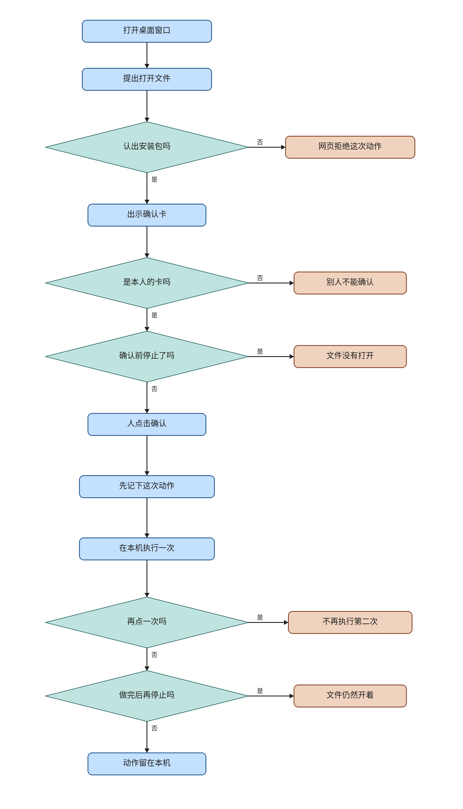

# ev-desktop

This knife adds the desktop install package. The package holds the chat window and a local executor that can open a file or run a program. The web build does not contain that executor. A local action runs only after the existing confirm claim, and only when the server recognizes this package. A `ChatRequest` that says desktop does not count.

This knife uses Electron. The plan left the packager open and suggested Electron because the Vite window can sit inside it. Tauri was not tried. This note does not say Tauri was rejected. The plan file is not edited.

The plan file and its checkboxes are untouched. Live lanes are not passed. This note does not merge or deploy. ev-desktop is the last knife in the plan, so this note does not start another one.

## What the code does

`PackageProof` can be built only by `recognize_package`. The header `X-Omni-Package` must match `DESKTOP_PACKAGE_TOKEN`. The words `desktop` and `web` are refused, including when the configured token itself is the word `desktop`. An empty token recognizes nothing. `PackageProof("desktop")` raises `TypeError`.

`ServerSurface` stays a one-member enum, `WEB = "web"`. `surface_for_login()` still returns `ServerSurface.WEB` and still takes no argument. `ChatRequest` still has no desktop field. The gateway does not import `desktop/`. `desktop.open` and `desktop.run` are not gateway tools. A web call of either name is denied as off the whitelist. A registered local tool is still denied with `服务端执行面是 web，拒绝本地工具` before execute.

The package lists the two actions in `desktop/actions.js`. `propose_local` stores a confirm claim and a card whose mode is `desktop`. The card's `surface` field is `desktop` because the proof was recognized. The web chat skips `mode === "desktop"`, so that card is not a schedule button in the web build. The buttons `打开测试文件` and `运行测试程序` live in `desktop/preload.js`. The first click proposes. A second button, `确认`, calls commit. The package token stays in the main process.

`commit_local` consumes the claim, then `arm_remote_claim` commits a request id, then the audit line records `server_surface` as `desktop`. The HTTP response is a license with `kind` `armed`. The server does not open the file. `perform` returns false unless that kind is `armed`. `confirm_local` calls `perform`, then posts finish. `finish_local` loads only a row whose action is `desktop.open` or `desktop.run`, so a calendar, mail, or errand claim is not sealed here. A second confirm sees a written claim and does not arm again, so `perform` does not run again. A claim that is still unknown, because the process died after arm and before finish, also does not open again.

`write_scope` returns `desktop:user:{id}` when the parts contain `local_target`, before the merchant and mail branches. `write_parts` for a run action rejects a string in `local_args` with `ValueError`. A string is not an empty argument list. `run_argv` uses `shell=False`.

`scripts/desktop-dev.sh` refuses an empty `DESKTOP_PACKAGE_TOKEN`, starts the Vite dev server when port 5173 is closed, and then starts Electron. Compose service names stay `postgres`, `qdrant`, `redis`, `minio`, `sandbox`, `sandbox-runner`, `eval`, `errand-compose`, `api`, `worker`, `beat`, and `nginx`. Beat schedule keys stay the three that already existed. The package tree has no Khoj name and no screen-click automation.

## Formal check

The question is whether a spoofed desktop word opens a file, whether stop before confirm opens one, whether the open happens before the claim is armed, whether a second click opens again, and whether stop after the open undoes it. That is an order of steps, so the check is TLC on a small model. The jar is the vendored `verification/tlc/tla2tools.jar`, SHA256 `e1f11b75c4b5bc4478ba0ac5cb6ae28e40a01b0016bc33e0aa97da22dfdbcd7f`, 4,510,215 bytes. `verification/tlc_jar.py` checks that pin. This knife did not download another jar.

Held run, 14 states generated, 9 distinct states, depth 5, no error. The statechart report says 9 states and 13 steps. The chart draws 9 states and 8 arrows. It hides 5 steps. Those are the `Done` stutters.

- `TypeOK`. The variables stay in their sets.
- `LieOpensNothing`. The word desktop opens nothing.
- `StopBeforeOpensNothing`. Stop before confirm opens nothing.
- `AtMostOneOpen`. The open count stays at most 1.
- `OpenAfterArm`. An opened file has a written claim.
- `RetryOpensNothing`. A second click while the claim is unknown does not open.
- `StopKeepsOpen`. Stop after the open leaves the count at 1.

TLC also checks deadlock. The held run reached no deadlock. `Done` is a stutter after a settled phase.

Broken variants, each exit 1:

- `--break-lie` violates `LieOpensNothing`.
- `--break-stop` violates `StopBeforeOpensNothing`.
- `--break-early` violates `OpenAfterArm`.
- `--break-again` violates `AtMostOneOpen`.
- `--break-keep` violates `StopKeepsOpen`.

Deleting the armed-license check in `perform` made `check.py` exit 2 with `modeling error: perform runs without an armed license`. The check was put back. The held command then exited 0. Two break flags together exit 2.

The model is one local action. It does not cover a second user, an Electron launch, or `xdg-open`. The chart is `ev-desktop-evidence/statechart/`. `/statechart` drew the held model with `TLA2TOOLS` pointed at the vendored jar. The project skill is `.cursor/skills/verify-desktop-open/SKILL.md`.

Run from the repo root:

```sh
python3 verification/desktop-open/check.py
```

`python` is not on PATH. The checker stays out of GitHub Actions.

## Operator flowchart



The main column is one local action from the install package. Side boxes are the exceptions, and the lines do not rejoin the main column. A missing package proof, another user's card, stop before confirm, a second click, and stop after the file is open each end on the side. The font is Noto Sans CJK SC, TTC index 2. Each drawn line is a whole phrase. The canvas is 1640 by 2860. The drawing script is `docs/envisioned-product/review/ev-desktop-evidence/draw_flowchart.py`.

## Tests

From `backend`, with `DATABASE_URL=sqlite+pysqlite:///./ci-eval.db`, `REDIS_ENABLED=false`, `CELERY_TASK_ALWAYS_EAGER=true`, `SANDBOX_RUNNER_URL` empty, `SECRET_KEY=test-secret-key`, and `ADMIN_PASSWORD=test-admin-pass`.

`python -m pytest tests/test_desktop_surface.py tests/test_web_blocks_local.py -q` is the plan command. This run also included `tests/test_schedule_confirm_claims.py`. The three files together exited 0. 27 passed. That is 16 in `test_desktop_surface.py`, 5 in `test_web_blocks_local.py`, and 6 in `test_schedule_confirm_claims.py`. The interpreter is `backend/.venv/bin/python`. `python` is not on PATH.

The new file uses `plain_client`. A header of `desktop` returns 403 and the claim stays open. A recognized package opens the stand-in file once. The audit line contains `"server_surface": "desktop"`. A second confirm does not open again. A second user gets 409 and the owner can still open. Stop before confirm does not open. Stop after finish does not close the file. A run starts the stand-in program once. A string in `local_args` raises `ValueError`. The tests pass a stand-in opener. They do not call `xdg-open`.

In `frontend`, `npm test` exited 0. 33 passed, 0 failed.

## Perf

One run each, in the order trunk, head, trunk, then the new file on the head. The machine had 4 cores and a load average of 0.35, 0.18, 0.07. Numbers are in `docs/envisioned-product/review/ev-desktop-evidence/perf.txt`.

| run | seconds | exit |
| --- | ---: | ---: |
| trunk `tests/test_web_blocks_local.py`, before the head | 2.200 | 0 |
| head `tests/test_web_blocks_local.py` | 1.856 | 0 |
| trunk `tests/test_web_blocks_local.py`, after the head | 1.759 | 0 |
| head `tests/test_desktop_surface.py` | 4.679 | 0 |

The cap is 60 seconds for the web-block file and 30 seconds for the new file. Both head runs are under the cap. The head web-block time sits between the two trunk times. This note does not call that a speedup. The 4.679 second desktop run is the shipped file, after one test was added. An earlier run of that file in the same order was 4.756 seconds and also exit 0. The wall clock is the pytest process. The web-block runs printed 5 passing tests. The shipped desktop file has 16. A LangGraph deprecation warning was printed and is not a failure. No profiler was attached.

## Live lanes

Deferred. Not passed. The plan boxes stay unchecked. Electron was not launched.

- Lane 1. Regression against trunk. `ev-desktop-regression.png`. Deferred.
- Lane 2. `scripts/desktop-dev.sh` answers an ordinary question. `ev-desktop-chat.png`. Deferred.
- Lane 3. Open a test file after confirm. `ev-desktop-file.png`. Deferred.
- Lane 4. Stop before the confirm click. `ev-desktop-stop.png`. Deferred.
- Lane 5. Web JSON says desktop. `ev-desktop-web.png`. Deferred.
- Lane 6. Stop after the file action finished. `ev-desktop-keep.png`. Deferred.
- Lane 7. A second user cannot confirm. `ev-desktop-identity.png`. Deferred.
- Lane 8. Two clicks run once. `ev-desktop-twice.png`. Deferred.
- Lane 9. Reload does not run the tool again. `ev-desktop-reload.png`. Deferred.
- Lane 10. Compose matches the ev-errands head, and the package has no Khoj and no screen-click automation. `ev-desktop-scope.png`. Deferred.

`ev-desktop-review-desktop.png` and `ev-desktop-review.mp4` are deferred. They were not recorded.

## Carried open items

These are not closed and not passed.

### From this knife

Anyone who has `DESKTOP_PACKAGE_TOKEN` can call `/api/desktop`. The web bundle does not contain the token. The token is one shared secret, not a per-user enrollment.

A crash after `arm_remote_claim` and before `perform` leaves the claim unknown. The next click does not open the file. The person has to propose again. `CONFIRM_DETAIL["unknown"]` still says `请先核对日历。` This knife does not change that sentence.

The window buttons propose a fixed probe path, `/tmp/ev-desktop-probe.txt` or `/usr/bin/true`. They do not yet take a path from the chat card. Lane 3's confirm card in the chat window is the unit-tested license. The Electron buttons are a separate propose-then-confirm pair for that probe.

The formal model is one action. It does not model a second user or a real `xdg-open`. `verification/desktop-open/check.py` is not in GitHub Actions. `.gitignore` does not ignore a `DesktopOpen_TTrace_*` directory. The checker writes its TLC output under a temporary directory, so this run did not leave one in the tree.

Live lanes 1 through 10, `ev-desktop-review-desktop.png`, and `ev-desktop-review.mp4` are deferred.

### From ev-errands

There is no admin page for `merchant_connectors`. App-wall phrases can match a page that is not an app wall. A crash after arm and before the wall reply leaves the errand claim unknown. `CONFIRM_DETAIL["unknown"]` still says `请先核对日历。` The errand model is one order. `verification/errand-place/check.py` is not in Actions. `.gitignore` does not ignore an `ErrandPlace_TTrace_*` directory. Live lanes for that knife stay deferred.

### From ev-mail

Inbound mail is direct delivery. The caller names the session and the delivery id. The first mail is `received` and route `filed` and opens no task. Source `internal` still dispatches. Route `held` still means ignore. Send goes through a `mail.send` claim. `external_success` is written only after a local `MailAcceptance` row exists. The provider in that knife is that local row. `gmail.py` and `gmail.readonly` were not changed. Mailto remains a link. A later network mail provider must not retry an armed id as if that local row were a remote call. HTTP mail ingest ignores the caller's `decision` and always passes `act`. `mail_entry` imports private inbox names. There is no mailbox-to-session map. `verification/mail-entry/check.py` is not in Actions. `.gitignore` does not ignore `MailEntry_TTrace_*`.

### From ev-webblock

`verification/web-block/check.py` is not in Actions. The formal model is narrow. This knife adds the recognized package beside that model. It does not add a `DESKTOP` member to `ServerSurface`. A string can still be assigned onto `ToolContext.surface` and remain on the object. Decisions go through `coerce_surface`. The router cannot select `local_probe`. `.gitignore` does not ignore `WebBlock_TTrace_*`.

### From ev-net

ev-net remains a hold, not a completion. DeepSeek `CreateChatCompletionRequest` still names no networking property. `FieldWhenAllowed` and `AbsentSkipsZhipu` stay open. This knife does not invent a field. The plan boxes for ev-net stay unchecked.

### From ev-gate and earlier

`note_external_success` is still not called from the calendar confirm HTTP path. This knife's finish path calls `finish_confirm` and does not call `note_external_success`.

ev-watch, ev-memory, ev-events, ev-plug, ev-stop, ev-dispatch, and ev-work residuals stay open. Task-watch, memory-ledger, EventInbox, UnknownWrite, DispatchBoundary, and WorkLoop are not in Actions. SweepLedger is in-process. The watch clock is `created_at`. Discard edits the original memory row. A direct remember that omits generation still extracts. Pulse is a fixed Friday slot. `list_memories` missing a user id still maps to 1. Naming a completed generation in `open_alongside` may open another running task beside one still running. There is no separate `waiting_resource` test. `load_runs` reads all historical rows. Production tools do not construct `ToolResult.unknown_write`. The real unknown result remains the HTTP confirm path. `test_work_loop` and eval `run_task` can still omit `task_id`. A failed credential publish may still leak a confirm sentence. The ReadDone `direct_answer` short-circuit remains. Disconnect does not wait for the worker thread. `stream_chat` returning on its own may flush a fragment buffered before stop.

## Decision log

`.audit/ev-desktop.tsv`
