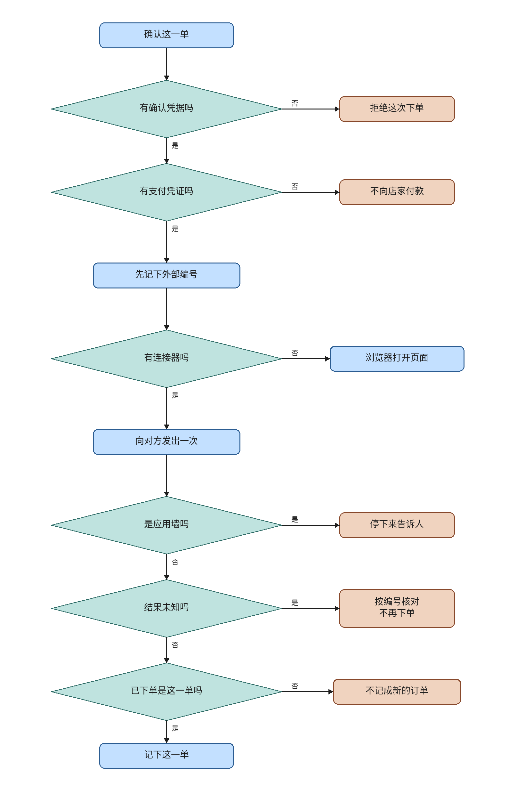

# ev-errands

This knife adds an errand plug. A connector row calls that shop once. No row calls a separate Compose browser service. Login, payment, and the send wait for an `errand.place` claim, or they read a vault the model cannot read. This knife chooses the Playwright Python sync API, Chromium only, for that service. The plan did not choose a library. The choice is recorded here and in the service docstring. The plan file is not edited.

The plan file and its checkboxes are untouched. Live lanes are not passed. This note does not merge or deploy, and it does not start ev-desktop.

## What the code does

This knife's channel decision is a connector row or the compose service. `propose_errand` shows a confirm card and inserts no `ErrandRecord`. `commit_errand` refuses an empty token with `缺少确认，未写入。` before it reads the vault or calls a shop. A missing pay secret rolls the session back before `arm_remote_claim` and says `没有可用的支付凭证，未支付。` The claim stays open. After the secret is present, `arm_remote_claim` commits a remote id and marks the claim unknown, then one HTTP call goes out. A connector row posts `place_url` with `Idempotency-Key`. No row posts the compose service at `/tasks`.

`interpret` treats `已下单` as this order only when the reply also carries this armed id. A page that only says `已下单` does not insert a row and does not place again. An unknown reply calls `decide_replay` and then looks up by that id. It does not call `settle_unknown`. A second click does not place again.

An app wall before a pay click calls `reopen_known_rejection` and says `这家店只能在 App 里下单，已停止。` A pay click that already happened stays unknown. `public_start_url` returns `https://{host}/` only for a dotted public hostname. It refuses an IP, localhost, `.local`, `.internal`, and `metadata.google.internal`. The compose task includes that URL only when the function returns one.

`Secret` hides its value from `str`, `repr`, and `format`. The vault stores login and pay with a Fernet key that is not the calendar key. The proposal card and the commit response do not echo the secret. `decide` returns `已下单` as the told text for a matched page and does not return the page HTML.

`_save` inserts `ErrandRecord` and then `finish_confirm`. It does not call `note_external_success`. The calendar confirm path still seals with `finish_confirm` and still does not call `note_external_success`. `CONFIRM_DETAIL["unknown"]` still says `请先核对日历。` This knife leaves that sentence as it is.

The browser image is `services/errand-compose`. Compose names it `errand-compose`. It is not in the api image, the web image, or a desktop package. `backend/requirements.txt` does not list Playwright. The service accepts `place` and `lookup`. Lookup does not click. An app-wall phrase is decided before `已下单`, and only when pay has not been clicked. Each task uses its own browser context.

`write_parts` for `errand.place` returns `ErrandOrder.claim_parts()`. When `merchant_key` is present, `write_scope` returns `errand:user:{id}:merchant:{merchant_key}`. There is no fifth router tool. Existing Compose services keep their duties.

## Formal check

The question is whether one order places once, whether a missing token or pay secret pays, whether success can precede the record, whether a second click places again, whether a bare `已下单` page becomes the record, whether an app wall clicks, and whether stop deletes the record. That is an order of steps, so the check is TLC on a small model. The jar is the vendored `verification/tlc/tla2tools.jar`, SHA256 `e1f11b75c4b5bc4478ba0ac5cb6ae28e40a01b0016bc33e0aa97da22dfdbcd7f`, 4,510,215 bytes. `verification/tlc_jar.py` checks that pin. This knife did not download another jar.

Held run, 19 states generated, 12 distinct states, depth 5, no error. The statechart report says 12 states and 18 steps. The chart draws 12 states and 11 arrows. It hides 7 steps. Those are the `Done` stutters.

- `TypeOK`. The variables stay in their sets.
- `AtMostOnePlace`. `places` stays at most 1.
- `BareWritesNothing`. An empty token does not place.
- `UnpaidWritesNothing`. A missing pay secret does not place.
- `SuccessAfterRecord`. A written claim has the acceptance row.
- `UnnamedIsNotOrder`. A page that says `已下单` without this armed id is not the record.
- `WallDoesNotClick`. An app wall does not click.
- `StopKeepsRecord`. Stop after acceptance still has the row.

TLC also checks deadlock. The held run reached no deadlock. `Done` is a stutter after a settled phase.

Broken variants, each exit 1:

- `--break-bare` violates `BareWritesNothing`.
- `--break-unpaid` violates `UnpaidWritesNothing`.
- `--break-success` violates `SuccessAfterRecord`.
- `--break-again` violates `AtMostOnePlace`.
- `--break-seen` violates `AtMostOnePlace`.
- `--break-page` violates `UnnamedIsNotOrder`.
- `--break-wall` violates `WallDoesNotClick`.
- `--break-stop` violates `StopKeepsRecord`.

Deleting the empty-token refusal in `commit_errand` made `check.py` exit 2 with `modeling error: commit without a token is not refused`. The refusal was put back. The held command then exited 0. Two break flags together exit 2.

The model is one order. It does not cover a second user, a real Chromium launch, a network shop, or the calendar confirm route. The chart is `ev-errands-evidence/statechart/`. `/statechart` drew the held model with `TLA2TOOLS` pointed at the vendored jar.

Run from the repo root:

```sh
python3 verification/errand-place/check.py
```

`python` is not on PATH.

## Operator flowchart



The main column is one confirmed order. Side boxes are the exceptions, and the lines do not rejoin the main column. The no-connector box is the blue side box. The wall, the unknown result, and a mismatched `已下单` are drawn on the main column after the one send. In the code those three outcomes come back from either channel. The chart does not draw a second column for the browser. The font is Noto Sans CJK SC, TTC index 2. Each drawn line is a whole phrase. The canvas is 1640 by 2480. The drawing script is `docs/envisioned-product/review/ev-errands-evidence/draw_flowchart.py`.

## Tests

From `backend`, with `DATABASE_URL=sqlite+pysqlite:///./ci-eval.db`, `REDIS_ENABLED=false`, `CELERY_TASK_ALWAYS_EAGER=true`, `SANDBOX_RUNNER_URL` empty, `SECRET_KEY=test-secret-key`, and `ADMIN_PASSWORD=test-admin-pass`.

`python -m pytest tests/test_errands.py tests/test_tool_contract.py -q` exited 0. 27 passed. That is 11 in `test_errands.py` and 16 in `test_tool_contract.py`. The interpreter is `backend/.venv/bin/python`. `python` is not on PATH.

The new file uses `plain_client`. A connector commit calls the shop once and does not call the compose service. An empty token returns `缺少确认，未写入。` and does not echo a planted secret. An app wall posts one compose task of kind `place` and zero shop calls. A timeout, then a second click, does not increase the place count. A lookup page that says `已下单` without this armed id does not insert. A lookup that echoes the armed id returns that order and does not place again. A missing pay secret does not charge, and the claim stays open. A second user cannot commit the first user's open claim. A stopped generation does not place.

In `frontend`, `npm test` exited 0. 33 passed. `ErrandCard` has the confirm button and does not render a password field.

## Perf

One run each, in the order trunk, head, trunk, then the new file on the head. The machine had 4 cores and a load average of 0.06, 0.08, 0.04. Numbers are in `docs/envisioned-product/review/ev-errands-evidence/perf.txt`.

| run | seconds | exit |
| --- | ---: | ---: |
| trunk `tests/test_tool_contract.py`, before the head | 5.564 | 0 |
| head `tests/test_tool_contract.py` | 4.425 | 0 |
| trunk `tests/test_tool_contract.py`, after the head | 4.424 | 0 |
| head `tests/test_errands.py` | 9.562 | 0 |

The cap is 60 seconds for the contract file and 30 seconds for the new file. Both head runs are under the cap. The first trunk run is the cold one. The second trunk run matches the head. This note does not call that a speedup. The wall clock is the pytest process. The contract runs printed 16 passing dots. The new file printed 11. A LangGraph deprecation warning was printed and is not a failure. No profiler was attached.

## Live lanes

Deferred. Not passed. The plan boxes stay unchecked.

- Lane 1. Regression against trunk. `ev-errands-regression.png`. Deferred.
- Lane 2. One connector errand after confirm. `ev-errands-api.png`. Deferred.
- Lane 3. No connector, the server browser handles it. `ev-errands-browser.png`. Deferred.
- Lane 4. Cancel the payment card. `ev-errands-pay.png`. Deferred.
- Lane 5. Unknown result, then click again. `ev-errands-unknown.png`. Deferred.
- Lane 6. An app-only wall. `ev-errands-wall.png`. Deferred.
- Lane 7. Stop before the confirm click. `ev-errands-stop.png`. Deferred.
- Lane 8. A second user cannot confirm the first user's errand. `ev-errands-identity.png`. Deferred.
- Lane 9. Reload during an open payment card. `ev-errands-reload.png`. Deferred.
- Lane 10. No cloud-phone client and no Khoj. `ev-errands-scope.png`. Deferred.

`ev-errands-review-errand.png` and `ev-errands-review.mp4` are deferred. They were not recorded.

## Carried open items

These are not closed and not passed.

### From this knife

There is no admin page for `merchant_connectors`. Tests insert the row. Who may insert one in production is open. The connector row has no secret column. A connector API key is not a vault kind.

App-wall phrases can match a page that is not an app wall. A crash after `arm_remote_claim` and before the wall reply leaves the claim unknown. The next click looks up, finds nothing, and shows the unknown sentence. The common path tells the person on the first reply and reopens.

`CONFIRM_DETAIL["unknown"]` still says `请先核对日历。` on an errand retry. This knife does not change that sentence.

The formal model is one order. It does not model a second user, a real Chromium launch, or a network shop. `verification/errand-place/check.py` is not in GitHub Actions. `.gitignore` does not ignore an `ErrandPlace_TTrace_*` directory. The checker writes its TLC output under a temporary directory, so this run did not leave one in the tree.

Live lanes 1 through 10, `ev-errands-review-errand.png`, and `ev-errands-review.mp4` are deferred.

### From ev-mail

Inbound mail is direct delivery. The caller names the session and the delivery id. The first mail is `received` and route `filed` and opens no task. Source `internal` still dispatches. Route `held` still means ignore. Send goes through a `mail.send` claim. `external_success` is written only after a local `MailAcceptance` row exists. The provider in that knife is that local row. `gmail.py` and `gmail.readonly` were not changed. Mailto remains a link. A later network mail provider must not retry an armed id as if that local row were a remote call. HTTP mail ingest ignores the caller's `decision` and always passes `act`. `mail_entry` imports private inbox names. There is no mailbox-to-session map. `verification/mail-entry/check.py` is not in Actions. `.gitignore` does not ignore `MailEntry_TTrace_*`.

### From ev-webblock

`verification/web-block/check.py` is not in Actions. The formal model is narrow. There is no recognized install package, so a real desktop allow waits for ev-desktop. A string can be assigned onto `ToolContext.surface` and remain on the object. Decisions go through `coerce_surface`. The router cannot select `local_probe`. `.gitignore` does not ignore `WebBlock_TTrace_*`.

### From ev-net

ev-net remains a hold, not a completion. DeepSeek `CreateChatCompletionRequest` still names no networking property. `FieldWhenAllowed` and `AbsentSkipsZhipu` stay open. This knife does not invent a field. The plan boxes for ev-net stay unchecked.

### From ev-gate and earlier

`note_external_success` is still not called from the calendar confirm HTTP path. This knife's own send does not call it either. `ErrandRecord` is the acceptance row, and `_save` ends at `finish_confirm`.

ev-watch, ev-memory, ev-events, ev-plug, ev-stop, ev-dispatch, and ev-work residuals stay open. Task-watch, memory-ledger, EventInbox, UnknownWrite, DispatchBoundary, and WorkLoop are not in Actions. SweepLedger is in-process. The watch clock is `created_at`. Discard edits the original memory row. A direct remember that omits generation still extracts. Pulse is a fixed Friday slot. `list_memories` missing a user id still maps to 1. Naming a completed generation in `open_alongside` may open another running task beside one still running. There is no separate `waiting_resource` test. `load_runs` reads all historical rows. Production tools do not construct `ToolResult.unknown_write`. The real unknown result remains the HTTP confirm path, and this knife uses `decide_replay` on that path. `test_work_loop` and eval `run_task` can still omit `task_id`. A failed credential publish may still leak a confirm sentence. The ReadDone `direct_answer` short-circuit remains. Disconnect does not wait for the worker thread. `stream_chat` returning on its own may flush a fragment buffered before stop.

## Decision log

`.audit/ev-errands.tsv`
