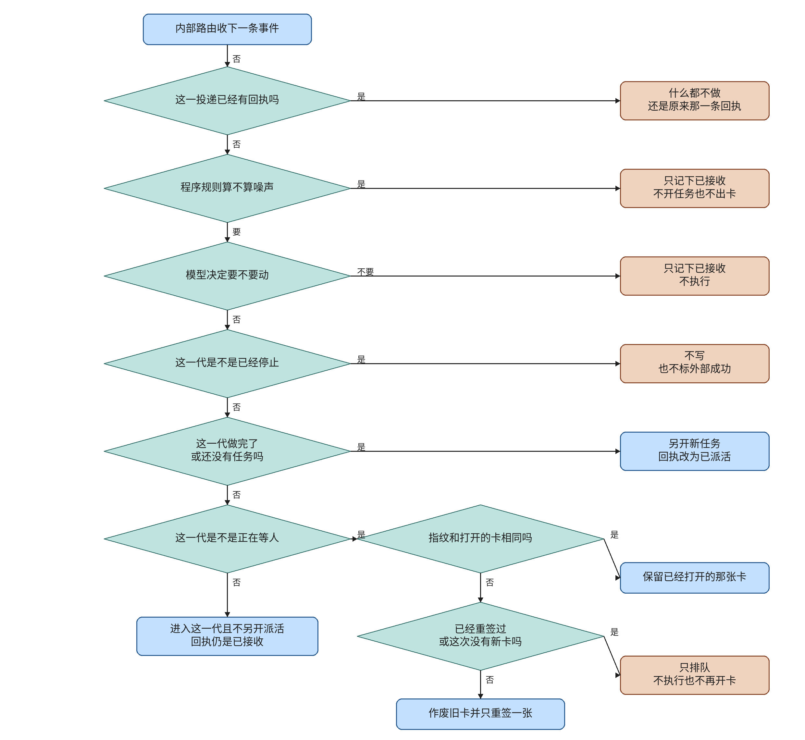

# ev-events

This knife adds an event inbox. One user, source, and delivery id is one receipt. The receipt is `received` when it arrives, `dispatched` when a new task is opened, and `external_success` only after a write the other side accepted. Noise is dropped by program rules before the model decision. A running or `waiting_resource` generation keeps that generation. A completed generation opens a new task. A stopped generation stores the receipt and writes nothing. While a generation is `waiting_person`, the same fingerprint keeps the open claim, a different fingerprint with a new card voids that claim and binds one card, and a later different event only queues.

The plan file and its checkboxes are untouched. Live lanes are not passed. This note does not merge or deploy, and it does not start ev-memory. The ev-net hold on `b5a1fd471e33d4a51023a2704472656cc2c41957` is unchanged.

## What the code does

`POST /api/events/inbox` calls `submit_event` for the signed-in user. The sources are `internal` and `mail`. `search_meeting_mail` stays a read. It does not submit an event.

`submit_event` returns the stored row when `(user_id, source, delivery_id)` already exists. A bounce, unsubscribe, noreply, delivery status, auto reply, or empty body is stored as `received` with route `noise`. A decision of `ignore` is stored as `received` with route `held`. A decision of `act` routes from the task:

- `stopped` stores `received` and route `stopped`. It does not open a task, a card, or `external_success`.
- `completed`, and no matching task, call `open_alongside`. The receipt is `dispatched` and route `opened`. `open_alongside` does not stop a generation that is already running.
- `waiting_person` keeps a matching fingerprint, reissues once when a card is present and this generation has no `reissued` receipt, and otherwise queues.
- `running` and `waiting_resource` store `received` and route `passthrough` on that generation.

When the caller omits `generation`, a `waiting_person` row is chosen before a `running` or `waiting_resource` row. Naming a completed generation opens a new task even if another generation in the session is still running.

`_insert` refuses `state="external_success"`. `note_external_success` updates that state only when the receipt's claim is `written` and `remote_request_id` matches. A second call with the same id returns the same receipt.

The table is `event_receipts` in Alembic revision `0014_event_receipt`. Revision `0013_claim_remote_request` was already on this release. PostgreSQL rows are limited to `app.current_user_id`. Another user's delivery id is a separate receipt.

## Formal check

The checker anchors were confirmed at `acf29b7ec17298604eb7f1f68970380ae2a47eb9`. The question is whether these steps can store two receipts, mark success on arrival, write a stopped generation, reuse a completed generation, open a second card, or open a new dispatch for a running generation. That is an order of steps, so the check is TLC on a small model. The jar is the vendored `verification/tlc/tla2tools.jar`, SHA256 `e1f11b75c4b5bc4478ba0ac5cb6ae28e40a01b0016bc33e0aa97da22dfdbcd7f`, 4,510,215 bytes, manifest `2.0 2026-11-06`, revision `d8fb231de4e4b5d02c1b2ed1ac759c086f694021`.

Held run, 126 states generated, 81 distinct states, no error:

- `TypeOK`. The variables stay in their sets.
- `OneReceipt`. A delivery is stored at most once.
- `ReceiveIsNotSuccess`. Success implies a write the other side accepted.
- `StoppedWritesNothing`. A stopped route has no card, no new generation, and no success.
- `CompletedNotReused`. An opened route after a completed aim uses a new generation.
- `OneCard`. At most one write card is open.
- `QueueStaysOne`. A queued route keeps that one card and does not mark success.
- `PassthroughStays`. A passthrough route does not open a generation.

TLC also checks deadlock. The held run reached no deadlock.

Broken variants, each exit 1:

- `--break-dedupe` violates `OneReceipt`. `Repeat` stores the delivery again.
- `--break-stopped` violates `StoppedWritesNothing`. `RefuseStopped` opens a card and a generation.
- `--break-reuse` violates `CompletedNotReused`. `OpenAfterCompleted` reuses `gen`.
- `--break-second` violates `OneCard`. `Later` opens a second card.
- `--break-success` violates `ReceiveIsNotSuccess`. A receive marks success before any write.
- `--break-pass` violates `PassthroughStays`. `Passthrough` opens a generation.

Removing `if existing is not None:` from `submit_event` made `check.py` exit 2 with `modeling error: submit lost the delivery dedupe`. The line was put back. The held command then exited 0. That scratch output is `ev-events-evidence/tlc-scratch.txt`.

The model is one user and one delivery, with at most one later event and one repeat. A waiting generation starts with one open card. It does not model a second user, a mail fetch, the calendar HTTP call, a crash between the claim commit and the request, or a waiting generation that has no card. The chart is `ev-events-evidence/statechart/`. TLC reached 81 states. The chart draws 16 states and 29 arrows. It hides 75 steps that stay inside one chart state.

Run from the repo root:

```sh
python verification/event-inbox/check.py
```

`/statechart` drew the held model with `TLA2TOOLS` pointed at the vendored jar.

## Operator flowchart



The main column is one delivery. Side boxes are the exceptions, and the lines do not rejoin the main column. The font is Noto Sans CJK SC. Each line is a whole phrase. The drawing script is `docs/envisioned-product/review/ev-events-evidence/draw_flowchart.py`.

## Tests

From `backend`, with `DATABASE_URL=sqlite+pysqlite:///./ci-eval.db`, `REDIS_ENABLED=false`, `CELERY_TASK_ALWAYS_EAGER=true`, `SANDBOX_RUNNER_URL` empty, `SECRET_KEY=test-secret-key`, and `ADMIN_PASSWORD=test-admin-pass`.

`python -m pytest tests/test_event_inbox.py tests/test_claim_fingerprint.py -q` exited 0. The run collected 25 tests: 14 inbox and 11 fingerprint. Output is `docs/envisioned-product/review/ev-events-evidence/unit.txt`.

The inbox tests use `plain_client`. They cover one receipt for two submits, passthrough into the same generation, a completed generation opening a new one, a stopped generation writing nothing, one reissued card, a later event that only queues, a repeated delivery while waiting, noise, ignore, a second user, and external success. An anonymous submit is rejected with 401. The source allow list is `internal` and `mail`. A `slack` submit is rejected with 422.

## Perf

One run each. Numbers are in `docs/envisioned-product/review/ev-events-evidence/perf.txt`.

| run | seconds | exit |
| --- | ---: | ---: |
| trunk `test_chat_sse_routing.py`, before the head | 4.521 | 0 |
| head `test_chat_sse_routing.py` | 4.358 | 0 |
| trunk `test_chat_sse_routing.py`, after the head | 4.282 | 0 |
| head `test_event_inbox.py` | 5.786 | 0 |

The head routing run is under 60 seconds. The head inbox run is under 30 seconds. The two trunk runs differ by 0.239 seconds. The head routing run is 0.163 seconds under the first trunk run.

## Live lanes

Lanes 1 through 10 are deferred. `ev-events-review-reissue.png` and `ev-events-review.mp4` were not produced.

## Carried open items

These are not closed and not passed.

From ev-net:

- `FieldWhenAllowed` and `AbsentSkipsZhipu` fail and stay findings. There is no 「上网」 switch. A turn can still hit Zhipu `/web_search` when 「上网」 is absent.
- The plan unit, You see, and live boxes for ev-net are unfulfilled. Live lanes and `ev-net-review-web.png` / `ev-net-review.mp4` are deferred.
- The new ev-net tests and `check.py` anchors lock the hold. A real cutover has to change them together.
- `verification/one-web-path/check.py` is not in GitHub Actions. `.gitignore` does not ignore `OneWebPath_TTrace_*`. The cutover evidence trace only shows `FieldWhenAllowed`. The formal model is narrow. The flowchart has two unlabeled "no" branches.

From ev-plug:

- An empty 403 is still a definite rejection. A retry could insert a second event if that response had stored one.
- `FollowupCard` still reads the root phase, so the button may look clickable after refresh while the server rejects a second insert.
- A crash after the arm commit and before the request leaves leaves the claim unknown, and it cannot be resent.
- Update, delete, and RSVP after unknown do not reconcile and seal the way create does.
- There is no UnknownWrite Actions workflow.
- Live lanes for that knife were not run.

From ev-stop:

- `verification/stop-before-send/check.py` is not in GitHub Actions.
- The formal `CalendarStays` model is weak.
- Disconnect only calls `wf_task.cancel()` and does not wait for the worker thread.
- After stop, `chat.py` may still infer and yield an artifact from text already received, and `finally` always sends `done`.
- If `stream_chat` returns on stop without raising `GenerationStopped`, `leave_stream` may stay false and flush fragments already accepted into the desensitization buffer.
- Dispatch, tiered-cache shortcuts, and Redis hits still do not read the stop bit.

From ev-dispatch:

- `verification/dispatch-boundary/check.py` is not in GitHub Actions.
- The formal anchors start after `def assign_turn(`, so they miss `from_plan`. The eval `run_task` is not anchored.
- A low-confidence queue can still enter the work graph. That is the existing routing.

From ev-work:

- `verification/work-loop/check.py` is not in GitHub Actions.
- The formal model is one generation. It has no second user, no allow list, no `verify_state`, no confirm click, and no empty 403. A stop that flips true during `gateway.invoke` may still enter that call.
- Production tools do not construct `ToolResult.unknown_write`. Calendar tools remain `effect=read` and only emit a draft card. Real unknown writes still live on the ev-plug HTTP confirm path.
- `tests/test_work_loop.py` and the eval `run_task` still may omit `task_id` and `generation`, so those paths skip the allow list and may skip stop.
- If claim publish fails with `ScheduleConfirmClosed`, `chat.py` drops the card and may still send the confirm sentence in `direct_answer`.
- The old `if state.get("direct_answer")` short-circuit in `reflect_node` remains on the ReadDone path, so a later queued sandbox after a read that already set `direct_answer` may still not run.

From this knife:

- `verification/event-inbox/check.py` is not in GitHub Actions.
- The model does not cover a second user, a mail fetch, or the calendar HTTP call.
- A waiting generation with no card is outside the model. In the code, a missing card queues and does not void the open claim.
- Naming a completed generation opens a new task beside a generation that is still running, because `open_alongside` does not stop it.

## Decision log

`.audit/ev-events.tsv` records the choices above.
