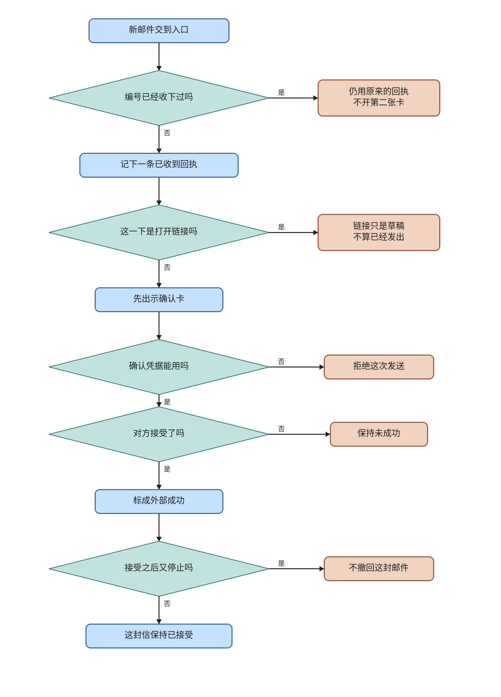

# ev-mail

This knife adds a mail entry. A new message is filed in the event inbox with source `mail` and a delivery id. A real send waits for a schedule-confirm claim, and `external_success` is written only after the acceptance row exists. The follow-up mailto link still opens a draft. `search_meeting_mail` stays the read-only meeting-prep search.

The plan file and its checkboxes are untouched. Live lanes are not passed. This note does not merge or deploy, and it does not start ev-errands or ev-desktop.

## What the code does

This knife's collection decision is direct delivery. An authenticated caller names the session and the delivery id and posts `source` `mail` to `POST /api/events/inbox`. The server does not poll Gmail and does not subscribe. The plan left push, a timed read, and any other way unset. This note records the choice. It does not edit the plan.

`receive` calls `submit_event` with source `mail` and decision `act`. A delivery id that starts with `out:` is rejected. For source `mail`, `_open_task` stores state `received` and route `filed` and does not call `open_alongside`. Source `internal` with decision `act` and no live task still stores `dispatched` and route `opened` and inserts one running `TaskRun`. A repeated user, source, and delivery id returns the stored receipt and keeps the first body.

While a task is `waiting_person`, the inbox rules are unchanged. The same fingerprint keeps the open claim. A different fingerprint with a calendar card cancels the open claims and reissues one card. A later different event, or a mail body with no card, only queues. `_CARD_MODE` stays the four calendar actions. `mail.send` is not one of them.

`propose_send` shows a confirm card and inserts no `MailAcceptance` row. The outbound delivery id is `out:` plus the fingerprint of `mail_to`, subject, and body. The client does not choose that id. The claim action is `mail.send`. `write_scope` keeps its signature. When the parts contain `mail_to`, the scope is `mail:user:{id}`. Calendar parts do not contain `mail_to`, so calendar scopes stay as they are. If the session has no live task, `propose_send` uses `insert_card_action` so the claim has a generation. A live task is passed through `live_task_ids_for_session`.

`commit_send` refuses an empty token with `缺少确认，未写入。` before it touches the provider. On an open claim the order is `consume_schedule_claim`, `arm_remote_claim`, insert one `MailAcceptance` row, `finish_confirm`, then `note_external_success`. The row is the provider. This knife does not call Google. If the claim is already armed and the row is missing, the next commit inserts that one row and then seals. A second commit does not insert again. `external_success` is written only after the claim is `written` and the remote id matches.

Stop does not delete `MailAcceptance` and does not add a mail branch. Once `arm_remote_claim` has committed, stop already leaves the claim alone.

The mailto control in `FollowupCard` is still an anchor with no `onClick`. `mailtoHref` still builds a URL. A new `发送` button calls `POST /api/mail/proposal` and reloads the session. `MailSendCard` renders mode `send`. Its `确认发送` button calls `POST /api/mail/send`. `ChatWindow` keeps mode `send` off `ScheduleCard`. After success, `finish_confirm` stamps the card phase `confirmed`, and the confirm button is not shown.

`note_external_success` is still not called from the calendar confirm HTTP path. `gmail.py` is unchanged. `GOOGLE_MAIL_SCOPES` is still the one `gmail.readonly` scope. The gmail and outlook plugin bodies were not read. `server/email/host.ts` was not read. The same-level idea is the `mail.send` action beside the calendar actions on the existing claim path.

## Formal check

The question is whether one delivery stays one receipt, whether a send without a token accepts, whether success can precede the acceptance row, whether stop deletes that row, and whether opening the link counts as a send. That is an order of steps, so the check is TLC on a small model. The jar is the vendored `verification/tlc/tla2tools.jar`, SHA256 `e1f11b75c4b5bc4478ba0ac5cb6ae28e40a01b0016bc33e0aa97da22dfdbcd7f`, 4,510,215 bytes. `verification/tlc_jar.py` checks that pin. This knife did not download another jar.

Held run, 17 states generated, 10 distinct states, depth 6, no error. The statechart report says 10 states and 16 steps. The chart draws 9 states and 10 arrows. It hides 6 steps. Those are the `Done` stutters.

- `TypeOK`. The variables stay in their sets.
- `OneReceipt`. A delivery id stays at one receipt.
- `BareWritesNothing`. A refused commit does not accept and does not succeed.
- `SuccessAfterAccept`. Success implies the acceptance row.
- `StopKeepsAccepted`. A stopped send still has the row.
- `LinkIsNotSend`. The link phase is not success.

TLC also checks deadlock. The held run reached no deadlock. `Done` is a stutter after a settled phase.

Broken variants, each exit 1:

- `--break-dedupe` violates `OneReceipt`.
- `--break-bare` violates `BareWritesNothing`.
- `--break-success` violates `SuccessAfterAccept`.
- `--break-stop` violates `StopKeepsAccepted`.
- `--break-link` violates `LinkIsNotSend`.

Deleting the empty-token refusal in `commit_send` made `check.py` exit 2 with `modeling error: commit without a token is not refused`. The refusal was put back. The held command then exited 0.

The model is one delivery id and one draft. It does not cover a second user, a waiting-person reissue, a Gmail network send, or the calendar confirm route. The chart is `ev-mail-evidence/statechart/`. `/statechart` drew the held model with `TLA2TOOLS` pointed at the vendored jar.

Run from the repo root:

```sh
python verification/mail-entry/check.py
```

## Operator flowchart



The main column is one new message, then a confirmed send. Side boxes are the exceptions, and the lines do not rejoin the main column. The font is Noto Sans CJK SC, TTC index 2. Each drawn line is a whole phrase. The canvas is 1640 by 2280. The drawing script is `docs/envisioned-product/review/ev-mail-evidence/draw_flowchart.py`.

## Tests

From `backend`, with `DATABASE_URL=sqlite+pysqlite:///./ci-eval.db`, `REDIS_ENABLED=false`, `CELERY_TASK_ALWAYS_EAGER=true`, `SANDBOX_RUNNER_URL` empty, `SECRET_KEY=test-secret-key`, and `ADMIN_PASSWORD=test-admin-pass`.

`python -m pytest tests/test_mail_entry.py tests/test_gmail_meeting_query.py tests/test_event_inbox.py -q` exited 0. 42 passed. That is 17 in `test_mail_entry.py`, 14 in `test_event_inbox.py`, and 11 in `test_gmail_meeting_query.py`. The interpreter is `backend/.venv/bin/python`. `python` is not on PATH.

The new file uses `plain_client`. A new message is state `received` and route `filed` and opens no task. The same delivery id keeps the first body. A second user gets 404 on the first session's messages and 404 posting into that session. Same fingerprint keeps the card. A different fingerprint reissues one. A later different event only queues. A proposal writes no acceptance row. A commit with no token writes nothing. A body that contains `mailto:` stays `received`. A commit after the claim inserts one acceptance row and the receipt becomes `external_success`. An armed claim with no row, then commit, inserts one row. Stop leaves that row.

In `frontend`, `npm test` exited 0. 31 passed. The mailto control stays an anchor and does not send.

## Perf

One run each, in the order trunk, head, trunk, then the new file on the head. The machine had 4 cores and a load average of 0.28. Numbers are in `docs/envisioned-product/review/ev-mail-evidence/perf.txt`.

| run | seconds | exit |
| --- | ---: | ---: |
| trunk `tests/test_gmail_meeting_query.py`, before the head | 1.791 | 0 |
| head `tests/test_gmail_meeting_query.py` | 1.679 | 0 |
| trunk `tests/test_gmail_meeting_query.py`, after the head | 1.684 | 0 |
| head `tests/test_mail_entry.py` | 6.596 | 0 |

The cap is 60 seconds for the meeting-query file and 30 seconds for the new file. Both head runs are under the cap. The trunk spread is 0.107 seconds, and the head is 0.112 seconds under the first trunk run. This note does not call that a speedup. The wall clock is the pytest process. The meeting-query runs printed 11 passing dots. The new file exited 0. A LangGraph deprecation warning was printed and is not a failure.

## Live lanes

Deferred. Not passed. The plan boxes stay unchecked.

- Lane 1. Regression against trunk. `ev-mail-regression.png`. Deferred.
- Lane 2. One inbound test message and one `received` receipt. `ev-mail-in.png`. Deferred.
- Lane 3. The same message id again. `ev-mail-dupe.png`. Deferred.
- Lane 4. The follow-up mailto link opens a draft and the receipt is not `external_success`. `ev-mail-mailto.png`. Deferred.
- Lane 5. The real send control before confirm shows the confirm card and does not send. `ev-mail-send.png`. Deferred.
- Lane 6. Confirm the send, then stop. A message the provider already accepted remains sent. `ev-mail-stop.png`. Deferred.
- Lane 7. A second user cannot read the first user's mail event. `ev-mail-identity.png`. Deferred.
- Lane 8. A different fingerprint while a confirm card is open reissues one card. `ev-mail-reissue.png`. Deferred.
- Lane 9. Reload keeps the message and does not add a second receipt. `ev-mail-reload.png`. Deferred.
- Lane 10. The diff adds no WeChat, Telegram, Slack, or Khoj client. `ev-mail-scope.png`. Deferred.

`ev-mail-review-mail.png` and `ev-mail-review.mp4` are deferred. They were not recorded.

## Carried open items

These are not closed and not passed.

### From this knife

The provider is the local `MailAcceptance` row. `GOOGLE_MAIL_SCOPES` stays `gmail.readonly`. A later network provider must not retry an armed id as if the local insert were a remote call. This knife does not build that provider.

There is no mailbox-to-session map. A later collector has to name the session. This knife does not build that map.

`mail_entry` imports `_file_unrouted`, `_bind_mail_claim`, `_existing`, and `_require_session` from the inbox. Those names are private. The inbox still owns the receipt row.

The formal model is one delivery and one draft. It does not model a second user or a waiting-person reissue. `verification/mail-entry/check.py` is not in GitHub Actions. `.gitignore` does not ignore a `MailEntry_TTrace_*` directory. The checker writes its TLC output under a temporary directory, so this run did not leave one in the tree.

Live lanes 1 through 10, `ev-mail-review-mail.png`, and `ev-mail-review.mp4` are deferred.

### From ev-webblock

`ServerSurface` has only `WEB` and is not a `str` enum. `ChatRequest` stays five fields. `invoke` denies a local spec before execute with `服务端执行面是 web，拒绝本地工具`. `shell` still fails the whitelist. `local_probe` is test-only. `verification/web-block/check.py` is not in Actions. The formal model is one round. `.gitignore` does not ignore `verification/web-block/WebBlock_TTrace_*`. `surface_for_login` does not read the user. There is still no recognized install package. A string can be assigned onto `ToolContext.surface` and remain on the object, but decisions and audit words go through `coerce_surface`. The router cannot select `local_probe`. Live lanes are deferred.

### From ev-net

ev-net remains a hold, not a completion. DeepSeek `CreateChatCompletionRequest` still names no networking property. `FieldWhenAllowed` and `AbsentSkipsZhipu` stay open. The production request body and Zhipu search were not changed. The 「上网」 switch is not landed. The plan boxes stay unchecked.

### From ev-gate and earlier

`note_external_success` is still not called from the calendar confirm HTTP path.

ev-watch, ev-memory, ev-events, ev-plug, ev-stop, ev-dispatch, and ev-work residuals stay open. Task-watch, memory-ledger, EventInbox, UnknownWrite, DispatchBoundary, and WorkLoop are not in Actions. `open_alongside` may open another running task beside one still running. An empty 403 is still a definite rejection. FollowupCard calendar buttons may still look clickable after refresh. An arm crash before a calendar request leaves the outcome unknown. Stop may not wait for the worker thread. Occasional artifact or done SSE may follow stop. `stream_chat` may flush a buffered fragment on an early return. A low-confidence queue can still enter the work graph. `test_work_loop` and eval `run_task` may omit `task_id`. A credential publish failure may still leak a confirm sentence. The ReadDone `direct_answer` short-circuit remains. Production tools do not currently construct `ToolResult.unknown_write`.

## Decision log

`.audit/ev-mail.tsv`
