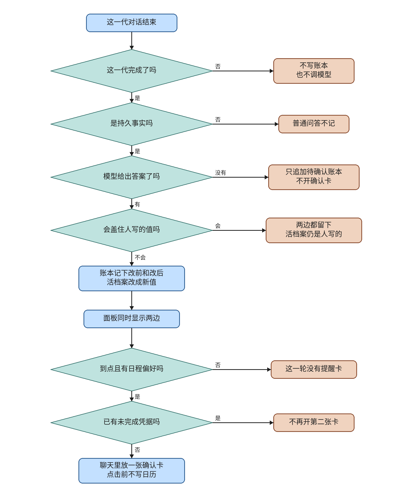

# ev-memory

This knife appends a memory change ledger and pushes a schedule reminder through the existing confirm claim. Overwrite of the live profile becomes one ledger row with source, actor, before, after, and pending. A low-confidence extract writes that row and opens no card. A generation that is not completed does not call the model and does not append a row. A second pulse of the same fingerprint adds no claim.

The plan file and its checkboxes are untouched. Live lanes are not passed. This note does not merge or deploy, and it does not start ev-watch. The ev-net hold is unchanged. `note_external_success` is still not called from the calendar confirm HTTP path.

## What the code does

`MemoryLedger` is table `memory_ledger` in Alembic revision `0015_memory_ledger`. `0014_event_receipt` stays the event inbox. PostgreSQL rows are limited to `app.current_user_id`. SQLite skips that policy. `_commit_change` is the only assignment to `MemoryItem.content` and the only live delete.

`decide_apply` returns false when the extract origin is `PLANNER_FAILED`, and when the incoming actor is `turn` while the latest applied actor is `person`. Every other write, including every person write, becomes the live value. A held-back write inserts a pending row and leaves the live row. A later person write does not discard that pending sibling. `settle_pending` can restore that statement or discard it. A second settle inserts nothing.

`remember_from_turn` returns 0 before `extract_for_ledger` when `generation` is set and `status` is not `completed`. A repeated completed generation inserts nothing and does not call the model again. A call with `generation` omitted still extracts, and its turn row uses a random `source_ref` so the partial unique index does not collide. `chat.py` keeps `if persisted and not is_stopped():` before `_remember_turn_isolated`, and calls remember only when `finished.status == "completed"`. A `waiting_person` finish therefore does not write long-term memory. That is the completed-turn call in this knife. The stop judgment itself stays in ev-stop.

`run_pulse` is beat task `app.tasks.pulse.run_pulse` on the maintenance queue, on the same interval as ingest recovery. It reads the live preference whose key is `schedule`. It does not rewrite memories. `push_pulse` publishes one `calendar.create` draft through `publish_schedule_claim`. The slot is Friday of that week, 13:00 to 14:00 UTC. The token on the assistant message is the emission record. A second push, when that token is already on the message, returns suppressed and does not publish again. An unknown claim is suppressed. No session inserts nothing. The pulse does not insert a `CalendarEvent`.

The memory panel lists each change's before and after. A pending row offers 恢复 and 放弃. `GET /api/memory` returns the live rows plus `changes`. `POST /api/memory/ledger/{id}/settle` accepts `restored` or `discarded`. The HTTP test uses `plain_client`.

DS-Bot at `71d344bf193f3f18185f25de3d8e5c483046910a` has `ds-bot/src/host/memory.js` and `memory-pending.js`. This knife copies the journal fields before and after, and the rule that a repeated finish appends no second row. It does not copy the markdown MemFS, the memory review that rewrites what the bot knows, or `pending.json`.

## Formal check

The question is whether a generation that is not completed can append a ledger row, whether a low-confidence extract can open a confirm card, whether a second pulse can add a claim, and whether a turn can replace a value a person already applied. That is an order of steps, so the check is TLC on a small model. The jar is the vendored `verification/tlc/tla2tools.jar`, SHA256 `e1f11b75c4b5bc4478ba0ac5cb6ae28e40a01b0016bc33e0aa97da22dfdbcd7f`, 4,510,215 bytes, manifest `2.0 2026-11-06`, revision `d8fb231`.

Held run, 71 states generated, 40 distinct states, no error:

- `TypeOK`. The variables stay in their sets.
- `NotCompletedWritesNothing`. A stopped or waiting status has `called` false and `turnRows` at 0.
- `LowConfidenceNoCard`. `memoryClaims` stays 0.
- `OneClaim`. `pulseClaims` stays at most 1.
- `PersonNotUndone`. A person row plus a turn row does not leave `live` as `turn` with `pending` false.

TLC also checks deadlock. The held run reached no deadlock.

Broken variants, each exit 1:

- `--break-stop` violates `NotCompletedWritesNothing`. Remember runs from stopped or waiting.
- `--break-quiet` violates `LowConfidenceNoCard`. The low-confidence extract sets `memoryClaims` to 1.
- `--break-claim` violates `OneClaim`. The second pulse increments `pulseClaims`.
- `--break-erase` violates `PersonNotUndone`. The turn replaces the person's live value.

Changing `decide_apply` to compare the latest actor with `"panel"` made `check.py` exit 2 with `modeling error: a turn can replace a person's value`. The comparison was put back to `"person"`. The held command then exited 0. That scratch note is `ev-memory-evidence/tlc-scratch.txt`.

The model is one generation and one schedule fingerprint. It does not model a second user, a crash between the claim commit and the token stamp, an unknown claim, a missing session, the panel settle buttons, or the calendar confirm HTTP path. The chart is `ev-memory-evidence/`. TLC reached 40 distinct states. The chart draws 10 states and 16 arrows. It hides 27 steps that stay inside one chart state, and the view hides 16 `Done` steps. The review mermaid replaces the script's ` or ` joiner with `或`.

Run from the repo root:

```sh
python verification/memory-ledger/check.py
```

`/statechart` drew the held model with `TLA2TOOLS` pointed at the vendored jar. It did not install another TLC.

## Operator flowchart



The main column is one finished generation, then one pulse. Side boxes are the exceptions, and the lines do not rejoin the main column. The first arrow, from 这一代对话结束 to 这一代完成了吗, has no 否 label. The font is Noto Sans CJK SC. Each drawn line is a whole phrase. The canvas is 1640 by 1980. The drawing script is `docs/envisioned-product/review/ev-memory-evidence/draw_flowchart.py`.

## Tests

From `backend`, with `DATABASE_URL=sqlite+pysqlite:///./ci-eval.db`, `REDIS_ENABLED=false`, `CELERY_TASK_ALWAYS_EAGER=true`, `SANDBOX_RUNNER_URL` empty, `SECRET_KEY=test-secret-key`, and `ADMIN_PASSWORD=test-admin-pass`.

`python -m pytest tests/test_memory_ledger.py tests/test_memory.py -q` is the required pair. The perf section records those two files. A wider run of `tests/test_memory_ledger.py tests/test_memory.py tests/test_stop_before_send.py tests/test_memory_api.py` is in `ev-memory-evidence/unit.txt`.

The ledger tests cover two stores showing before and after, a stopped turn and a waiting turn adding no row and calling no model, a planner failure staying pending, a pending sibling kept when a person writes again, discard leaving the live value, two pulses leaving one open claim, a repeated generation, an unknown claim, a missing session, and a second user hidden from the panel. The panel HTTP test uses `plain_client`.

`npm test` in `frontend` exited 0. 30 tests passed.

## Perf

One run each, in the order trunk, head, trunk, then the ledger file on the head. The machine had 4 cores and a load average of 0.07. Numbers are in `docs/envisioned-product/review/ev-memory-evidence/perf.txt`.

| run | seconds | exit |
| --- | ---: | ---: |
| trunk `tests/test_memory.py`, before the head | 2.140 | 0 |
| head `tests/test_memory.py` | 2.032 | 0 |
| trunk `tests/test_memory.py`, after the head | 2.196 | 0 |
| head `tests/test_memory_ledger.py` | 3.515 | 0 |

The first trunk seconds for `tests/test_memory.py` are 2.140. The head run of that file is 2.032, under 60 seconds. The ledger file is 3.515, under 30 seconds. Each run printed only passing tests and exited 0. The two trunk runs differ by 0.056 seconds. The head run is 0.108 seconds under the first trunk run, which sits inside that rerun spread. This pass does not show a slowdown. The files are not ratioed.

## Live lanes

Lanes 1 through 10 are deferred. `ev-memory-review-ledger.png` and `ev-memory-review.mp4` were not produced.

- Lane 1. Ordinary chat on trunk and on the head. `ev-memory-regression.png`. Deferred.
- Lane 2. A preference, then a correction. `ev-memory-ledger.png`. Deferred.
- Lane 3. Stop before the answer finishes. `ev-memory-stop.png`. Deferred.
- Lane 4. A pulse that needs a calendar write. `ev-memory-pulse.png`. Deferred.
- Lane 5. The same pulse again while the card is open. `ev-memory-once.png`. Deferred.
- Lane 6. A second user opens the memory panel. `ev-memory-identity.png`. Deferred.
- Lane 7. A long transcript that names a new tool. `ev-memory-privilege.png`. Deferred.
- Lane 8. Two conflicting preference statements. `ev-memory-conflict.png`. Deferred.
- Lane 9. Reload the memory panel. `ev-memory-reload.png`. Deferred.
- Lane 10. The diff has no Khoj tree and no job that rewrites all memories. `ev-memory-scope.png`. Deferred.

## Carried open items

These are not closed and not passed.

From ev-events:

- `note_external_success` is not called from the calendar confirm HTTP path, so a real accepted write does not automatically become `external_success`. The hook is safer than marking success early, and it is not wired.
- `verification/event-inbox/check.py` is not in GitHub Actions. The formal model is one user, one delivery, and at most one later event and one repeat. Anchors were confirmed at feat commit `acf29b7ec17298604eb7f1f68970380ae2a47eb9`. The PR head only pointed the docs at that commit.
- Naming a completed generation, `open_alongside` may open a new running task beside one that is still running.
- Noise events still must carry a valid act or ignore field. The decision is validated first.
- There is no separate `waiting_resource` test. The code treats it with running in `_ENTER`.
- On the operator flowchart, the arrow from the start to the first diamond is labeled 否, and the model-decision downward 否 is easy to misread. The chart does not draw how `external_success` is marked later.
- Live lanes and `ev-events-review-reissue.png` / `ev-events-review.mp4` are deferred.

From ev-net:

- `FieldWhenAllowed` and `AbsentSkipsZhipu` fail and stay findings. There is no 「上网」 switch. A turn can still hit Zhipu `/web_search` when 「上网」 is absent.
- The plan unit, You see, and live boxes for ev-net are unfulfilled. Live lanes and `ev-net-review-web.png` / `ev-net-review.mp4` are deferred.
- The new ev-net tests and `check.py` anchors lock the hold. A real cutover has to change them together.
- `verification/one-web-path/check.py` is not in GitHub Actions. `.gitignore` does not ignore `OneWebPath_TTrace_*`. The cutover evidence trace only shows `FieldWhenAllowed`. The formal model is narrow. The flowchart has two unlabeled "no" branches.

From ev-plug:

- An empty 403 is still a definite rejection. A retry could insert a second event if that response had stored one.
- `FollowupCard` still reads the root phase, so the button may look clickable after refresh while the server rejects a second insert.
- A crash after the arm commit and before the request leaves leaves the claim unknown, and it cannot be resent.
- Update, delete, and RSVP after unknown do not reconcile and seal the way create does.
- There is no UnknownWrite Actions workflow.
- Live lanes for that knife were not run.

From ev-stop:

- `verification/stop-before-send/check.py` is not in GitHub Actions.
- The formal `CalendarStays` model is weak.
- Disconnect only calls `wf_task.cancel()` and does not wait for the worker thread.
- After stop, `chat.py` may still infer and yield an artifact from text already received, and `finally` always sends `done`.
- If `stream_chat` returns on stop without raising `GenerationStopped`, `leave_stream` may stay false and flush fragments already accepted into the desensitization buffer.
- Dispatch, tiered-cache shortcuts, and Redis hits still do not read the stop bit.

From ev-dispatch:

- `verification/dispatch-boundary/check.py` is not in GitHub Actions.
- The formal anchors start after `def assign_turn(`, so they miss `from_plan`. The eval `run_task` is not anchored.
- A low-confidence queue can still enter the work graph. That is the existing routing.

From ev-work:

- `verification/work-loop/check.py` is not in GitHub Actions.
- The formal model is one generation. It has no second user, no allow list, no `verify_state`, no confirm click, and no empty 403. A stop that flips true during `gateway.invoke` may still enter that call.
- Production tools do not construct `ToolResult.unknown_write`. Calendar tools remain `effect=read` and only emit a draft card. Real unknown writes still live on the ev-plug HTTP confirm path.
- `tests/test_work_loop.py` and the eval `run_task` still may omit `task_id` and `generation`, so those paths skip the allow list and may skip stop.
- If claim publish fails with `ScheduleConfirmClosed`, `chat.py` drops the card and may still send the confirm sentence in `direct_answer`.
- The old `if state.get("direct_answer")` short-circuit in `reflect_node` remains on the ReadDone path, so a later queued sandbox after a read that already set `direct_answer` may still not run.

From this knife:

- `verification/memory-ledger/check.py` is not in GitHub Actions.
- The model is one generation and one fingerprint. It does not cover a second user, settle buttons, an unknown claim, or a missing session.
- A direct `remember_from_turn` call with no generation uses a random `source_ref`.
- The pulse covers the live `preference` / `schedule` row only, on a fixed Friday 13:00 to 14:00 UTC slot.
- `list_memories` still maps a missing user id to 1. The writers return 0 when the user id is below 1.
- Live lanes 1 through 10 and the review screenshot and video are deferred.

## Decision log

`.audit/ev-memory.tsv`.
