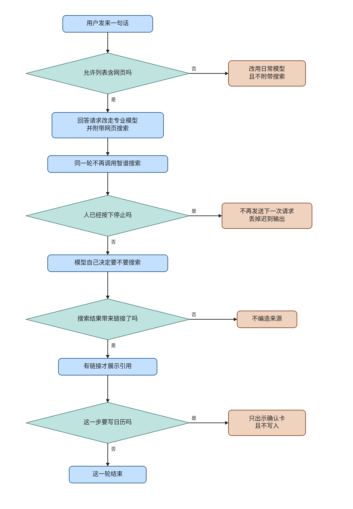

# ev-net

This knife gives the answer request DeepSeek's own web search. A normal turn offers that search. The model chooses when to use it. The same turn does not call Zhipu `/web_search`. This note is the implementation record. It is not a review pass, and it does not merge or deploy.

The plan file and its checkboxes are untouched. Live lanes 1 to 10 were not run. This note does not start ev-events.

## What changed for a person using the product

There is no earth button, and the person does not have to say 「上网」. The default constitution list already contains `web`, so the answer request carries `tools: [{"type": "web_search"}]` and leaves `tool_choice` unset. The model searches when the sentence needs new public information. A sentence that only needs what the model already knows can finish without a search.

The hard refusal is the existing allow list. A turn whose `allowed_tools` omits `web` stays on `deepseek-flash` and does not attach `web_search`. The chat request still cannot edit that list. The answer prompt also tells the model not to search when the person says not to. That sentence is guidance. It is not a second parser.

## The document

Read on 2026-11-12:

- https://api-docs.deepseek.com/guides/responses_api.md
- https://api-docs.deepseek.com/zh-cn/guides/responses_api.md
- https://api-docs.deepseek.com/quick_start/pricing

`web_search` is a server tool on `POST /responses`. The guide says it runs on `deepseek-v4-pro` and is ignored on `deepseek-flash`. The example omits `tool_choice`, and the text says that omission uses automatic selection. `previous_response_id` is not supported, so a later function round has to send the prior items again. Chat Completions is not given a networking field. This change does not write `web_search: true` or `enable_search` into `_build_request`.

## What the running turn does

`begin_turn` still copies the constitution list. That list is `kb`, `web`, `calendar`, `sandbox`. `web_offered` is true when the list is missing or contains `web`.

`_decision_to_plan` no longer appends `"web"`. `verify_state` no longer queues `"web"` again. `execute_web` returns without calling `search_planned`. The Zhipu client in `web_search.py` remains for any caller that still imports it. The chat turn does not call it. Embedding, rerank, and vision are unchanged.

`stream_chat` sends the user-facing answer through `client.responses.create`. When search is offered, `build_responses_body` sets the model to `deepseek-v4-pro` and appends the server tool. Other roles stay on their configured models. `chat_model` remains `deepseek-flash`. A turn that already has knowledge-base, web, or sandbox evidence and does not need the web still drafts through `complete_text` on the chat model. A turn that needs the web skips that draft and streams.

Search events become reasoning steps. A citation is emitted only when the completed search item has a URL. A completed search with no URL does not become a citation. `stream_chat` can replay one function tool into the next request, up to three rounds, because the API does not store `previous_response_id`. The chat route does not pass the calendar tool into that loop. The calendar card is unchanged, and this path does not call `create_event`.

`_create_responses` checks `is_stopped()` before `responses.create`. The stream returns when stop is set, and the chat handler stops forwarding late chunks.

## Cost

The published peak cache-miss prices on 2026-11-12 are $1.32 per 1M input tokens and $3.96 per 1M output tokens for `deepseek-v4-pro`, against $0.30 and $1.20 for `deepseek-flash`. Concurrency on that page is 500 for pro and 2500 for flash. Pro does not list vision. The standalone Search and Fetch prices on that page are for those separate APIs. This note does not treat them as the fee for the Responses server tool.

Offering search therefore moves the streamed answer from flash to pro. That is the tradeoff for a search the flash model would ignore. Planner, router, and judge calls are not moved.

## Formal check

The question is whether one turn offers the server tool by default, omits it when `web` is absent, also calls Zhipu, sends after stop, writes the calendar from the card, or cites a URL the payload did not carry. The check is TLC on a small model of those steps. The jar is the vendored `verification/tlc/tla2tools.jar`, SHA256 `e1f11b75c4b5bc4478ba0ac5cb6ae28e40a01b0016bc33e0aa97da22dfdbcd7f`.

Passing run, 96 distinct states, no error. The raw output is `docs/envisioned-product/review/ev-net-evidence/tlc-cutover.txt`.

- `TypeOK`
- `NoZhipu`
- `NoBoth`
- `DefaultOffers`
- `ExplicitOmits`
- `StopBlocksLaterSend`
- `CalendarStaysUnwritten`
- `CitationNeedsSource`

Broken variants, each exit 1:

- `--break-both` violates `NoBoth`.
- `--break-omit` violates `DefaultOffers`.
- `--break-zhipu` violates `NoZhipu`.
- `--break-stop` violates `StopBlocksLaterSend`.
- `--break-calendar` violates `CalendarStaysUnwritten`.
- `--break-cite` violates `CitationNeedsSource`.

A scratch edit that replaced the server tool with `file_search` made `check.py` exit 2 with `modeling error: the responses body does not attach web_search`. A scratch edit that called `search_planned` from `execute_web` made it exit 2 with `modeling error: execute_web calls search_planned`. Both edits were restored, and the passing run exited 0 again.

The earlier hold, with `NoGuessedField` passing while `FieldWhenAllowed` failed, is not this model's pass. Those two cutover invariants are not in the new config.

The model is one turn. It does not cover a second user, a request already on the wire when stop arrives, or the click that writes the calendar.

`/statechart` drew the passing model with `TLA2TOOLS` pointed at the vendored jar by absolute path. TLC reached 96 states. The chart has 11 states and 17 arrows. Forty steps that stay inside one chart state are not drawn. The files are `docs/envisioned-product/review/ev-net-evidence/statechart-responses/`. Pele 1.9.0 wrote `chart.svg` beside `chart.mmd`.

## Operator flowchart

The main column is one turn. Side boxes are the exceptions, and the lines do not rejoin the main column. The font is Noto Sans CJK SC, TTC index 2. Each drawn line is a whole phrase. The canvas is 1640 by 2360. Thirteen arrows are drawn. The drawing script is `docs/envisioned-product/review/ev-net-evidence/draw_flowchart.py`. The Mermaid source is `docs/envisioned-product/review/ev-net-flowchart.mmd`, and Pele wrote `ev-net-flowchart.svg` beside it.

This picture replaces the hold chart in the repo. It is not stamped as reviewed.

## Tests

From `backend`, with the local virtualenv:

`python -m pytest tests/test_one_web_path.py tests/test_web_thinking.py tests/test_zhipu_endpoints.py tests/test_deepseek_roles.py -q` exited 0. Collected tests are 14, 1, 44, and 24. Output is `docs/envisioned-product/review/ev-net-evidence/unit.txt`.

The same environment also ran `tests/test_workflow.py`, `tests/test_router.py`, and `tests/test_dispatch_boundary.py` with that set. Collected tests are 29, 17, and 6. The combined run exited 0.

`tests/test_one_web_path.py` covers the default offer, an allow list that omits `web`, a user sentence that asks for search without forcing the tool, the absent second plug, an interface error, a failed response, a stream with usage and a finished search that has no citation, a citation taken only from a real URL, a function-tool replay, and a stop before the follow-up send.

## Perf

One run each. Numbers are in `docs/envisioned-product/review/ev-net-evidence/unit.txt`.

| run | seconds | exit |
| --- | ---: | ---: |
| head `test_web_thinking.py` | 1.449 | 0 |
| head `test_one_web_path.py` | 1.467 | 0 |
| head named set of four files | 4.096 | 0 |

The thinking run is under 60 seconds. The one-web-path run is under 30 seconds. Trunk was not re-timed in this run. The earlier hold note still has those trunk numbers, and they are not a comparison for this head.

## Live lanes

Lanes 1 through 10 were not run. `ev-net-review-web.png` and `ev-net-review.mp4` were not produced. A live Responses call needs an API key and was not made. Do not read this note as a live pass.

## Left open

- A sentence such as 不要联网 is prompt guidance. The hard switch remains `web` missing from that generation's `allowed_tools`.
- The chat route does not pass function tools into `stream_chat`. The replay helper is covered by unit tests. Calendar confirmation stays on the existing card.
- An in-flight request is not cancelled by stop. Late chunks already received are not forwarded.
- `web_search.py` can still post to Zhipu if some other caller invokes `search_planned`. The chat tool does not.
- The Responses server tool's own fee, apart from the pro token price, was not stated on the pricing page read here.
- Live lanes, the review screenshot, and the review video remain deferred.

## Decision log

`.audit/ev-net.tsv` is the earlier hold. This run appends `.audit/ev-net-responses.tsv`. The product supplement is in `docs/envisioned-product/decision-trail.md`.
