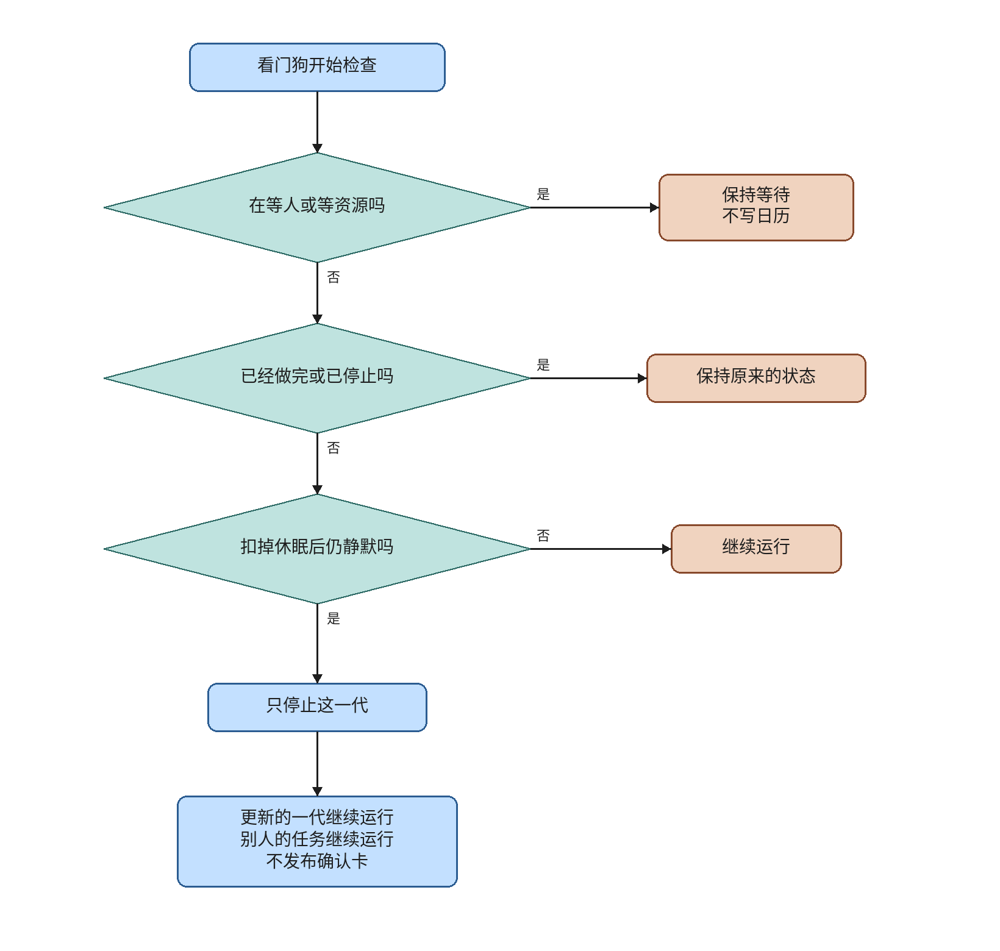

# ev-watch

This knife adds a read-only task watchdog. Every 60 seconds the beat reads `TaskRun` and stops a `running` generation that has been silent for 20 minutes, after sleep credit. `waiting_person`, `waiting_resource`, `completed`, and `stopped` stay as they are. The sweep calls `task_run.stop` for that user and that generation. It does not publish a confirm card and it does not insert a calendar row.

The plan file and its checkboxes are untouched. Live lanes are not passed. This note does not merge or deploy, and it does not start ev-webblock. The ev-net hold is unchanged. `note_external_success` is still not called from the calendar confirm HTTP path.

## What the code does

`sweep_task` is beat entry `watch-task-runs` on the maintenance queue, schedule 60. The ingest recovery entry and the memory pulse entry stay on `max(60, celery_stale_check_seconds)`. `deploy/health-watch.sh` is unchanged. It still checks disk, containers, and `/health/ready`.

`_EFFECT` is the only status rule. `running` maps to `stop`. The other four statuses map to `leave`. Import raises if that table drifts from `TASK_RUN_STATUSES`.

The silence clock is `TaskRun.created_at`. This table has no progress log and no sleep column. `ToolAuditLog` is not read, because it has no generation. Silence is `now - created_at - credit`, and it cannot go below zero. A row stops when that span is at least 20 minutes and the status is still `running` on a fresh `task_run.get`.

Sleep credit lives on `SweepLedger` in the worker process. A gap between ticks is sleep only when it is strictly longer than three 60 second intervals. The whole gap is credit, not the excess over 180 seconds. The next sweep keeps that credit, so the slept time is not counted again. A passed ledger does not touch the module global, so tests do not depend on process order. The first sweep in a fresh process has no previous tick, so its credit is zero.

`load_runs` uses `maintenance_session` and closes it before any stop. `run_sweep` does not call `publish_schedule_claim`, does not insert `CalendarEvent`, and does not call the tool gateway. Chat, the event inbox, and the pulse remain the card writers.

`ORDINARY_STALL` is 20 minutes because that is the ordinary stall in OpenMausBot `TURN_STALL_MS` at `083fd7b51405e6d0c01e189b2f65ab0322509b5a`. The 2 hour tool stall is not copied. `TurnWatchdog` in that repo is an in-process timer. This repo does not run that class. The generation guard that was copied is the existing `stop(user_id, generation)`, which writes one row. The revoke before that guard in `server/index.ts` is not copied.

A stall becomes `stopped`. There is no separate notice. The plan allows a reminder or a stop, and a notice would be another writer next to the three card publishers.

## Formal check

The question is whether a waiting or completed generation can be stopped, whether sleep credit is counted as silence on a later sweep, whether stopping an older generation stops a newer one or another user, and whether the sweep publishes a card. That is an order of steps, so the check is TLC on a small model. The jar is the vendored `verification/tlc/tla2tools.jar`, SHA256 `e1f11b75c4b5bc4478ba0ac5cb6ae28e40a01b0016bc33e0aa97da22dfdbcd7f`, 4,510,215 bytes, manifest `2.0 2026-11-06`, revision `d8fb231`.

Held run, 88 states generated, 38 distinct states, depth 6, no error. The statechart report says 38 states and 87 steps. The extra generated state is the initial state. That reading is inferred from 1 plus 87.

- `TypeOK`. The variables stay in their sets.
- `WaitStays`. A generation that was parked waiting stays `waiting`.
- `CompletedStays`. A generation that was finished stays `completed`.
- `SleepNotSilence`. A watchdog stop happens only when sleep credit is still 0.
- `NewerStays`. The newer generation stays `running`.
- `OtherStays`. The other user's generation stays `running`.
- `NoCard`. The claim count stays 0.

TLC also checks deadlock. The held run reached no deadlock. `Done` is a stutter after the first sweep.

Broken variants, each exit 1:

- `--break-wait` violates `WaitStays`.
- `--break-done` violates `CompletedStays`.
- `--break-sleep` violates `SleepNotSilence`.
- `--break-newer` violates `NewerStays`.
- `--break-other` violates `OtherStays`.
- `--break-card` violates `NoCard`.

Changing `"waiting_person": "leave"` to `"stop"` made `check.py` exit 2 with `modeling error: waiting on a person is a stall`. The line was put back. The held command then exited 0.

The model is one older generation, one newer generation of the same user, and one other user's running generation. Credit is 0 or 1. The sweep runs at most twice. It does not model a progress log, a worker restart, an open claim row, or a reminder message. The chart is `ev-watch-evidence/statechart/`. TLC reached 38 distinct states. The chart draws 6 states and 10 arrows. It hides 49 steps, and it does not draw 3 steps that stay inside one chart state.

Run from the repo root:

```sh
python verification/task-watch/check.py
```

`/statechart` drew the held model with `TLA2TOOLS` pointed at the vendored jar. It did not install another TLC.

## Operator flowchart



The main column is one sweep. Side boxes are the exceptions, and the lines do not rejoin the main column. The first arrow, from 看门狗开始检查 to 在等人或等资源吗, has no 否 label. The font is Noto Sans CJK SC. Each drawn line is a whole phrase. The canvas is 1640 by 1560. The drawing script is `docs/envisioned-product/review/ev-watch-evidence/draw_flowchart.py`.

## Tests

From `backend`, with `DATABASE_URL=sqlite+pysqlite:///./ci-eval.db`, `REDIS_ENABLED=false`, `CELERY_TASK_ALWAYS_EAGER=true`, `SANDBOX_RUNNER_URL` empty, `SECRET_KEY=test-secret-key`, and `ADMIN_PASSWORD=test-admin-pass`.

`python -m pytest tests/test_watchdog.py tests/test_celery_ingest.py -q` exited 0. 15 passed.

The watchdog tests cover a waiting status producing no stop, a completed row and a stopped row staying put, sleep credit still covering the row on the next sweep, a gap of exactly 180 seconds adding no credit, a stalled running row becoming stopped with unchanged calendar, claim, message, and tool-audit counts, two sweeps of a waiting row with one open claim leaving that one claim, an older generation stopping without stopping a newer generation or another user, and the beat entry sitting beside the two existing ones. These tests call `decide` and `run_sweep`. They do not use `BindingClient`.

## Perf

One run each, in the order trunk, head, trunk, then the watchdog file on the head. The machine had 4 cores and a load average of 0.04. Numbers are in `docs/envisioned-product/review/ev-watch-evidence/perf.txt`.

| run | seconds | exit |
| --- | ---: | ---: |
| trunk `tests/test_celery_ingest.py`, before the head | 2.116 | 0 |
| head `tests/test_celery_ingest.py` | 2.036 | 0 |
| trunk `tests/test_celery_ingest.py`, after the head | 2.089 | 0 |
| head `tests/test_watchdog.py` | 1.977 | 0 |

The first trunk seconds for `tests/test_celery_ingest.py` are 2.116. The head run of that file is 2.036, under 60 seconds. The watchdog file is 1.977, under 30 seconds. The two files are not ratioed. No profiler was attached. The ceiling is far above the measured seconds, and the two trunk runs differ by 0.027 seconds.

## Live lanes

Lanes 1 through 10 are deferred. `ev-watch-review-alert.png` and `ev-watch-review.mp4` were not produced. The review-gate boxes are not passed.

- Lane 1. Regression against trunk. `ev-watch-regression.png`. Deferred.
- Lane 2. A confirm card left open past the stall window. `ev-watch-wait.png`. Deferred.
- Lane 3. A running task with no progress. `ev-watch-stall.png`. Deferred.
- Lane 4. Stop, then the watchdog. `ev-watch-stop.png`. Deferred.
- Lane 5. A second user with a healthy task. `ev-watch-identity.png`. Deferred.
- Lane 6. The watchdog twice on a waiting task. `ev-watch-twice.png`. Deferred.
- Lane 7. A recorded sleep interval. `ev-watch-sleep.png`. Deferred.
- Lane 8. The tool audit after a watchdog run. `ev-watch-tools.png`. Deferred.
- Lane 9. Reload after an alert. `ev-watch-reload.png`. Deferred.
- Lane 10. The diff has no prompt edit and no Khoj tree. `ev-watch-scope.png`. Deferred.

Lane 9 asks for a notice that survives reload. This knife's visible result is the `stopped` status. There is no separate notice row.

## Carried open items

These are not closed and not passed.

From ev-memory:

- `verification/memory-ledger/check.py` is not in GitHub Actions. No raw `tlc-held.txt` was committed. The report says 40 states and 70 steps. The write-up said 71 generated.
- The formal model is one generation and one schedule fingerprint. It has no second user, no settle, no unknown claim, no missing session, and no crash after the claim commit before the message is stamped with the token.
- `.gitignore` does not ignore `verification/memory-ledger/MemoryLedger_TTrace_*`.
- A narration comment remains at `backend/app/tasks/pulse.py:195` above the second-pulse suppress return.
- A direct `remember_from_turn` call that omits generation still extracts, using a random `source_ref`. The chat path always passes generation and status.
- Discarding a pending ledger row edits the original row (`pending=0`, `decision=discarded`) instead of appending another row. Restore does append a settle row.
- `list_memories` still maps a missing user id to 1. Write paths return 0 when the user id is below 1, and `panel_view` returns empty.
- The pulse only covers a live preference with key `schedule`, and it uses a fixed Friday 13:00 to 14:00 UTC slot.
- Concurrent pulses that both have not yet seen an open claim are not covered by the formal model.
- Live lanes 1 through 10 and `ev-memory-review-ledger.png` / `ev-memory-review.mp4` are deferred.

From ev-events:

- `note_external_success` is not called from the calendar confirm HTTP path, so a real accepted write does not become `external_success` by itself.
- `verification/event-inbox/check.py` is not in GitHub Actions. The formal model is narrow. Anchors were confirmed at feat commit `acf29b7ec17298604eb7f1f68970380ae2a47eb9`.
- Naming a completed generation, `open_alongside` may open a new running task beside one that is still running.
- Noise events still must carry a valid act or ignore field. The decision is validated first.
- There is no separate `waiting_resource` test. The inbox treats it with running in `_ENTER`.
- On the operator flowchart, the arrow from the start to the first diamond is labeled 否, and the model-decision downward 否 is easy to misread. The chart does not draw how `external_success` is marked later.
- Live lanes and `ev-events-review-reissue.png` / `ev-events-review.mp4` are deferred.

From ev-net:

- `FieldWhenAllowed` and `AbsentSkipsZhipu` fail and stay findings. There is no 「上网」 switch. A turn can still hit Zhipu `/web_search` when 「上网」 is absent.
- The plan unit, You see, and live boxes for ev-net are unfulfilled. Live lanes and `ev-net-review-web.png` / `ev-net-review.mp4` are deferred.
- The new ev-net tests and `check.py` anchors lock the hold. A real cutover has to change them together.
- `verification/one-web-path/check.py` is not in GitHub Actions. `.gitignore` does not ignore `OneWebPath_TTrace_*`. The cutover evidence trace only shows `FieldWhenAllowed`. The formal model is narrow. The flowchart has two unlabeled no branches.

From ev-plug:

- An empty 403 is still a definite rejection. A retry could insert a second event if that response had stored one.
- `FollowupCard` still reads the root phase, so the button may look clickable after refresh while the server rejects a second insert.
- A crash after the arm commit and before the request leaves leaves the claim unknown, and it cannot be resent.
- Update, delete, and RSVP after unknown do not reconcile and seal the way create does.
- There is no UnknownWrite Actions workflow.
- Live lanes for that knife were not run.

From ev-stop:

- `verification/stop-before-send/check.py` is not in GitHub Actions.
- The formal `CalendarStays` model is weak.
- Disconnect only calls `wf_task.cancel()` and does not wait for the worker thread.
- After stop, `chat.py` may still infer and yield an artifact from text already received, and `finally` always sends `done`.
- If `stream_chat` returns on stop without raising `GenerationStopped`, `leave_stream` may stay false and flush fragments already accepted into the desensitization buffer.
- Dispatch, tiered-cache shortcuts, and Redis hits still do not read the stop bit.

From ev-dispatch:

- `verification/dispatch-boundary/check.py` is not in GitHub Actions.
- The formal anchors start after `def assign_turn(`, so they miss `from_plan`. The eval `run_task` is not anchored.
- A low-confidence queue can still enter the work graph. That is the existing routing.

From ev-work:

- `verification/work-loop/check.py` is not in GitHub Actions.
- The formal model is one generation. It has no second user, no allow list, no `verify_state`, no confirm click, and no empty 403. A stop that flips true during `gateway.invoke` may still enter that call.
- Production tools do not construct `ToolResult.unknown_write`. Calendar tools remain `effect=read` and only emit a draft card. Real unknown writes still live on the ev-plug HTTP confirm path.
- `tests/test_work_loop.py` and the eval `run_task` still may omit `task_id` and `generation`, so those paths skip the allow list and may skip stop.
- If claim publish fails with `ScheduleConfirmClosed`, `chat.py` drops the card and may still send the confirm sentence in `direct_answer`.
- The old `if state.get("direct_answer")` short-circuit in `reflect_node` remains on the ReadDone path, so a later queued sandbox after a read that already set `direct_answer` may still not run.

From this knife:

- `verification/task-watch/check.py` is not in GitHub Actions.
- The formal model does not cover a progress log, a worker restart, a second maintenance worker, or an open claim row. `NoCard` only says the sweep itself does not increment a claim counter.
- A `running` generation stops 20 minutes after `created_at`, minus sleep credit, even when a long answer is still streaming.
- The first sweep after a process start has no measured gap, so downtime counts as quiet time.
- There is no notice besides `stopped`. Lane 9 is deferred and is not met by a separate alert row.
- Live lanes 1 through 10 and `ev-watch-review-alert.png` / `ev-watch-review.mp4` are deferred.

## Decision log

`.audit/ev-watch.tsv`.
