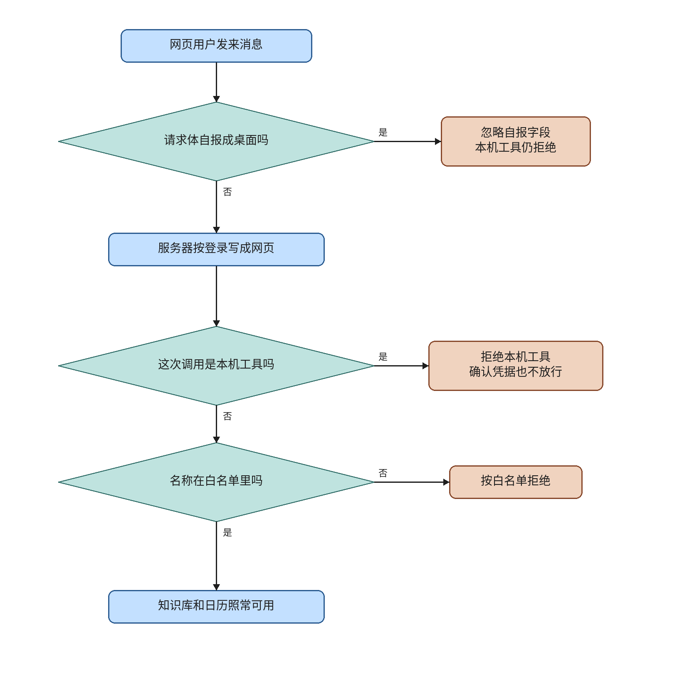

# ev-webblock

This knife makes a web login refuse a local tool. The server writes the execution surface from the authenticated user. This repository has no install package, so that value is web. `ChatRequest` does not gain a desktop field. A body that says desktop, with or without a confirm token, is still denied. `kb`, `web`, `calendar`, and `sandbox` stay allowed. The calendar confirm card and the stop path are unchanged.

The plan file and its checkboxes are untouched. Live lanes are not passed. This note does not merge or deploy, and it does not start ev-mail, ev-errands, or ev-desktop. The ev-net hold is unchanged. `note_external_success` is still not called from the calendar confirm HTTP path.

## What the code does

`ServerSurface` is an enum with one member, `WEB`. It does not subclass `str`, so it does not compare equal to the wire string `desktop`. `ServerSurface("desktop")` raises `ValueError`.

`surface_for_login` takes the authenticated user id and returns `ServerSurface.WEB`. The request body is not a parameter. The user id is not read, because no install package is stored on the user. `ev-desktop` is the later change that can recognize a package.

`coerce_surface` returns a `ServerSurface` unchanged, and returns `ServerSurface.WEB` for every other object. That includes the strings `desktop` and `web`. `ToolContext.surface` defaults to `ServerSurface.WEB`. Assigning the string `desktop` does not rewrite the field. `invoke` and the audit line both run `coerce_surface`, so the decision and the recorded word are web.

`ToolSpec.local` defaults to false. The four builtins keep that default. The test name `local_probe` is registered only inside `tests/test_web_blocks_local.py`, after `ensure_builtin_tools()`, and the test removes that name in `finally`. `constitution.yaml` does not list it, so `begin_turn` does not snapshot it onto a `TaskRun`.

`invoke` peeks `get_tool` after the empty-name refusal and before AutoHarness and the whitelist. A spec with `local` true returns `服务端执行面是 web，拒绝本地工具` and does not call `spec.execute`. `shell` has no spec, so it still fails with `工具不在白名单`. Every audit event from `invoke` sets `server_surface` to the coerced value. `ToolAuditLog` gains no column. The JSONL line keeps the extra key because `write_audit` already spreads the event.

`chat` calls `surface_for_login(current_user.id)` and passes it into the workflow. `run_agent_workflow` stores `coerce_surface(surface)` on the state and copies it into the existing `ToolContext` constructor. The router still cannot return `local_probe`. The unit drives `invoke` with the same mint the login uses.

## Formal check

The question is whether a desktop claim can become the server surface, whether a local tool can execute, whether an unknown name skips the whitelist, and whether a confirm token changes that. That is an order of steps, so the check is TLC on a small model. The jar is the vendored `verification/tlc/tla2tools.jar`, SHA256 `e1f11b75c4b5bc4478ba0ac5cb6ae28e40a01b0016bc33e0aa97da22dfdbcd7f`, 4,510,215 bytes. `verification/tlc_jar.py` checks that pin. This knife did not download another jar.

Held run, 36 states generated, 27 distinct states, depth 3, no error. The statechart report says 27 states and 27 steps. The chart draws 5 states and 4 arrows. It hides 9 steps. Those are the `Done` stutters, one for each settled claim and tool kind.

- `TypeOK`. The variables stay in their sets.
- `SurfaceStaysWeb`. After the mint the surface is `web`.
- `NoLocalRun`. A local tool's execute count stays 0.
- `ShellStaysWhitelist`. An unknown name ends on the whitelist denial.
- `TokenStillDenied`. A local tool whose claim is `token` stays denied.

TLC also checks deadlock. The held run reached no deadlock. `Done` is a stutter after `Decide`.

Broken variants, each exit 1:

- `--break-spoof` violates `SurfaceStaysWeb`.
- `--break-local` violates `NoLocalRun`.
- `--break-shell` violates `ShellStaysWhitelist`.

Replacing the `local_tool_denial(` call in `invoke` made `check.py` exit 2 with `modeling error: the local denial is not before the whitelist and execute`. The call was put back. The held command then exited 0.

The model is one turn. The claim is `none`, `desktop`, or `token`. The tool is `local`, `builtin`, or `unknown`. It does not model a second user, a stopped generation, the calendar confirm route, or a desktop package. The chart is `ev-webblock-evidence/statechart/`. `/statechart` drew the held model with `TLA2TOOLS` pointed at the vendored jar.

Run from the repo root:

```sh
python verification/web-block/check.py
```

## Operator flowchart



The main column is one web request. Side boxes are the exceptions, and the lines do not rejoin the main column. The first arrow, from 网页用户发来消息 to 请求体自报成桌面吗, has no 否 label. The font is Noto Sans CJK SC, TTC index 2. Each drawn line is a whole phrase. The canvas is 1640 by 1680. The drawing script is `docs/envisioned-product/review/ev-webblock-evidence/draw_flowchart.py`.

## Tests

From `backend`, with `DATABASE_URL=sqlite+pysqlite:///./ci-eval.db`, `REDIS_ENABLED=false`, `CELERY_TASK_ALWAYS_EAGER=true`, `SANDBOX_RUNNER_URL` empty, `SECRET_KEY=test-secret-key`, and `ADMIN_PASSWORD=test-admin-pass`.

`python3 -m pytest tests/test_web_blocks_local.py tests/test_harness_gateway.py -q` exited 0. 16 passed. The interpreter on this machine is `python3`. `python` is not on PATH.

The new file denies `local_probe` for a surface minted by `surface_for_login(1)`. It denies the same call when `ChatRequest` is filled with `desktop` and when that body also carries `confirm_token`. The token is also passed in the `invoke` args. `shell` still contains `工具不在白名单` and does not contain `拒绝本地工具`. The four builtins stay registered with `local` false. The execute counter stays 0.

In `frontend`, `npm test` exited 0. 30 passed.

## Perf

One run each, in the order trunk, head, trunk, then the new file on the head. The machine had 4 cores and a load average of 0.22. Numbers are in `docs/envisioned-product/review/ev-webblock-evidence/perf.txt`.

| run | seconds | exit |
| --- | ---: | ---: |
| trunk `tests/test_harness_gateway.py`, before the head | 1.863 | 0 |
| head `tests/test_harness_gateway.py` | 1.455 | 0 |
| trunk `tests/test_harness_gateway.py`, after the head | 1.489 | 0 |
| head `tests/test_web_blocks_local.py` | 1.841 | 0 |

The cap is 60 seconds for the gateway file and 30 seconds for the new file. Both head runs are under the cap. The second trunk run was 1.489 seconds, so the gap from 1.863 to 1.455 sits inside the run-to-run spread. This note does not call that a speedup. The wall clock is the pytest process. The gateway runs printed 11 passing dots. The new file exited 0. A LangGraph deprecation warning was printed and is not a failure.

## Live lanes

Deferred. Not passed. The plan boxes stay unchecked.

- Lane 1. Regression against trunk. `ev-webblock-regression.png`. Deferred.
- Lane 2. The web page denies the test local tool. `ev-webblock-deny.png`. Deferred.
- Lane 3. The body says desktop and there is no confirm token. `ev-webblock-noconfirm.png`. Deferred.
- Lane 4. The same login repeats that call with a confirm token. `ev-webblock-lie.png`. Deferred.
- Lane 5. Stop still blocks the next model request. `ev-webblock-stop.png`. Deferred.
- Lane 6. A second web user cannot run the test local tool. `ev-webblock-identity.png`. Deferred.
- Lane 7. Repeated denials, including a body that says desktop, and the audit shows server surface web. `ev-webblock-repeat.png`. Deferred.
- Lane 8. A knowledge-base answer still appears. `ev-webblock-kb.png`. Deferred.
- Lane 9. Reload shows no local-control button. `ev-webblock-reload.png`. Deferred.
- Lane 10. The diff has no Electron package and no Khoj tree. `ev-webblock-scope.png`. Deferred.

`ev-webblock-review-web.png` and `ev-webblock-review.mp4` are deferred. They were not recorded.

## Carried open items

These are not closed and not passed.

From ev-watch:

- `verification/task-watch/check.py` is not in GitHub Actions.
- The formal model is narrow. Credit is 0 or 1, the sweep runs at most twice, and there is no restart or open-claim row.
- No raw `tlc-held.txt` was committed for that knife.
- `load_runs` reads all historical `TaskRun` rows, so the in-process credit dict can grow.
- The flowchart does not spell "20 minutes" or the restart-lost ledger.
- Silence uses `TaskRun.created_at`, so a long answer that is still streaming can be stopped at 20 minutes.
- A stall becomes `stopped` with no separate notice.
- Sleep credit lives in the worker process. It is forgotten on restart and is not shared across maintenance workers.
- Live lanes for that knife stay deferred.

From ev-memory:

- `verification/memory-ledger/check.py` is not in GitHub Actions. No raw `tlc-held.txt` was committed.
- `.gitignore` may still omit `MemoryLedger_TTrace_*`.
- A narration comment remains at `backend/app/tasks/pulse.py:195`.
- A direct `remember_from_turn` that omits `generation` still extracts with a random `source_ref`.
- Discarding a pending ledger row edits the original row instead of appending.
- `list_memories` still maps a missing user id to 1.
- The pulse uses a fixed Friday 13:00 to 14:00 UTC slot.

From ev-events:

- `note_external_success` is not hooked from the calendar confirm HTTP path.
- `verification/event-inbox/check.py` is not in GitHub Actions. The formal model is narrow.
- Naming a completed generation, `open_alongside` may open a new running task beside one that is still running.

From ev-net:

- `FieldWhenAllowed` and `AbsentSkipsZhipu` remain findings. There is no 「上网」 switch. A turn can still hit Zhipu `/web_search` when 「上网」 is absent.
- This knife does not invent a DeepSeek chat-completions networking field. Production `_build_request` and Zhipu `/web_search` stay as they were. The plan boxes for ev-net stay unchecked.

From ev-work, ev-dispatch, ev-stop, and ev-plug:

- `verification/work-loop/check.py`, `verification/dispatch-boundary/check.py`, `verification/stop-before-send/check.py`, and `verification/unknown-write/check.py` are not in GitHub Actions.
- Production tools do not construct `ToolResult.unknown_write`. Calendar tools remain `effect=read`. Real unknown writes still live on the ev-plug HTTP confirm path.
- The eval `run_task` still may omit `task_id` and `generation`.
- An empty 403 is still treated as a definite rejection.
- `FollowupCard` may still look clickable after refresh.
- Update, delete, and RSVP after unknown do not reconcile and seal the way create does.
- Live lanes for those knives stay deferred.

From this knife:

- `verification/web-block/check.py` is not in GitHub Actions.
- The formal model is one turn. It has no second user, no stopped generation, and no desktop package.
- `surface_for_login` does not read the user id. A recognized install package does not exist yet.
- A string assigned to `ToolContext.surface` stays on the object. The denial and the audit word use `coerce_surface`, so the string is not an allow.
- The router cannot select `local_probe`. The unit calls `invoke` directly.
- Live lanes 1 through 10 and `ev-webblock-review-web.png` / `ev-webblock-review.mp4` are deferred.

## Decision log

`.audit/ev-webblock.tsv`.
